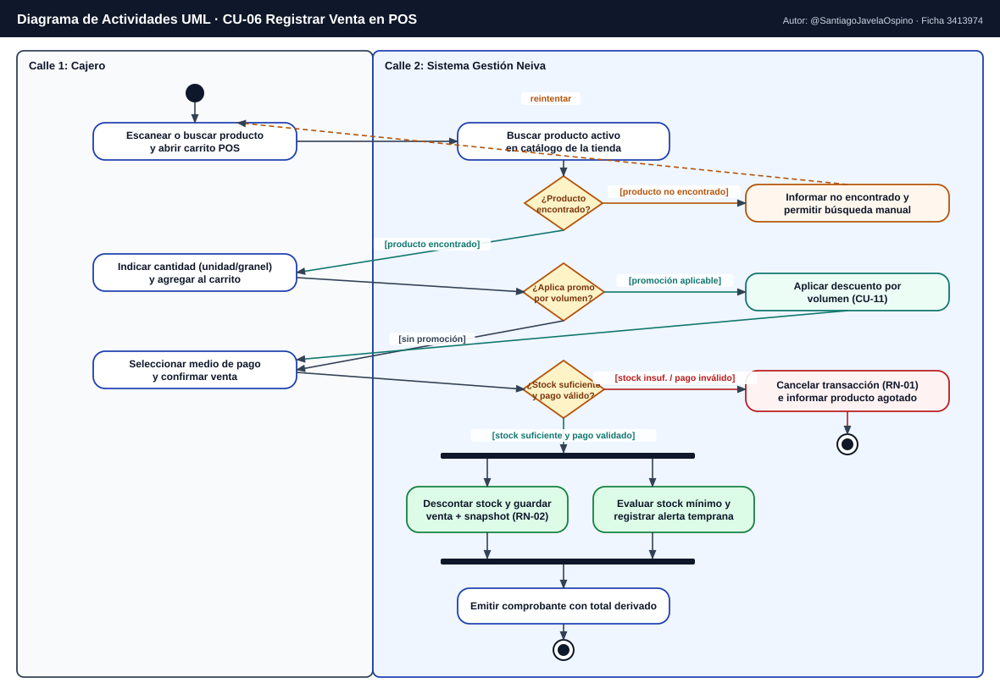
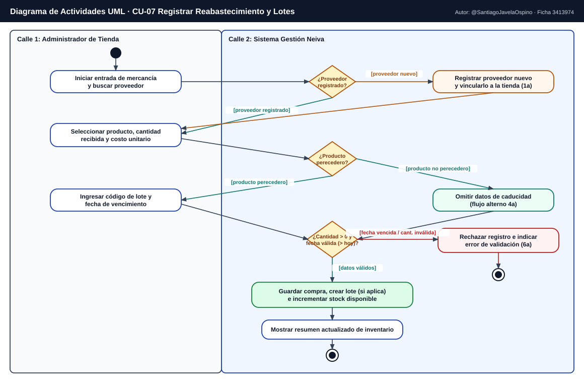

# Diagramas de Actividades UML · Gestión Neiva (POS SaaS)

- **Autor:** `@SantiagoJavelaOspino`
- **Casos de uso críticos modelados:**
  1. **CU-06 · Registrar venta en POS** (`01a-actividad-venta-pos.drawio` / `01a-actividad-venta-pos.svg`)
  2. **CU-07 · Registrar reabastecimiento y lotes** (`01b-actividad-reabastecimiento.drawio` / `01b-actividad-reabastecimiento.svg`)

---

## 1. Diagrama 1: `CU-06 · Registrar venta en POS`

- **Fuente editable:** [01a-actividad-venta-pos.drawio](./01a-actividad-venta-pos.drawio)
- **Calles (Swimlanes):** `Cajero` | `Sistema Gestión Neiva`
- **Decisiones con guardas entre corchetes (todas las salidas cubiertas):**
  - `[producto encontrado]` / `[producto no encontrado]` (flujo alterno 2a de la plantilla)
  - `[promoción por volumen aplicable]` / `[sin promoción aplicable]` (flujo alterno 4a / `CU-11`)
  - `[stock suficiente para todas las líneas]` / `[stock insuficiente]` (excepción 5a de la plantilla)
  - `[pago validado]` / `[pago rechazado o cancelado]` (excepción 6a de la plantilla)
- **Concurrencia (bifurcación y unión / Fork & Join):** Al confirmar la venta con stock suficiente y pago validado, el sistema ejecuta en paralelo (bifurcación/unión): (1) descontar existencias y guardar líneas con snapshot histórico, y (2) verificar si algún producto alcanzó el umbral de stock mínimo para registrar alerta temprana.

---

## 2. Diagrama 2: `CU-07 · Registrar reabastecimiento y lotes`

- **Fuente editable:** [01b-actividad-reabastecimiento.drawio](./01b-actividad-reabastecimiento.drawio)
- **Calles (Swimlanes):** `Administrador de Tienda` | `Sistema Gestión Neiva`
- **Decisiones con guardas entre corchetes (todas las salidas cubiertas):**
  - `[proveedor ya registrado]` / `[proveedor nuevo]` (flujo alterno 2a de la plantilla)
  - `[producto perecedero]` / `[producto no perecedero]` (flujo alterno 4a de la plantilla)
  - `[fecha de vencimiento válida (> hoy)]` / `[fecha vencida o inválida]` (excepción 5a de la plantilla)
- **Concurrencia:** Este caso de uso es estrictamente secuencial y **no presenta actividades concurrentes** que requieran nodo de bifurcación/unión, ya que primero deben validarse las fechas y cantidades del lote antes de incrementar el inventario disponible.
