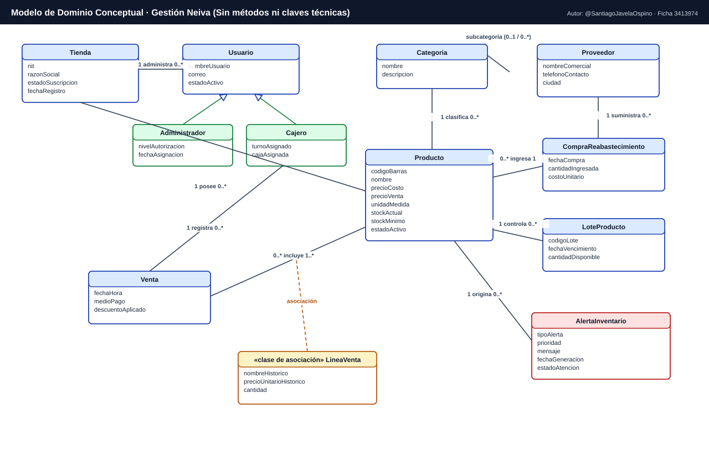

# Modelo de Dominio Conceptual · Gestión Neiva (POS SaaS)

- **Autor:** `@SantiagoJavelaOspino`
- **Fuente editable:** [03-modelo-dominio.drawio](./03-modelo-dominio.drawio)
- **Imagen exportada:** [03-modelo-dominio.svg](./03-modelo-dominio.svg)

---

## 1. Clases conceptuales del negocio (10 clases, sin métodos ni claves foráneas)

| # | Clase conceptual | Atributos de negocio | Observación de modelado |
|---|---|---|---|
| 1 | **Tienda** | `nit`, `razonSocial`, `estadoSuscripcion`, `fechaRegistro` | Representa cada micro-negocio aislado (tenant). |
| 2 | **Usuario** *(superclase)* | `nombreUsuario`, `correo`, `estadoActivo` | Generalización de los roles operativos de la tienda. |
| 3 | **Administrador** *(subclase de Usuario)* | `nivelAutorizacion`, `fechaAsignacion` | **Generalización:** hereda de `Usuario`; gestiona catálogo, compras y reportes. |
| 4 | **Cajero** *(subclase de Usuario)* | `turnoAsignado`, `cajaAsignada` | **Generalización:** hereda de `Usuario`; opera el punto de venta. |
| 5 | **Categoria** | `nombre`, `descripcion` | Agrupación jerárquica de productos (asociación reflexiva: subcategoría de). |
| 6 | **Proveedor** | `nombreComercial`, `telefonoContacto`, `ciudad` | Suministra mercancía en reabastecimientos. |
| 7 | **Producto** | `codigoBarras`, `nombre`, `precioCosto`, `precioVenta`, `unidadMedida`, `stockActual`, `stockMinimo`, `estadoActivo` | Bien comercializado por unidad o a granel. |
| 8 | **LoteProducto** | `codigoLote`, `fechaVencimiento`, `cantidadDisponible` | Seguimiento de caducidad de productos perecederos. |
| 9 | **Venta** | `fechaHora`, `medioPago`, `descuentoAplicado` | Transacción comercial en caja (total es derivado). |
| 10 | **LineaVenta** *(clase de asociación)* | `nombreHistorico`, `precioUnitarioHistorico`, `cantidad` | **Clase de asociación** entre `Venta` y `Producto` que congela el snapshot histórico. |
| 11 | **CompraReabastecimiento** | `fechaCompra`, `cantidadIngresada`, `costoUnitario` | Entrada de mercancía suministrada por un proveedor. |
| 12 | **AlertaInventario** | `tipoAlerta`, `prioridad`, `mensaje`, `fechaGeneracion`, `estadoAtencion` | Aviso de stock mínimo o vencimiento próximo (≤ 15 días). |

## 2. Verificación de reglas del modelo de dominio (sección 7 de Rúbricas G1)

- **Sin métodos ni detalles técnicos:** Ninguna clase incluye operaciones, tipos SQL, claves primarias/foráneas ni referencias a frameworks.
- **Generalización y clase de asociación:** Incluye herencia conceptual (`Administrador` y `Cajero` son tipos de `Usuario`) y clase de asociación (`LineaVenta` entre `Venta` y `Producto`).
- **Coherencia con plantillas extendidas:** Todos los conceptos citados en `CU-06`, `CU-07` y `CU-08` (Tienda, Cajero, Administrador, Producto, LoteProducto, Proveedor, Venta, LineaVenta, CompraReabastecimiento, AlertaInventario) existen en el diagrama.
