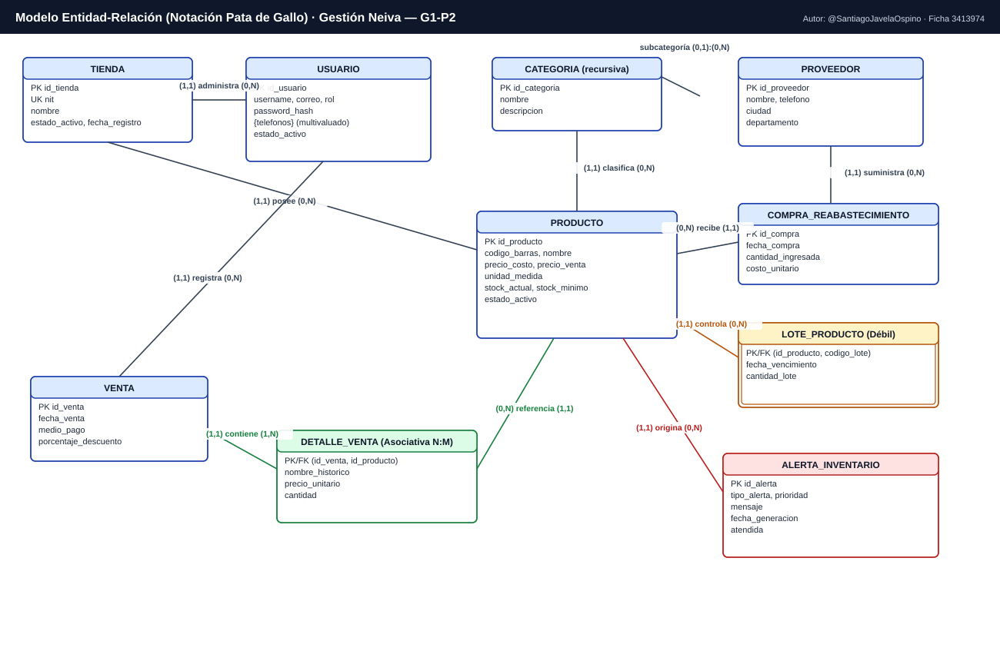

# Modelo Entidad-Relación (MER) · Gestión Neiva (POS SaaS)

- **Autor:** `@SantiagoJavelaOspino`
- **Notación declarada:** **Pata de gallo (Crow's Foot / IE)** con indicación explícita de cardinalidad mínima y máxima (`(0,N)`, `(1,N)`, `(1,1)`, `(0,1)`) y participación (línea doble / obligatoria vs. opcional).
- **Fuente editable:** [04-modelo-entidad-relacion.drawio](./04-modelo-entidad-relacion.drawio)
- **Imagen exportada:** [04-modelo-entidad-relacion.svg](./04-modelo-entidad-relacion.svg)

---

## 1. Catálogo de entidades (9 entidades)

| # | Entidad | Tipo | Identificador | Atributos principales |
|---|---|---|---|---|
| 1 | **TIENDA** | Fuerte | `id_tienda` (PK) | `nit` (único), `nombre`, `estado_activo`, `fecha_registro` |
| 2 | **USUARIO** | Fuerte | `id_usuario` (PK) | `username`, `correo`, `password_hash`, `rol`, `telefonos` *(multivaluado en análisis)*, `estado_activo` |
| 3 | **CATEGORIA** | Fuerte *(recursiva)* | `id_categoria` (PK) | `nombre`, `descripcion` *(relación recursiva `subcategoria_de`)* |
| 4 | **PROVEEDOR** | Fuerte | `id_proveedor` (PK) | `nombre`, `telefono`, `ciudad`, `departamento` |
| 5 | **PRODUCTO** | Fuerte | `id_producto` (PK) | `codigo_barras`, `nombre`, `precio_costo`, `precio_venta`, `unidad_medida`, `stock_actual`, `stock_minimo`, `estado_activo` |
| 6 | **LOTE_PRODUCTO** | **Débil** *(depende de PRODUCTO)* | `(id_producto, codigo_lote)` | `fecha_vencimiento`, `cantidad_lote` |
| 7 | **VENTA** | Fuerte | `id_venta` (PK) | `fecha_venta`, `medio_pago`, `porcentaje_descuento` |
| 8 | **DETALLE_VENTA** | **Asociativa** *(resuelve N:M VENTA–PRODUCTO)* | `(id_venta, id_producto)` | `nombre_historico`, `precio_unitario`, `cantidad` |
| 9 | **COMPRA_REABASTECIMIENTO** | Fuerte | `id_compra` (PK) | `fecha_compra`, `cantidad_ingresada`, `costo_unitario` |
| 10 | **ALERTA_INVENTARIO** | Fuerte | `id_alerta` (PK) | `tipo_alerta`, `prioridad`, `mensaje`, `fecha_generacion`, `atendida` |

## 2. Relaciones, cardinalidad y participación

| Relación (verbo) | Entidad A | Cardinalidad y participación | Entidad B | Observación |
|---|---|---|---|---|
| `TIENDA` **administra** `USUARIO` | TIENDA | `(1,1)` obligatoria — `(0,N)` opcional | USUARIO | Cada usuario pertenece exactamente a una tienda (`RF-01`, `RF-02`). |
| `TIENDA` **posee** `PRODUCTO` | TIENDA | `(1,1)` obligatoria — `(0,N)` opcional | PRODUCTO | Aislamiento multi-tenant (`RF-04`, `RNF-01`). |
| `CATEGORIA` **es subcategoría de** `CATEGORIA` | CATEGORIA | `(0,1)` opcional — `(0,N)` opcional | CATEGORIA | **Relación recursiva** para jerarquía de categorías (`RF-03`). |
| `CATEGORIA` **clasifica** `PRODUCTO` | CATEGORIA | `(1,1)` obligatoria — `(0,N)` opcional | PRODUCTO | Cada producto pertenece a una categoría (`RF-03`, `RF-04`). |
| `PRODUCTO` **controla** `LOTE_PRODUCTO` | PRODUCTO | `(1,1)` identificadora — `(0,N)` opcional | LOTE_PRODUCTO | **Entidad débil:** un lote no existe sin su producto (`RF-08`). |
| `VENTA` **incluye** `PRODUCTO` *(resuelta con `DETALLE_VENTA`)* | VENTA / PRODUCTO | N:M → `(1,N)` y `(0,N)` | DETALLE_VENTA | **Relación N:M resuelta** con entidad asociativa y atributos propios de snapshot (`RF-06`, `RF-07`). |
| `USUARIO` **registra** `VENTA` | USUARIO | `(1,1)` obligatoria — `(0,N)` opcional | VENTA | Trazabilidad del cajero que efectuó la venta (`RF-06`). |
| `PROVEEDOR` **suministra** `COMPRA_REABASTECIMIENTO` | PROVEEDOR | `(1,1)` obligatoria — `(0,N)` opcional | COMPRA_REABASTECIMIENTO | Registro de entrada de mercancía por proveedor (`RF-08`). |
| `PRODUCTO` **origina** `ALERTA_INVENTARIO` | PRODUCTO | `(1,1)` obligatoria — `(0,N)` opcional | ALERTA_INVENTARIO | Alertas de stock bajo o vencimiento próximo (`RF-09`). |
