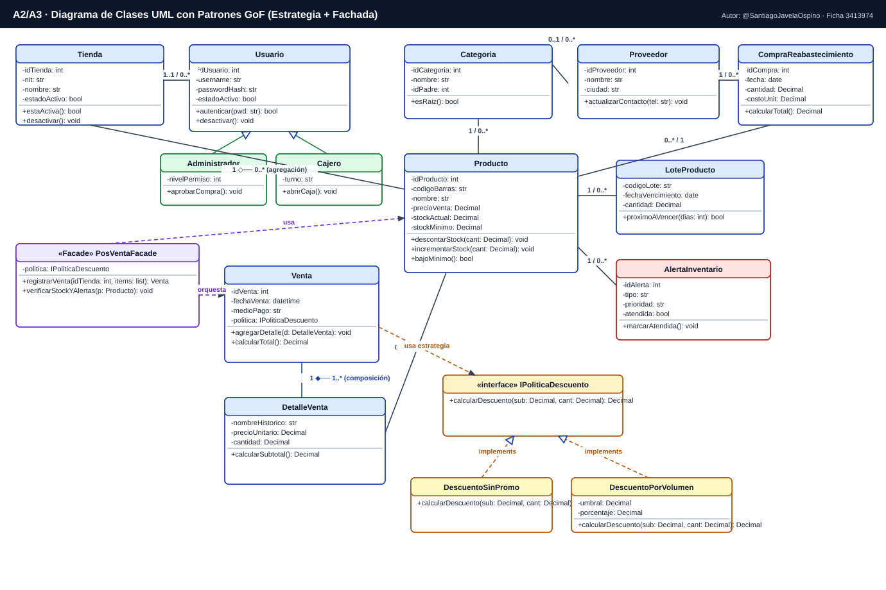

# A2 · Diagrama de Clases UML y A3 · Patrones de Diseño GoF

- **Caso de estudio:** Gestión Neiva — Sistema POS SaaS Multi-Tenant e Inventario Inteligente.
- **Autor:** `@SantiagoJavelaOspino`
- **Fuente editable:** [02-diagrama-clases.drawio](./02-diagrama-clases.drawio)
- **Imagen exportada:** [02-diagrama-clases.svg](./02-diagrama-clases.svg)

---

## 1. Resumen del Diagrama de Clases (A2 — 13 clases, alta cohesión)

- **Relaciones estructurales aplicadas con criterio:**
  - **Composición (`◆──`):** `Venta` `1` ◆── `1..*` `DetalleVenta` (una línea de venta no tiene sentido ni ciclo de vida fuera de su venta cabecera; al revertirse la venta se eliminan sus líneas).
  - **Agregación (`◇──`):** `Tienda` `1` ◇── `0..*` `Producto` (el catálogo de productos pertenece a una tienda).
  - **Herencia (`«es un»`):** `Usuario` `<|--` `Administrador` y `Usuario` `<|--` `Cajero`.
  - **Interfaz con polimorfismo (≥ 2 implementaciones):** `«interface» IPoliticaDescuento` `<|..` `DescuentoSinPromo` y `DescuentoPorVolumen`.
- **Alta cohesión (Regla 5 de la rúbrica):** Ninguna clase mezcla interfaz de usuario, lógica de negocio, persistencia, notificaciones y reportes; las clases de dominio encapsulan únicamente estado y reglas propias, mientras `PosVentaFacade` coordina el flujo POS.
- **Trazabilidad:** Todas las clases trazan a ≥ 1 requisito en [`06-matriz-trazabilidad.md`](./06-matriz-trazabilidad.md).

---

## 2. Patrones de Diseño GoF Aplicados (A3 — 2 patrones distintos, ninguno es Singleton)

| Patrón GoF | Problema concreto del caso | Por qué este patrón | Clases que lo implementan | Qué mejora en mantenibilidad |
|---|---|---|---|---|
| **1. Estrategia (Strategy)** | En las tiendas de barrio de Neiva las reglas de descuento cambian según la temporada o el tipo de tienda (sin promoción, descuento por volumen en ventas mayoristas, futuras promociones por vencimiento próximo). Si los `if/else` de descuento vivieran dentro de `Venta.calcularTotal()`, cada nueva campaña obligaría a modificar la clase crítica de facturación. | Encapsula cada algoritmo de cálculo de descuento detrás de una interfaz común (`IPoliticaDescuento`) inyectada en `Venta`, aprovechando el polimorfismo para intercambiar reglas en tiempo de ejecución sin acoplar `Venta` a implementaciones concretas. | `«interface» IPoliticaDescuento`, `DescuentoSinPromo`, `DescuentoPorVolumen`, y el contexto `Venta`. | Permite agregar nuevas reglas (ej. `DescuentoProximoVencimiento`) creando una clase nueva sin modificar ni arriesgar pruebas de `Venta` (cumple principio Abierto/Cerrado — OCP). |
| **2. Fachada (Facade)** | Confirmar una venta en el terminal POS (`RF-06`, `RF-07`, `RNF-03`) exige coordinar múltiples colaboradores en orden estricto: validar aislamiento de `Tienda`, consultar y bloquear `Producto`, aplicar `IPoliticaDescuento`, crear `Venta` con sus `DetalleVenta` inmutables y disparar verificación de `AlertaInventario`. Si los controladores HTTP llamaran directamente a cada clase de dominio, quedarían fuertemente acoplados y duplicarían la lógica transaccional. | Proporciona un único punto de entrada simplificado (`PosVentaFacade.registrarVenta(...)`) que oculta la complejidad de la orquestación transaccional al resto de la aplicación (API web y futuros clientes). | `PosVentaFacade` coordinando `Tienda`, `Producto`, `Venta`, `IPoliticaDescuento` y `AlertaInventario`. | Desacopla la capa de presentación del núcleo de dominio: cambios internos en la validación de lotes o generación de alertas se ajustan dentro de la fachada sin romper los controladores ni la interfaz POS. |
