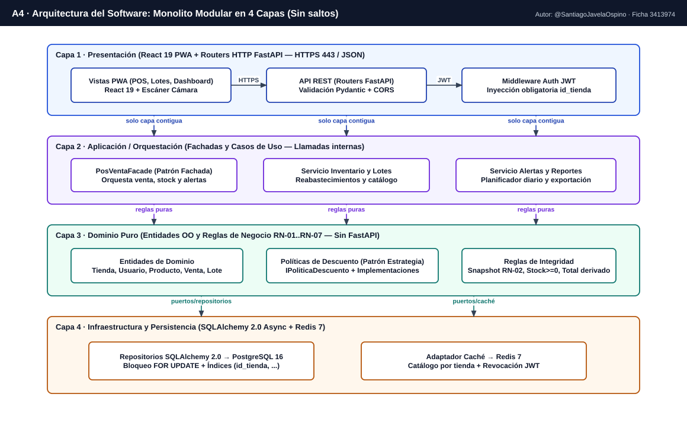

# A4 · Arquitectura del Software y Decisiones frente a RNF

- **Caso de estudio:** Gestión Neiva — Sistema POS SaaS Multi-Tenant e Inventario Inteligente.
- **Autor:** `@SantiagoJavelaOspino`
- **Estilo arquitectónico definido:** **Monolito Modular en 4 Capas** *(Presentación PWA → Aplicación / Fachadas → Dominio Puro → Infraestructura / Persistencia)* con comunicación estrictamente descendente (**sin capas saltadas**).
- **Estilo de comunicación entre componentes:**
  - Cliente PWA ↔ Capa de Presentación/API: **REST sobre HTTPS (JSON)** con autenticación Bearer JWT.
  - Entre capas internas (Aplicación → Dominio → Infraestructura): **llamadas síncronas/asíncronas en memoria mediante interfaces y fachadas**, desacopladas por inyección de dependencias.
- **Fuente editable:** [03-arquitectura.drawio](./03-arquitectura.drawio)
- **Imagen exportada:** [03-arquitectura.svg](./03-arquitectura.svg)

---

## 1. Tabla de decisiones arquitectónicas frente a los RNF (5 RNF)

| RNF / Aspecto | Decisión de diseño adoptada | Alternativa descartada | Razón concreta del descarte |
|---|---|---|---|
| **RNF-01 · Seguridad y aislamiento multi-tenant** | Discriminador obligatorio `id_tienda` por fila inyectado desde token JWT verificado en middleware/dependencia centralizada; contraseñas con hash+sal (Argon2id) y transporte TLS 1.3. | Base de datos física separada por cada tienda (Database-per-tenant). | Multiplica el costo de servidor en la nube para tiendas de barrio y vuelve compleja la ejecución simultánea de migraciones de esquema. |
| **RNF-02 · Rendimiento POS (≤ 1.5 s con 50 usuarios)** | Índices compuestos `(id_tienda, codigo_barras)` en PostgreSQL + caché de catálogo activo y sesiones en Redis 7 (TTL corto invalidado al actualizar producto). | Consultar siempre la tabla `producto` sin índices compuestos ni caché. | Con múltiples tiendas y 50 cajeros concurrentes, los escaneos secuenciales degradan la respuesta por encima del límite de 1.5 s. |
| **RNF-03 · Concurrencia e integridad (cero sobreventas)** | Transacción ACID corta en PostgreSQL con bloqueo de fila `SELECT ... FOR UPDATE` ordenado por `id_producto` dentro de `PosVentaFacade`. | Validación de stock en memoria de la aplicación sin bloqueo transaccional. | Ante dos cobros simultáneos sobre la última unidad, ambas peticiones leen stock = 1 y provocan sobreventa (stock negativo). |
| **RNF-04 · Disponibilidad ≥ 99.5 % y respaldo** | Contenedorización con reinicio automático, chequeo de salud (`/health`), respaldo automático diario (`pg_dump` fuera del nodo de datos) y prueba mensual de restauración. | Servidor monolítico sin respaldos automatizados ni verificación de recuperación. | Una falla de disco o error humano causaría pérdida irreversible del historial de ventas e inventario de las tiendas. |
| **RNF-05 · Mantenibilidad y usabilidad móvil** | Monolito modular en 4 capas (Presentación, Aplicación, Dominio, Infraestructura) + frontend PWA liviano; la presentación nunca salta a la base de datos. | Arquitectura de Microservicios distribuidos (un servicio independiente por módulo). | Para un equipo de 3 aprendices añade sobrecarga operativa (red distribuida, sagas, orquestación) innecesaria frente al volumen actual. |
