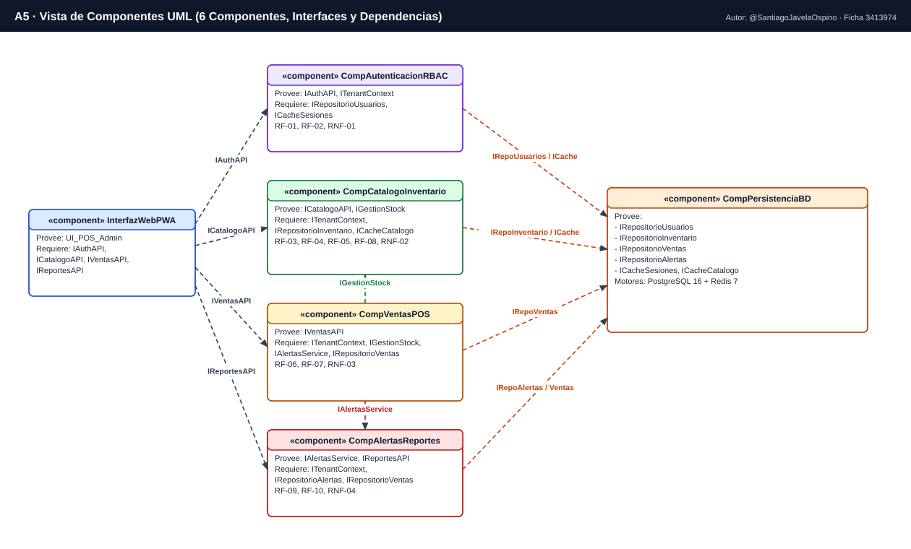

# A5 · Vista de Componentes

- **Caso de estudio:** Gestión Neiva — Sistema POS SaaS Multi-Tenant e Inventario Inteligente.
- **Autor:** `@SantiagoJavelaOspino`
- **Fuente editable:** [04-vista-componentes.drawio](./04-vista-componentes.drawio)
- **Imagen exportada:** [04-vista-componentes.svg](./04-vista-componentes.svg)

---

## Tabla de mapeo de componentes (6 componentes con interfaces provistas y requeridas)

| # | Componente | Interfaz(es) provista(s) | Interfaz(es) requerida(s) | Clases que agrupa | Requisitos que atiende |
|---|---|---|---|---|---|
| 1 | **`InterfazWebPWA`** *(Presentación)* | `UI_POS_Admin` (interfaz gráfica responsiva) | `IAuthAPI`, `ICatalogoAPI`, `IVentasAPI`, `IReportesAPI` | Vistas PWA (POS, Reabastecimiento, Dashboard) | `RF-05`, `RF-06`, `RF-08`, `RF-10`, `RNF-05` |
| 2 | **`CompAutenticacionRBAC`** | `IAuthAPI`, `ITenantContext` | `IRepositorioUsuarios`, `ICacheSesiones` | `Tienda`, `Usuario`, `Administrador`, `Cajero` | `RF-01`, `RF-02`, `RNF-01` |
| 3 | **`CompCatalogoInventario`** | `ICatalogoAPI`, `IGestionStock` | `ITenantContext`, `IRepositorioInventario`, `ICacheCatalogo` | `Categoria`, `Proveedor`, `Producto`, `LoteProducto`, `CompraReabastecimiento` | `RF-03`, `RF-04`, `RF-05`, `RF-08`, `RNF-02` |
| 4 | **`CompVentasPOS`** | `IVentasAPI` | `ITenantContext`, `IGestionStock`, `IAlertasService`, `IRepositorioVentas` | `PosVentaFacade`, `Venta`, `DetalleVenta`, `IPoliticaDescuento`, `DescuentoSinPromo`, `DescuentoPorVolumen` | `RF-06`, `RF-07`, `RNF-03` |
| 5 | **`CompAlertasReportes`** | `IAlertasService`, `IReportesAPI` | `ITenantContext`, `IRepositorioAlertas`, `IRepositorioVentas` | `AlertaInventario`, generador de reportes y exportador | `RF-09`, `RF-10`, `RNF-04` |
| 6 | **`CompPersistenciaBD`** *(Infraestructura)* | `IRepositorioUsuarios`, `IRepositorioInventario`, `IRepositorioVentas`, `IRepositorioAlertas`, `ICacheSesiones`, `ICacheCatalogo` | Motor PostgreSQL 16 y Redis 7 | Repositorios SQLAlchemy Async y adaptador Redis | `RNF-01`, `RNF-02`, `RNF-03`, `RNF-04` |

> **Regla de capas verificada:** `InterfazWebPWA` jamás se comunica directamente con `CompPersistenciaBD`; toda solicitud atraviesa los componentes de negocio y el filtro de contexto `ITenantContext`.
