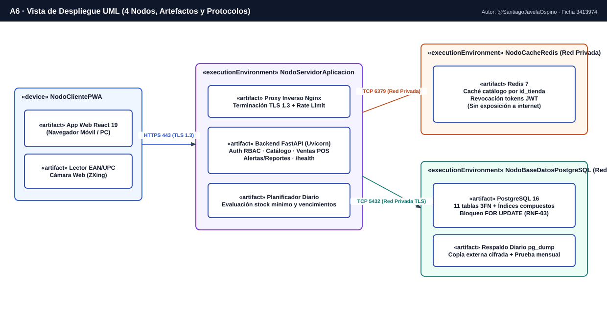

# A6 · Vista de Despliegue

- **Caso de estudio:** Gestión Neiva — Sistema POS SaaS Multi-Tenant e Inventario Inteligente.
- **Autor:** `@SantiagoJavelaOspino`
- **Fuente editable:** [05-vista-despliegue.drawio](./05-vista-despliegue.drawio)
- **Imagen exportada:** [05-vista-despliegue.svg](./05-vista-despliegue.svg)

---

## Tabla de nodos, artefactos, protocolos y decisiones frente a RNF (4 nodos)

| # | Nodo | Artefactos alojados | Conexión (protocolo y puerto) | Decisión que responde a un RNF |
|---|---|---|---|---|
| 1 | **`NodoClientePWA`** *(Celular / PC del tendero y cajero)* | Navegador web ejecutando aplicación SPA/PWA (`React 19 + Vite`) y lector de código de barras en cámara. | **HTTPS (TLS 1.3) · Puerto 443** hacia `NodoServidorAplicacion`. | **RNF-01 / RNF-05:** Cifrado en tránsito de credenciales y ventas; operación liviana en dispositivos móviles sin instalación nativa. |
| 2 | **`NodoServidorAplicacion`** *(Servidor VPS / Contenedor Docker)* | Proxy inverso Nginx (terminación TLS), servidor ASGI Uvicorn + backend `FastAPI` (componentes Auth, Catálogo, Ventas POS y Alertas/Reportes) y tarea programada diaria. | Recibe **HTTPS 443**; consume **TCP 6379** (red privada) hacia Redis y **TCP 5432** (red privada con TLS interno) hacia PostgreSQL. | **RNF-02 / RNF-04:** Procesamiento asíncrono concurrente, reinicio automático de contenedores y punto de salud `/health` para sostener disponibilidad ≥ 99.5 %. |
| 3 | **`NodoCacheRedis`** *(Red privada interna)* | Instancia `Redis 7` para caché de catálogo activo por `id_tienda` y listas de revocación de sesiones JWT. | Acepta únicamente **TCP 6379** desde la subred privada de `NodoServidorAplicacion` (sin exposición pública). | **RNF-02:** Mantiene la latencia de búsqueda POS por código de barras por debajo de 1.5 s bajo carga de 50 usuarios concurrentes. |
| 4 | **`NodoBaseDatosPostgreSQL`** *(Red privada interna + almacenamiento de respaldos)* | Motor relacional `PostgreSQL 16` con esquema multi-tenant, índices compuestos y agente de respaldo automático diario (`pg_dump` hacia almacenamiento externo cifrado). | Acepta únicamente **TCP 5432** desde `NodoServidorAplicacion` (bloqueado a internet por firewall). | **RNF-01 / RNF-03 / RNF-04:** Base de datos sin exposición a internet; transacciones ACID con bloqueo de fila; respaldos diarios y prueba mensual de restauración. |
