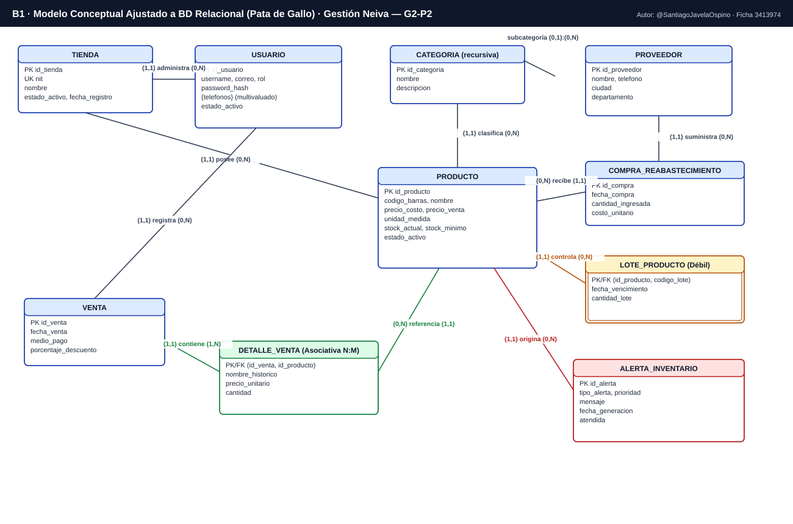
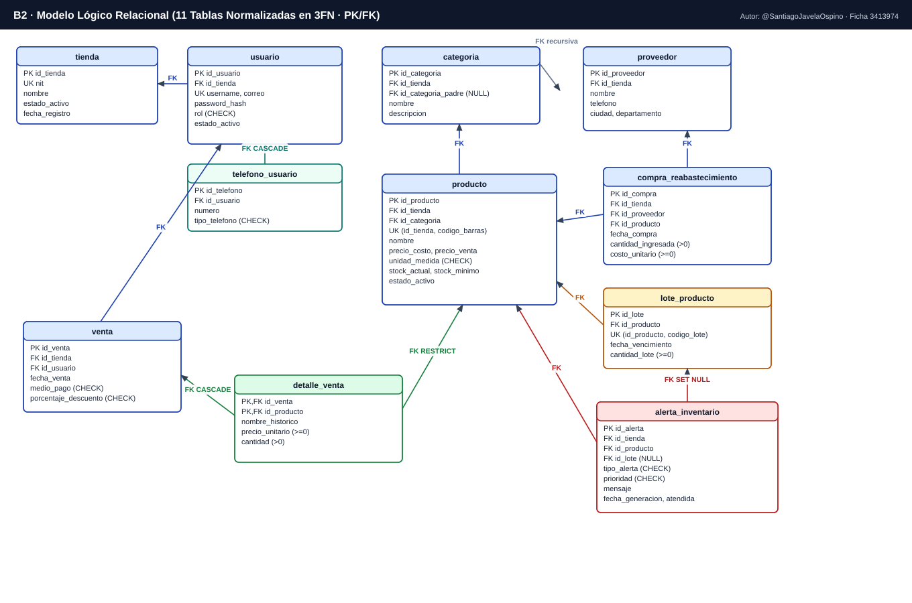

# B1 · Modelo Conceptual y B2 · Modelo Lógico Relacional

- **Caso de estudio:** Gestión Neiva — Sistema POS SaaS Multi-Tenant e Inventario Inteligente.
- **Autor:** `@SantiagoJavelaOspino`
- **Base reutilizada y ajustada:** MER de análisis de `G1-P2-santiago-javela/04-modelo-entidad-relacion.md` (que a su vez amplió las 4 tablas iniciales de `03-execute/proyecto-formativo-inventario/03-modelo-datos-base.md`).
- **Tipo de base de datos justificado:** **Relacional (PostgreSQL 16)**, por la necesidad de transacciones ACID en ventas POS (`RNF-03`), integridad referencial estricta entre tiendas, productos, lotes y detalles (`RF-01`..`RF-09`), y soporte nativo de restricciones `CHECK`, `UNIQUE` e índices compuestos multi-tenant (`RNF-01`, `RNF-02`).

---

## 1. B1 · Modelo Conceptual (ajustado para BD relacional)

- **Fuente editable:** [01-modelo-conceptual.drawio](./01-modelo-conceptual.drawio)
- **Imagen exportada:** [01-modelo-conceptual.svg](./01-modelo-conceptual.svg)

### Entidades, cardinalidades (mín/máx), verbos y trazabilidad a requisitos

| Entidad | Identificador | Atributos clave | Requisito(s) |
|---|---|---|---|
| `TIENDA` | `id_tienda` | `nit`, `nombre`, `estado_activo`, `fecha_registro` | `RF-01`, `RNF-01` |
| `USUARIO` | `id_usuario` | `username`, `correo`, `password_hash`, `rol`, `telefonos` *(multivaluado)*, `estado_activo` | `RF-02`, `RNF-01` |
| `CATEGORIA` | `id_categoria` | `nombre`, `descripcion` *(recursiva)* | `RF-03` |
| `PROVEEDOR` | `id_proveedor` | `nombre`, `telefono`, `ciudad`, `departamento` | `RF-03`, `RF-08` |
| `PRODUCTO` | `id_producto` | `codigo_barras`, `nombre`, `precio_costo`, `precio_venta`, `unidad_medida`, `stock_actual`, `stock_minimo`, `estado_activo` | `RF-04`, `RF-05` |
| `LOTE_PRODUCTO` *(débil)* | `(id_producto, codigo_lote)` | `fecha_vencimiento`, `cantidad_lote` | `RF-08`, `RF-09` |
| `VENTA` | `id_venta` | `fecha_venta`, `medio_pago`, `porcentaje_descuento` | `RF-06`, `RF-10` |
| `DETALLE_VENTA` *(asociativa N:M)* | `(id_venta, id_producto)` | `nombre_historico`, `precio_unitario`, `cantidad` | `RF-06`, `RF-07` |
| `COMPRA_REABASTECIMIENTO` | `id_compra` | `fecha_compra`, `cantidad_ingresada`, `costo_unitario` | `RF-08` |
| `ALERTA_INVENTARIO` | `id_alerta` | `tipo_alerta`, `prioridad`, `mensaje`, `fecha_generacion`, `atendida` | `RF-09`, `RF-10` |

**Relaciones clave con verbo y cardinalidad mín/máx:**
- `TIENDA` `(1,1)` **administra** `(0,N)` `USUARIO` (1:N)
- `TIENDA` `(1,1)` **posee** `(0,N)` `PRODUCTO` (1:N)
- `CATEGORIA` `(0,1)` **es subcategoría de** `(0,N)` `CATEGORIA` (1:N recursiva)
- `CATEGORIA` `(1,1)` **clasifica** `(0,N)` `PRODUCTO` (1:N)
- `PRODUCTO` `(1,1)` **controla** `(0,N)` `LOTE_PRODUCTO` (1:N identificadora)
- `VENTA` `(1,N)` **incluye** `(0,N)` `PRODUCTO` (N:M resuelta mediante `DETALLE_VENTA`)
- `USUARIO` `(1,1)` **registra** `(0,N)` `VENTA` (1:N)
- `PROVEEDOR` `(1,1)` **suministra** `(0,N)` `COMPRA_REABASTECIMIENTO` (1:N)
- `PRODUCTO` `(1,1)` **recibe** `(0,N)` `COMPRA_REABASTECIMIENTO` (1:N)
- `PRODUCTO` `(1,1)` **origina** `(0,N)` `ALERTA_INVENTARIO` (1:N)

---

## 2. B2 · Modelo Lógico Relacional (11 tablas en 3FN)

- **Fuente editable:** [02-modelo-logico.drawio](./02-modelo-logico.drawio)
- **Imagen exportada:** [02-modelo-logico.svg](./02-modelo-logico.svg)

### Cuadro de reglas de transformación aplicadas (Conceptual → Lógico)

| Regla de transformación | Caso concreto en Gestión Neiva | Resultado en el modelo lógico |
|---|---|---|
| **Entidad fuerte → tabla con PK** | `TIENDA`, `USUARIO`, `CATEGORIA`, `PROVEEDOR`, `PRODUCTO`, `VENTA`, `COMPRA_REABASTECIMIENTO`, `ALERTA_INVENTARIO` | 8 tablas base con llave primaria `id_<tabla>` (estándar `snake_case` singular). |
| **Relación N:M → tabla intermedia** | `VENTA` incluye varios `PRODUCTO` y un `PRODUCTO` aparece en varias `VENTA`. | Tabla intermedia `detalle_venta(id_venta FK, id_producto FK, nombre_historico, precio_unitario, cantidad)` con **PK compuesta** `(id_venta, id_producto)`. |
| **Relación 1:N → FK en el lado «muchos»** | Una `TIENDA` tiene muchos `PRODUCTO`; un `USUARIO` registra muchas `VENTA`; un `PROVEEDOR` suministra muchas `COMPRA_REABASTECIMIENTO`. | `producto.id_tienda FK`, `venta.id_usuario FK`, `compra_reabastecimiento.id_proveedor FK`, etc. |
| **Atributo multivaluado → tabla aparte (1FN)** | `USUARIO.telefonos` permite almacenar uno o más números de contacto por usuario (`RF-02`). | Tabla `telefono_usuario(id_telefono PK, id_usuario FK, numero, tipo_telefono)`. |
| **Relación recursiva → FK a la misma tabla** | Una `CATEGORIA` puede depender de una categoría padre (`RF-03`). | `categoria.id_categoria_padre FK NULL` apuntando a `categoria(id_categoria)`. |
| **Entidad débil → tabla con FK identificadora + restricción única** | `LOTE_PRODUCTO` depende de `PRODUCTO` y se identifica por `(id_producto, codigo_lote)`. | Tabla `lote_producto(id_lote PK, id_producto FK NOT NULL, codigo_lote, fecha_vencimiento, cantidad_lote)` con `UNIQUE(id_producto, codigo_lote)`. |
| **Generalización (`Usuario` ← `Administrador` / `Cajero`) → tabla única con discriminador** | `Administrador` y `Cajero` comparten casi todos los atributos en persistencia; solo difiere su rol de autorización. | Tabla única `usuario` con columna `rol` restringida por `CHECK (rol IN ('SUPERADMIN', 'ADMIN_TIENDA', 'CAJERO'))`, evitando joins innecesarios en cada petición JWT. |
