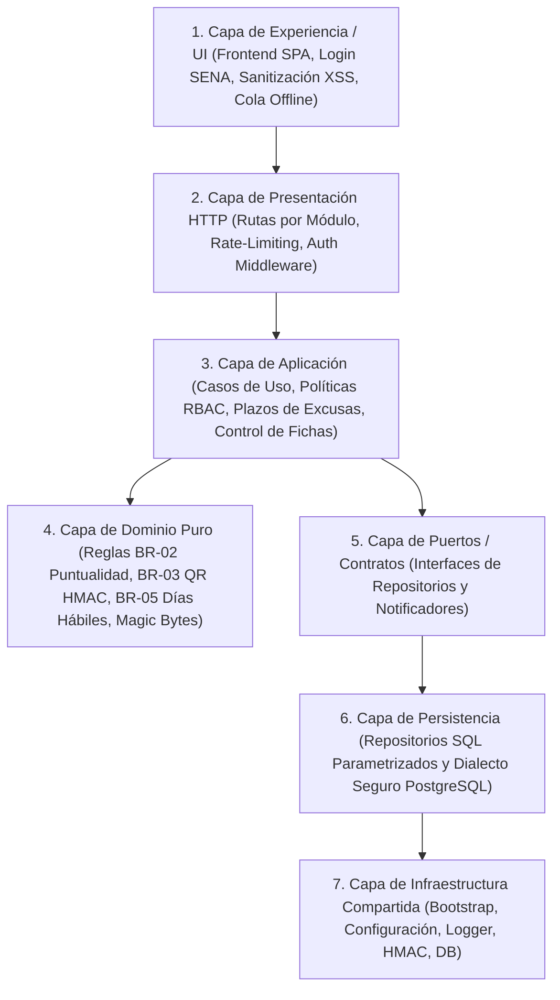

# 🚀 Socialización y Especificación del MVP — Sistema de Asistencia de Ambiente SENA

- **Programa:** Análisis y Desarrollo de Software (ADSO) — Ficha 3413974
- **Aprendiz:** Santiago Javela Ospino
- **Semana:** Week 19 — Socialización de los MVP (Producto Mínimo Viable)
- **Despliegue en Producción (Vercel):** https://ejemplo-sigma.vercel.app/
- **Repositorio GitHub (Santiago Javela Ospino):** https://github.com/SantiagoJavelaOspino/Sistema-de-asistencia
- **Repositorio GitHub (Equipo):** https://github.com/Tomasberserk/Sistema-de-asistencia

---

## 1. Contexto de la Socialización (Week 19)

Durante la **Week 19** se llevó a cabo la sesión de socialización y sustentación del **Producto Mínimo Viable (MVP)** del **Sistema Web de Control y Toma de Asistencia SENA**, integrando la evolución de los artefactos diseñados entre las semanas 16 (Modelado UML y Casos de Uso), 17 (Rediseño UX/UI y Mockups) y 18 (Ingeniería Inversa, MoSCoW Operativo, Design Thinking y Código Fuente).

El MVP desplegado en **Vercel** (`https://ejemplo-sigma.vercel.app/`) materializa una solución funcional de extremo a extremo para eliminar los cuellos de botella del llamado de lista tradicional en los ambientes de formación del SENA.

---

## 2. Problema y Propuesta de Valor del MVP

| Dimensión | Proceso Tradicional en Ambiente | Solución Entregada en el MVP (`ejemplo-sigma.vercel.app`) |
| :--- | :--- | :--- |
| **Tiempo de registro** | 10 a 15 minutos por sesión llamando lista verbalmente o firmando planillas en papel. | **Menos de 30 segundos** para toda la ficha mediante escaneo de **QR rotativo HMAC** o **Check-in de 1 clic / Código manual**. |
| **Fraude o suplantación** | Envío de fotos de códigos QR estáticos por grupos de mensajería a aprendices ausentes. | **Semilla criptográfica HMAC con rotación temporal**, validación de sesión autenticada, unicidad por `(sesion_id, aprendiz_id)` y *rate-limiting*. |
| **Gestión de excusas** | Excusas médicas enviadas por WhatsApp o papel que se extravían o no tienen trazabilidad. | **Bandeja digital de excusas aislada por instructor-ficha**, cálculo automático de plazo en **días hábiles (`BR-05`)** y validación de seguridad de archivos adjuntos por *magic bytes*. |
| **Caídas de Internet** | Imposibilidad de registrar asistencia en ambientes con mala cobertura Wi-Fi. | **Cola Offline Idempotente (`offline-queue.js`)** en el navegador que almacena y sincroniza automáticamente al recuperar conexión sin duplicar registros. |

---

## 3. Alcance Funcional del MVP por Rol (RBAC)

El MVP implementa autenticación centralizada con identidad oficial SENA, tokens JWT, protección contra XSS (`sanitize.js`) y aislamiento estricto de permisos por rol (**RBAC**):

### 3.1. Rol: Coordinador Académico (`academic`)
- **Gestión integral de Fichas de Formación:** Creación y parametrización con selectores de **Jornada** (Mañana, Tarde, Noche, Fines de Semana) y **Modalidad** (Presencial, Virtual, Mixta).
- **Asignación Instructor–Ficha:** Vinculación controlada de instructores a sus respectivas fichas activas.
- **Principio de Cuatro Ojos (`fourEyes.js`):** Protección contra borrado o cierre accidental de fichas, garantizando integridad histórica.
- **Supervisión y Auditoría:** Consulta de indicadores de asistencia, deserción y trazabilidad de cambios.

### 3.2. Rol: Instructor (`attendance` & `excuses`)
- **Apertura y Cierre de Sesiones de Asistencia:** Generación en vivo del **QR dinámico rotativo** y del **código manual de respaldo** proyectable en el ambiente.
- **Monitoreo en Tiempo Real:** Visualización instantánea de aprendices registrados (`ASISTIÓ`, `TARDE`, `AUSENTE`, `EXCUSADO`) conforme a las reglas de puntualidad (`punctuality.js` — `BR-02`).
- **Registro Manual Asistido (Contingencia):** Capacidad de registrar o ajustar la asistencia de aprendices sin dispositivo móvil o con discapacidad, dejando rastro auditable.
- **Bandeja de Revisión de Excusas:** Aprobación o rechazo con observación motivada de las excusas radicadas exclusivamente por los aprendices de sus fichas asignadas.

### 3.3. Rol: Aprendiz (`student`)
- **Check-in Unificado en 1 Clic / Escáner QR / Código Manual:** Registro inmediato desde su panel autenticado sin portales fragmentados.
- **Consulta de Historial y Horas de Formación:** Visualización transparente de su porcentaje de asistencia, retardos e inasistencias.
- **Radicación de Excusas con Evidencia:** Selección de la sesión específica de inasistencia, carga de soporte documental validado (PDF/PNG/JPG) y visualización de notificaciones de aprobación o motivo de rechazo.
- **Configuración de Seguridad en 2 Pasos:** Cambio y verificación de contraseña con compuerta de validación (`2-step password verification gate`).

---

## 4. Arquitectura Técnica del MVP (7 Capas)

El MVP socializado está construido bajo una **Arquitectura Modular de 7 Capas (`N = 7`)**, verificada mediante pruebas automatizadas de fronteras arquitectónicas (`architecture-layers.test.js`):

---

## 5. Matriz MoSCoW Validada en el MVP

| Clasificación | Funcionalidades del MVP | Estado en Producción (`Vercel`) |
| :--- | :--- | :---: |
| **Must Have (Obligatorio)** | • Login unificado SENA con RBAC (Coordinador, Instructor, Aprendiz). • Apertura de sesión con QR rotativo HMAC y código manual. • Reglas de puntualidad (`BR-02`) y bloqueo de registros duplicados (`BR-07`). • Asignación Instructor-Ficha y aislamiento de bandeja de excusas. | ✅ **Desplegado y Funcional** |
| **Should Have (Importante)** | • Radicación de excusas con selector de sesión, validación de días hábiles (`BR-05`) y verificación de *magic bytes*. • Cola offline idempotente (`offline-queue.js`) ante caídas de red. • Compuerta de seguridad de 2 pasos en pestaña de Configuración. | ✅ **Desplegado y Funcional** |
| **Could Have (Deseable)** | • Suite automatizada de 10 pruebas QA/E2E y benchmark de concurrencia (`NFR-01`). • Pipeline de Integración Continua (`.github/workflows/ci.yml`). | ✅ **Integrado en Repositorio** |
| **Won't Have (Descartado en MVP)** | • Verificación biométrica facial en servidor (removida explícitamente por privacidad Ley 1581 de 2012, latencia en ambiente y simplicidad operativa). | 🚫 **Removido por Decisión Arquitectónica (`ADR-004`)** |

---

## 6. Seguimiento de Compromisos y Observaciones de la Socialización

Durante la revisión de los MVPs entre las semanas 18 y 19 se validaron los siguientes puntos críticos de ingeniería inversa y calidad:

| # | Observación / Compromiso de Socialización | Solución Implementada en Nuestro MVP | Estado |
| :-: | :--- | :--- | :---: |
| **1** | **Unificación del portal de registro del aprendiz** | Se eliminó el portal verde separado y se unificó el flujo de check-in (QR y manual en 1 clic) dentro del panel principal autenticado. | ✅ Completado (`a691999`, `ad5c7c8`) |
| **2** | **Aislamiento y trazabilidad de excusas** | Cada aprendiz selecciona la sesión exacta al radicar su excusa; el instructor solo ve excusas de sus fichas asignadas y el aprendiz recibe aviso del motivo si es rechazada. | ✅ Completado (`b88fd84`, `b540fb1`, `ae9afc2`) |
| **3** | **Eliminación de biometría y parametrización de fichas** | En el panel de coordinación se removió la pestaña de verificación facial y se añadieron los selectores de **Jornada** y **Modalidad** al crear fichas. | ✅ Completado (`421abb8`, `85addb9`) |
| **4** | **Contingencia ante fallos de red y accesibilidad** | Se implementó la cola offline idempotente (`offline-queue.js`), el ingreso por código manual y el registro asistido por el instructor. | ✅ Completado (`a3db54b`) |
| **5** | **Validación E2E (End-to-End) y pruebas de calidad** | Integración de 10 suites automatizadas (`run-all.js`, `e2e-discovery.test.js`, `audit-verification.test.js`, `frontend-experience.test.js`). | ✅ Completado (`4104240`) |

---

## 7. Trazabilidad de Entregables en el Repositorio (`03-execute`)

- **Week 16 (UML, Casos de Uso y Diagrama de Clases):** [`03-execute/16-week/02-optional-activity/`](../../16-week/02-optional-activity/)
- **Week 17 (Idea Replanteada, Mockup y Presentación):** [`03-execute/17-week/02-optional-activity/`](../../17-week/02-optional-activity/)
- **Week 18 (Código Fuente `.zip`, Ingeniería Inversa, Inventario, MoSCoW y Design Thinking):** [`03-execute/18-week/02-optional-activity/`](../../18-week/02-optional-activity/)
- **Week 19 (Socialización del MVP y Despliegue en Vivo):** [`https://ejemplo-sigma.vercel.app/`](https://ejemplo-sigma.vercel.app/)
