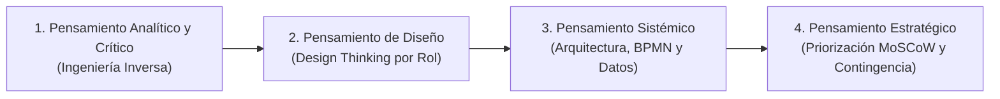

# Estrategia de Pensamiento y Gestión del Conocimiento — Proyectos SENA (Horarios y Asistencia)

- **Autor:** Santiago Javela Ospino
- **Ficha:** ADSO 3413974
- **Fecha:** Agosto de 2026
- **Temática:** Estrategias de pensamiento aplicadas a ingeniería de software, modelo SECI de gestión del conocimiento y transferencia técnica en el desarrollo de los sistemas de **Gestión de Horarios Académicos** y **Control de Asistencia de Ambiente SENA**.

---

## 1. Introducción y Objetivo

En el desarrollo de software empresarial y académico (como la plataforma de **Gestión de Horarios SENA** de 53 pantallas y el **Sistema de Asistencia de Ambiente**), el principal riesgo no es solo técnico, sino la **fragmentación del conocimiento** entre roles, equipos y fases del ciclo de vida.

Este documento establece la **Estrategia de Pensamiento y Gestión del Conocimiento** utilizada para:
1. Analizar sistemas existentes mediante **pensamiento crítico e ingeniería inversa**.
2. Empatizar con los actores institucionales mediante **Design Thinking**.
3. Priorizar entregables de valor con **pensamiento convergente (MoSCoW)**.
4. Transformar el conocimiento tácito del equipo en activos explícitos, reutilizables y verificables (modelo **SECI**, **SDD — Specification-Driven Development**, **BPMN 2.0** y **ADR**).

---

## 2. Marco de Estrategias de Pensamiento Aplicadas

Para abordar la complejidad de ambos dominios del SENA, se articuló un marco de **cuatro estrategias de pensamiento complementarias**:

### 2.1. Pensamiento Analítico y Crítico (Deconstrucción e Ingeniería Inversa)
- **Qué hace:** Descompone un sistema existente o prototipo (`design-software-mockup` de Horarios y MVP de Asistencia) en sus piezas fundamentales: rutas, roles, estado, reglas de negocio ocultas, vulnerabilidades y vacíos funcionales.
- **Aplicación real en Week 23:**
  - Identificación de las 53 pantallas y 7 roles del sistema de horarios, detectando brechas entre la interfaz visual y las restricciones de base de datos.
  - Detección de fallos críticos en el sistema de asistencia (repetición de nombres/registros, falta de validación en tipos de documento, ausencia de control para eliminar/archivar fichas y necesidad de un plan de contingencia offline y de accesibilidad).

### 2.2. Pensamiento de Diseño (Design Thinking Centrado en el Rol)
- **Qué hace:** Pone a las personas reales del ecosistema SENA en el centro antes de escribir código.
- **Fases ejecutadas:**
  1. **Empatizar:** Mapa de empatía por cada uno de los roles (`Aprendiz`, `Instructor`, `Coordinador Académico`, `Director de Centro`, `Administrador de Soporte`).
  2. **Definir:** Formulación de puntos de dolor concretos (ej. cruces de ambientes, demora en el llamado de lista tradicional, falta de visibilidad de excusas).
  3. **Idear:** Propuestas accionables (bloqueo preventivo de franjas ocupadas, autoguardado, QR rotativo HMAC con fallback manual de 1 clic, vista móvil por pestañas).
  4. **Prototipar y Evaluar:** Validación sobre mockups navegables y pruebas de extremo a extremo (E2E).

### 2.3. Pensamiento Sistémico y Arquitectónico (ISO/IEC 25010 + BPMN 2.0)
- **Qué hace:** Conecta los procesos humanos con los componentes de software y el modelo de datos para que un cambio en un módulo no rompa otro.
- **Aplicación real en Week 23:**
  - Modelado de los **12 procesos BPMN por rol** (`PROC_C1` a `PROC_S2`) integrados en `SENA_BPMN_Horarios.zip`.
  - Alineación con los atributos de calidad **ISO/IEC 25010** (Adecuación Funcional, Usabilidad, Mantenibilidad, Seguridad, Eficiencia de Desempeño, Compatibilidad y Portabilidad).
  - Diseño de reglas de integridad relacional (`UNIQUE` sobre instructor, ambiente y ficha por franja horaria) y arquitectura modular de 7 capas / Micro-Frontends.

### 2.4. Pensamiento Estratégico y Convergente (MoSCoW + Gestión del Riesgo)
- **Qué hace:** Filtra las ideas para garantizar entregas incrementales viables (MVP) y prepara respuestas ante fallos.
- **Clasificación MoSCoW aplicada:**
  - **Must Have (Obligatorio):** Autenticación RBAC, prevención de colisiones de horario, registro de asistencia por QR/código manual con validación de identidad, aislamiento de excusas por instructor-ficha.
  - **Should Have (Importante):** Cola offline idempotente, panel de indicadores para Director de Centro, radicación de evidencias con validación de *magic bytes*, guardado automático.
  - **Could Have (Deseable):** Exportación avanzada de reportes ejecutivos, notificaciones push y modo oscuro de alto contraste.
  - **Won't Have (Fuera de alcance actual):** Reconocimiento biométrico facial en servidores externos (descartado por privacidad Ley 1581 de 2012 y latencia en ambientes).

---

## 3. Modelo SECI de Gestión del Conocimiento (Nonaka y Takeuchi)

Para que el aprendizaje adquirido en las sesiones no se pierda como "conocimiento aislado de cada aprendiz", se implementó la espiral del conocimiento **SECI**:

| Fase SECI | Conversión | Cómo se ejecutó en nuestro proyecto SENA | Artefactos Generados (Evidencia) |
| :--- | :---: | :--- | :--- |
| **1. Socialización** | *Tácito → Tácito* | Sesiones de trabajo en equipo, socialización de MVPs, observación directa del proceso real de llamado de asistencia y programación de horarios en el SENA. | Revisiones cruzadas en clase, feedback del instructor y pares. |
| **2. Exteriorización** | *Tácito → Explícito* | Traducción de las ideas, observaciones y dolores de usuario en diagramas formales, historias de usuario, mapas de procesos y apuntes de ingeniería inversa. | `SENA_GestionHorarios_TodosLosRoles.bpmn`, `Ingenieria_Inversa.md`, artefactos de Design Thinking. |
| **3. Combinación** | *Explícito → Explícito* | Integración y estandarización de documentos dispersos en una arquitectura normativa guiada por especificación (**SDD**), modelos lógicos/relacionales y matrices de trazabilidad. | `SantiagoJavelaOspino.md` (Especificación ISO 25010), `MODELO_DATOS_LOGICO_GLOBAL.md`, `MODELO_DATOS_RELACIONAL.md`, `Plan_de_Contingencia.md`, `ADR-001` a `ADR-004`. |
| **4. Interiorización** | *Explícito → Tácito* | Apropiación práctica por parte del equipo al codificar la arquitectura de 7 capas, ejecutar las 10 suites de pruebas automatizadas y aplicar estándares Git/RBAC de forma natural. | Repositorios funcionales en GitHub, despliegue en Vercel y sustentación técnica. |

---

## 4. Prácticas de Retención y Transferencia de Conocimiento en el Equipo

1. **Desarrollo Guiado por Especificación (SDD — Specification-Driven Development):**
   Ningún cambio pasa a código sin estar respaldado en las carpetas de contexto (`01-context`), dominio (`02-domain`), requisitos (`04-requirements`), arquitectura (`05-architecture`) y datos (`06-data`).
2. **Registros de Decisiones de Arquitectura (ADR):**
   Cada decisión crítica (ej. adoptar arquitectura de 7 capas, rotación QR con HMAC, eliminar biometría por privacidad, política de 4 ojos para fichas) queda documentada con su contexto, alternativas evaluadas y consecuencias.
3. **Trazabilidad Extremadamente Clara (Requisito → BPMN → Regla de Negocio → Test):**
   Cada regla del dominio (`BR-02` puntualidad, `BR-03` ventana QR, `BR-05` días hábiles de excusa, `BR-07` unicidad) está vinculada a su proceso BPMN y verificada por pruebas automatizadas.
4. **Control de Versiones Estandarizado:**
   Uso de *Conventional Commits* (`feat`, `fix`, `docs`, `chore`, `refactor`) y sincronización entre forks de trabajo colaborativo para preservar el historial técnico completo.
