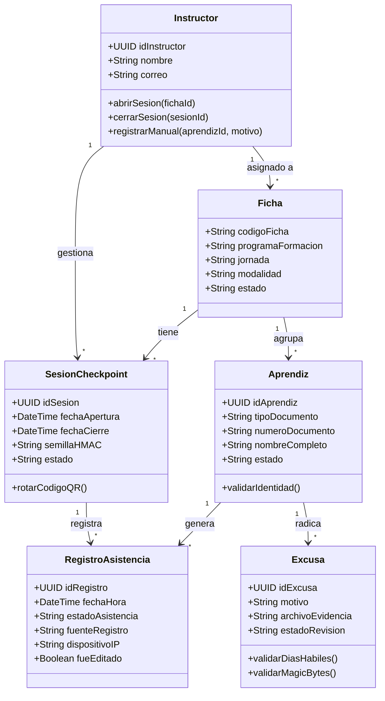

# Ingeniería Inversa — Sistema de Gestión de Horarios y Sistema de Asistencia SENA

- **Autor:** Santiago Javela Ospino
- **Ficha:** ADSO 3413974
- **Fecha:** Agosto de 2026
- **Sistemas Analizados:**
  1. **Mockup Oficial de Gestión de Horarios SENA:** `https://code-sena.github.io/design-software-mockup/app/index.html#/`
  2. **Sistema Web de Toma de Asistencia de Ambiente SENA:** `https://ejemplo-sigma.vercel.app/`

---

## 1. Propósito de la Ingeniería Inversa

Extraer la arquitectura subyacente, el mapa de navegación, el modelo de datos implícito, las reglas de negocio, las vulnerabilidades y las oportunidades de mejora tanto del **Prototipo de Gestión de Horarios SENA** como del **Sistema de Toma de Asistencia de Ambiente**, para traducirlos en especificaciones formales, modelos BPMN y planes de contingencia.

---

## 2. Ingeniería Inversa: Plataforma de Gestión de Horarios SENA

### 2.1. Deconstrucción Arquitectónica y de Navegación
Al inspeccionar el DOM, el enrutador y los recursos cargados en `design-software-mockup`, se identificó:
- **Patrón de Arquitectura Frontend:** Micro-Frontend simulado mediante un **Shell-Host** central que administra el estado de sesión, el menú lateral dinámico y un **Router por Hash (`#/ruta`)** con **Guards RBAC** por rol.
- **Volumen de Vistas:** **53 pantallas y modales** distribuidos en **7 módulos/roles**:
  1. **Auth / Shell Global:** Login multi-rol, selector de contexto, notificaciones y manejo de sesión.
  2. **Coordinador Académico:** Programación de horarios (`/horarios/sch-01` a `sch-03`), asignación de instructores/ambientes, resolución de conflictos y aprobación de excepciones (`PROC_C1`, `PROC_C2`, `PROC_C3`).
  3. **Instructor:** Consulta de horario propio (`#/instructor/mi-horario`), declaración de disponibilidad y solicitud de excepciones (`PROC_I1`, `PROC_I2`, `PROC_I3`).
  4. **Aprendiz:** Consulta de horario por ficha (`#/aprendiz/mi-horario`) y bandeja de notificaciones de cambio de ambiente o jornada (`PROC_A1`, `PROC_A2`).
  5. **Director de Centro:** Dashboard ejecutivo de KPIs (`#/admin/indicadores`), ocupación de ambientes, alertas tempranas de deserción y matriz RBAC (`PROC_D1`, `PROC_D2`).
  6. **Parametrización:** Configuración maestra de sedes, centros, programas, competencias, ambientes y topes horarios (`#/admin/parametrizacion`).
  7. **Administrador de Soporte / Backoffice:** Gestión documental (`#/backoffice/documentos`) y auditoría de logs transaccionales (`#/backoffice/auditoria` — `PROC_S1`, `PROC_S2`).

### 2.2. Hallazgos Críticos y Mejoras Propuestas (Design Thinking + MoSCoW)

| # | Hallazgo Detectado en la Ingeniería Inversa | Impacto en Operación / UX | Mejora Propuesta e Implementada en la Especificación | Prioridad MoSCoW |
| :-: | :--- | :--- | :--- | :---: |
| **1** | Los selectores de programación muestran ambientes e instructores que ya están ocupados en esa misma franja. | Alto riesgo de cruces de horario y reproceso para el Coordinador Académico. | **Deshabilitación preventiva en tiempo real** de opciones ocupadas en el dropdown + restricción `UNIQUE` en base de datos. | **Must Have** |
| **2** | Formularios extensos de programación sin persistencia intermedia ante cierre accidental o caída de red. | Pérdida de trabajo cuando el coordinador programa múltiples fichas seguidas. | **Guardado automático de borrador (`auto-save`)** en almacenamiento local antes de publicar el horario definitivo. | **Should Have** |
| **3** | En resoluciones móviles (`390×844`), la grilla semanal de 6 días obliga a desplazamiento horizontal excesivo. | Dificultad de lectura para aprendices e instructores desde celulares. | **Vista móvil adaptativa por pestañas de día (Lunes a Sábado)** y tarjetas colapsables de sesión. | **Must Have** |
| **4** | Bajo contraste cromático en etiquetas de estado y alertas de colisión en ciertas pantallas del mockup. | Incumplimiento de accesibilidad visual WCAG 2.1 AA. | **Sistema semántico de alto contraste** (verde institucional SENA `#39A900`, ámbar de advertencia y rojo de colisión con iconografía explícita). | **Should Have** |
| **5** | Ausencia de confirmación de seguridad al modificar o dar de baja parámetros críticos o fichas activas. | Riesgo de alteración accidental de cronogramas vigentes. | **Modal de confirmación en 2 pasos / Regla de 4 ojos** y baja lógica auditable en lugar de borrado físico. | **Must Have** |

---

## 3. Ingeniería Inversa: Sistema de Toma de Asistencia de Ambiente SENA

Durante la sesión de auditoría e ingeniería inversa del sistema de asistencia, se identificaron y resolvieron los siguientes puntos técnicos y normativos:

### 3.1. Hallazgos Levantados en Sesión y Solución Técnica

1. **Necesidad de un Plan de Contingencia Integral (Accesibilidad y Conectividad):**
   - *Problema detectado:* ¿Qué ocurre cuando un aprendiz tiene discapacidad visual, auditiva o motriz, no posee teléfono celular o se cae el internet del ambiente?
   - *Solución aplicada:* Se diseñó el **Plan de Contingencia (`Plan_de_Contingencia.md`)** con registro manual asistido por el instructor, check-in de 1 clic para sesiones autenticadas, soporte de lectores de pantalla y una **cola offline idempotente (`offline-queue.js`)** que sincroniza al recuperar red.

2. **Repetición en Nombres y Duplicidad de Asistencias:**
   - *Problema detectado:* El sistema inicial permitía enviar más de un registro por sesión o presentaba inconsistencias ante homónimos.
   - *Solución aplicada:* La llave de negocio se ancló al identificador único de persona y número de documento validado (`UNIQUE(session_id, student_id)`). Si el aprendiz intenta registrarse por segunda vez en el mismo checkpoint, el sistema responde de forma idempotente bloqueando el duplicado.

3. **Restricciones en "Tipo de Documento" y Datos del Aprendiz:**
   - *Problema detectado:* El campo "Tipo de documento" no tenía restricciones de dominio adecuadas y aceptaba entradas arbitrarias.
   - *Solución aplicada:* Se implementó validación estricta por enumeración cerrada (`CC`, `TI`, `CE`, `PEP`, `PPT`) junto con expresión regular de formato/longitud numérica y sanitización contra XSS (`sanitize.js`).

4. **Imposibilidad o Riesgo al Borrar una Ficha Creada:**
   - *Problema detectado:* En la interfaz no existía un flujo controlado para dar de baja o eliminar una ficha creada por error sin romper registros históricos.
   - *Solución aplicada:* Se implementó el servicio de control de fichas (`fichaControlService.js` y `fourEyes.js`) que permite inactivar/archivar fichas con validación de **principio de cuatro ojos** y bloqueo de borrado físico si ya posee sesiones o asistencias asociadas.

5. **Marco Legal (Habeas Data) y Tiempo de Retención / Borrado de Datos del Aprendiz:**
   - *Problema detectado:* No estaba documentada la política legal sobre cuánto tiempo se conservan los datos personales del aprendiz ni bajo qué ley se protegen.
   - *Solución aplicada:* Se incorporó el cumplimiento de la **Ley Estatutaria 1581 de 2012** y el **Decreto 1377 de 2013** (Protección de Datos Personales en Colombia), eliminando endpoints biométricos faciales innecesarios y estableciendo la retención activa durante la vigencia de la ficha más el periodo legal de archivo académico institucional, tras el cual los datos se anonimizan.

---

## 4. Diagrama de Clases y Flujo Reconstruido (Ingeniería Inversa de Asistencia)

