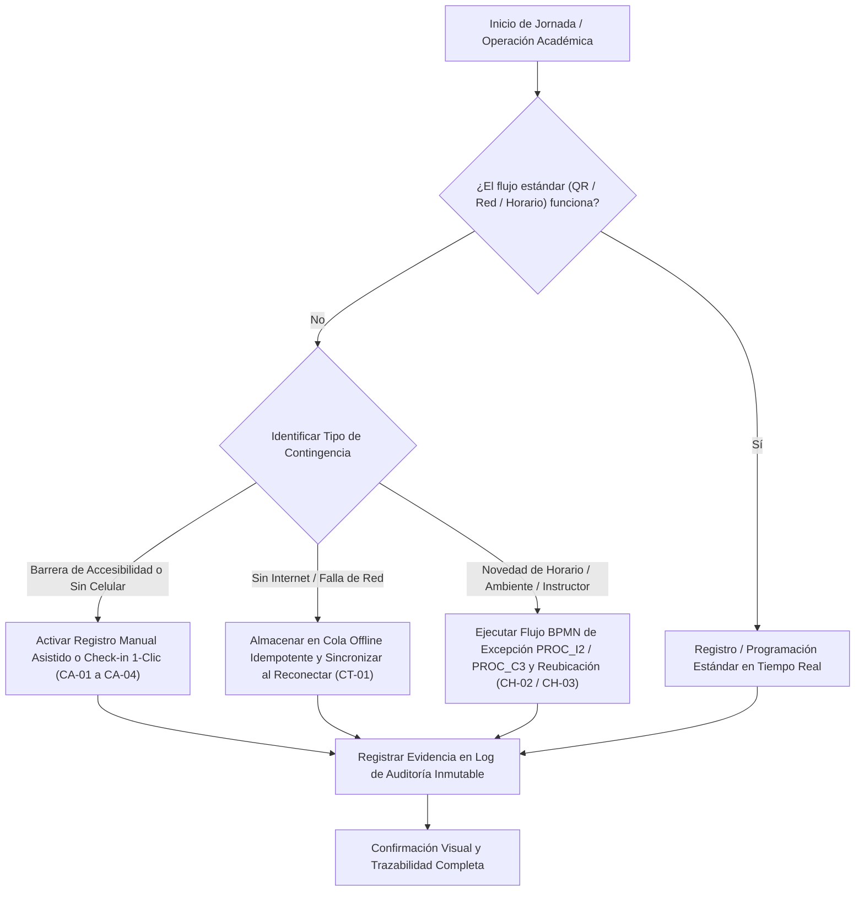

# Plan de Contingencia Operativo y Tecnológico — Sistemas SENA (Asistencia de Ambiente y Gestión de Horarios)

- **Autor:** Santiago Javela Ospino
- **Ficha:** ADSO 3413974
- **Fecha:** Agosto de 2026
- **Alcance:** Continuidad operativa, accesibilidad e integridad de datos para el **Sistema de Toma de Asistencia de Ambiente** y la **Plataforma de Gestión de Horarios Académicos SENA**.

---

## 1. Propósito y Alcance

El presente **Plan de Contingencia** define los protocolos técnicos, operativos y de accesibilidad que deben ejecutarse cuando ocurran eventos excepcionales, fallos de conectividad, barreras de accesibilidad o conflictos de datos que impidan el flujo estándar en:
1. **Sistema de Asistencia de Ambiente SENA** (registro por QR dinámico HMAC, código manual y validación por rol).
2. **Sistema de Gestión de Horarios Académicos SENA** (programación de fichas, ambientes, instructores y franjas horarias).

Su objetivo es garantizar **continuidad del servicio (0% pérdida de registros académicos)**, **inclusión universal** (cumplimiento de criterios de accesibilidad WCAG 2.1 AA) y **trazabilidad auditable** bajo la norma ISO/IEC 25010.

---

## 2. Matriz de Contingencias — Sistema de Toma de Asistencia de Ambiente

### 2.1. Casos de Accesibilidad e Inclusión (Personas con Discapacidad o Sin Dispositivo)

| ID | Escenario / Situación | Impacto | Acción de Contingencia (Protocolo Operativo y del Sistema) | Responsable |
| :---: | :--- | :--- | :--- | :--- |
| **CA-01** | **Aprendiz sin dispositivo móvil o sin batería/cámara** | El aprendiz no puede escanear el código QR proyectado ni abrir el portal desde su teléfono. | 1. El instructor habilita en su panel la opción de **Registro Manual Asistido** o permite el ingreso del código OTP de 6 dígitos en un equipo del ambiente. 2. El registro queda marcado con `fuenteRegistro = MANUAL_INSTRUCTOR` y justificación en el log de auditoría. | Instructor / Aprendiz |
| **CA-02** | **Aprendiz con discapacidad visual** | Dificultad o imposibilidad para enfocar el código QR proyectado en pantalla o leer el código temporal. | 1. La interfaz web cuenta con etiquetas `aria-label`, alto contraste y compatibilidad con lectores de pantalla (NVDA / TalkBack) para ingreso por teclado en un paso. 2. Como alternativa inmediata, el instructor ejecuta el registro asistido con validación verbal de documento. | Instructor / Sistema |
| **CA-03** | **Aprendiz con discapacidad auditiva** | El aprendiz no percibe anuncios verbales sobre la apertura/cierre de la ventana de asistencia o cambio de código. | 1. El sistema proyecta alertas visuales de alto contraste, temporizador regresivo en pantalla grande y notificaciones visuales de estado (`ASISTIÓ`, `TARDE`, `EXCUSADO`). | Sistema / Instructor |
| **CA-04** | **Aprendiz con discapacidad motriz** | Dificultad para manipular el teléfono o digitar códigos con límite corto de tiempo (20-30 s). | 1. El sistema ofrece **Check-in de 1 clic** para aprendices con sesión autenticada en su dispositivo. 2. Si requiere apoyo, el instructor registra la asistencia manualmente sin penalización de puntualidad (`BR-02`). | Sistema / Instructor |

---

### 2.2. Casos Técnicos, de Conectividad y Reglas de Negocio (Asistencia)

| ID | Escenario / Situación | Causa Raíz | Protocolo de Contingencia y Recuperación |
| :---: | :--- | :--- | :--- |
| **CT-01** | **Pérdida total o intermitencia de conexión a Internet en el ambiente** | Caída de red Wi-Fi del centro de formación o datos móviles. | **Cola Offline Idempotente (`offline-queue.js`):** 1. El navegador del instructor/aprendiz almacena localmente los eventos de asistencia firmados con timestamp e identificador único (`clientRequestId`). 2. Al restablecerse la red, la cola sincroniza automáticamente los lotes contra el backend evitando duplicados. 3. Si el corte supera toda la jornada, se exporta/carga respaldo CSV/JSON firmado por el instructor. |
| **CT-02** | **Falla en la generación o lectura del código QR rotativo** | Proyector defectuoso, reflejo de luz o desincronización de reloj HMAC. | 1. El sistema muestra simultáneamente un **código alfanumérico/numérico manual** sincronizado con la semilla HMAC. 2. El instructor puede regenerar manualmente la semilla del checkpoint o activar el registro por listado de ficha. |
| **CT-03** | **Código temporal expirado o inválido al momento de enviar** | Latencia de red o vencimiento de la ventana de rotación. | 1. El backend evalúa una ventana de tolerancia configurable (`grace window` del token inmediatamente anterior). 2. Si ya expiró, la interfaz solicita el nuevo código en pantalla sin borrar los datos ya digitados por el aprendiz. |
| **CT-04** | **Intento de registro duplicado o suplantación** | El aprendiz intenta registrar asistencia dos veces o desde un documento distinto. | 1. Restricción de unicidad por `(sesion_id, aprendiz_id)`: el sistema bloquea el segundo intento de forma idempotente e informa que la asistencia ya fue registrada. 2. Tras 3 intentos fallidos consecutivos, aplica `rate-limiting` (bloqueo temporal de 30 s) y registra la IP/dispositivo en auditoría. |
| **CT-05** | **Aprendiz recién trasladado o no sincronizado en la ficha activa** | Desfase entre matrícula de SofiaPlus y la base de datos local de la ficha. | 1. El sistema impide registros huérfanos, pero permite radicar un **Intento Pendiente / Novedad de Ficha** validando tipo de documento (`CC`, `TI`, `CE`, `PEP`, `PPT`) y número. 2. Coordinación Académica valida y asocia al aprendiz a la ficha conservando la marca de tiempo original. |
| **CT-06** | **Inasistencia por fuerza mayor (salud, calamidad, citación legal)** | El aprendiz no puede asistir presencialmente a la sesión. | 1. El aprendiz radica una **Excusa con Evidencia** dentro del plazo de días hábiles (`businessDays.js`, regla `BR-05`). 2. El sistema valida los *magic bytes* del archivo adjunto (PDF/JPG/PNG) para evitar archivos corruptos o maliciosos y notifica al instructor asignado a la ficha. |

---

## 3. Matriz de Contingencias — Sistema de Gestión de Horarios Académicos SENA

En concordancia con la arquitectura de Micro-Frontends (53 pantallas, 7 roles) y los procesos BPMN (`PROC_C1` a `PROC_S2`), se establecen las siguientes contingencias:

| ID | Escenario / Incidente en Horarios | Proceso BPMN Asociado | Acción de Contingencia y Mitigación |
| :---: | :--- | :--- | :--- |
| **CH-01** | **Colisión de horario (cruce de instructor, ambiente o ficha)** | `PROC_C1` / `PROC_C2` | 1. Validación preventiva en tiempo real en UI (deshabilitación de franjas/ambientes ocupados). 2. Restricción dura en base de datos `UNIQUE(instructor_id, franja_id, fecha_especifica)` y `UNIQUE(ambiente_id, franja_id, fecha_especifica)`. 3. Si ocurre por carga masiva, el motor rechaza el bloque en conflicto y sugiere los 3 ambientes/franjas equivalentes disponibles. |
| **CH-02** | **Incapacidad o indisponibilidad repentina de un Instructor** | `PROC_I2` / `PROC_C3` | 1. El instructor o coordinación registra una **Excepción de Disponibilidad** (`PROC_I2`). 2. El Coordinador Académico ejecuta el flujo `PROC_C3`, filtrando instructores de la misma red de conocimiento con horas disponibles bajo su tope semanal (`horas_maximas_semana`) para reasignación temporal o suplencia. |
| **CH-03** | **Ambiente de aprendizaje inhabilitado (mantenimiento, daño eléctrico o sobrecupo)** | `PROC_C2` / `CU-04` | 1. El Director/Coordinador cambia el estado del ambiente a `MANTENIMIENTO` en `#/admin/parametrizacion`. 2. El sistema identifica automáticamente las sesiones afectadas, verifica la regla `matriculados_ficha <= capacidad_personas` y reubica la sesión notificando a aprendices e instructor (`PROC_A2`). |
| **CH-04** | **Intento de eliminación accidental de una Ficha o Cronograma publicado** | `PROC_S2` (Auditoría) | 1. **Prohibición de borrado físico (`Hard Delete`):** Las fichas y horarios publicados tienen integridad referencial protegida; solo admiten transición de estado (`ACTIVA` → `FINALIZADA` / `SUSPENDIDA`) con regla de **Cuatro Ojos** (`fourEyes.js`: requiere aprobación de Coordinación). 2. Todo cambio genera un snapshot en el log de auditoría (`usuario`, `IP`, `timestamp`, `estado_anterior`, `estado_nuevo`) permitiendo *rollback* inmediato. |
| **CH-05** | **Caída de un Micro-Frontend o del servicio de interoperabilidad** | Shell-Host / `PROC_S1` | 1. El `Shell-Host` aísla el fallo mediante *Error Boundaries* sin tumbar el resto de módulos. 2. Los aprendices e instructores pueden consultar la última versión cacheada de `#/mi-horario` (modo lectura local) o descargar su horario en PDF previamente emitido. |

---

## 4. Flujo de Decisión ante Contingencias Operativas

---

## 5. Cumplimiento Legal, Privacidad y Retención de Datos (Ley 1581 de 2012)

De acuerdo con los hallazgos levantados en la sesión de ingeniería inversa sobre protección de datos de los aprendices:
1. **Marco Normativo:** Cumplimiento de la **Ley 1581 de 2012** (Protección de Datos Personales en Colombia) y el **Decreto 1377 de 2013**.
2. **Validación Estricta de Documento:** El campo `tipo_documento` restringe exclusivamente valores válidos del dominio (`CC`, `TI`, `CE`, `PEP`, `PPT`) y valida formato/longitud numérica antes de persistir.
3. **Política de Retención y Ciclo de Vida del Dato:**
   - Los registros transaccionales de asistencia y excusas se conservan activos durante la **etapa lectiva y productiva de la ficha** más el periodo legal de auditoría académica institucional (5 años en archivo histórico inactivo conforme a tablas de retención documental del SENA).
   - Finalizado el tiempo de retención legal, los datos personales sensibles se anonimizan para fines exclusivamente estadísticos (indicadores de deserción y ocupación del centro).
