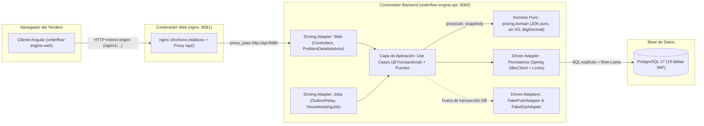
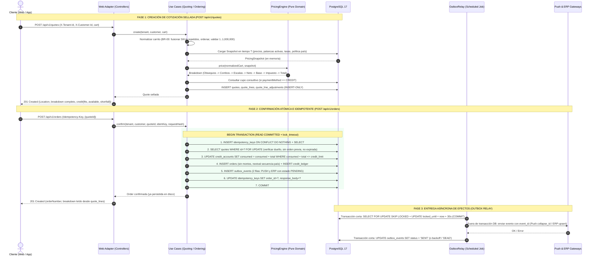

# INFORME DE AUDITORÍA TÉCNICA Y FUNCIONAL — ORDERFLOW ENGINE

> **Rol de Auditoría:** Senior Software Analyst · Software Architect · Business Analyst · QA & Security Auditor  
> **Fecha de Auditoría:** 17 de octubre de 2026  
> **Modo de Operación:** **100% Analítico y de Solo Lectura** (cero modificaciones en el directorio del proyecto `orderflow-engine-docs-main`, configuraciones, bases de datos o repositorios).  
> **Directorio Auditado:** `C:\Users\Aprendiz\Downloads\orderflow-engine-docs-main\orderflow-engine-docs-main`

---

## A. RESUMEN EJECUTIVO

### 1. ¿Qué es Orderflow Engine y qué problema busca resolver?
**Orderflow Engine** es el núcleo transaccional de cálculo de precios (*pricing engine*) y confirmación idempotente de pedidos para un **marketplace B2B multi-país y multi-tenant de bebidas**, donde tenderos compran a distribuidores en países como Colombia, Ecuador, Guatemala y Perú ([Prueba_Tecnica_Tech_Lead_1.pdf](file:///C:/Users/Aprendiz/Downloads/orderflow-engine-docs-main/orderflow-engine-docs-main/assignment/Prueba_Tecnica_Tech_Lead_1.pdf), [SPEC.md](file:///C:/Users/Aprendiz/Downloads/orderflow-engine-docs-main/orderflow-engine-docs-main/spec/SPEC.md#L12-L25)).

El sistema nace para resolver dos problemas críticos del negocio:
1. **Complejidad comercial y tributaria multi-país (Parte A1):** En un mismo carrito pueden coexistir múltiples palancas comerciales (**descuentos por escala** por SKU o familia, **combos**, **obsequios**), tasas de **impuestos por SKU** sobre la base gravable neta, y **control de cupo de crédito** sin usar aritmética de punto flotante (`float`/`double`), sin quemar monedas/escalas/tasas en el código, y garantizando que **el total cotizado y el total confirmado jamás diverjan** aunque cambien los precios o promociones entre la cotización y la confirmación.
2. **Pérdida e inconsistencia de pedidos confirmados (Parte A2):** El cliente reportó un incidente grave en producción ocurrido durante tres *releases* consecutivos: *"un pedido se confirmaba, le devolvíamos número de orden al tendero, y después no aparecía en su historial — en algunos casos ni siquiera había quedado registrado"*. Además, se requería evitar pedidos duplicados o doble consumo de cupo ante reintentos (mala red, doble tap) y garantizar que los efectos externos (**notificación push** y **publicación al ERP**) no se pierdan ni se dupliquen incluso si los sistemas externos caen.

### 2. Estado comprobado del proyecto (Hallazgo Crítico de Auditoría)
Aplicando rigor forense y el estándar de evidencia exigido, el estado del proyecto debe dividirse en dos planos estrictamente diferenciados:

- **Plano de Especificación, Arquitectura y Gobernanza (`orderflow-engine-docs`):** **Verificado directamente — Excelente / Nivel Senior/Staff.** Los 35 archivos contenidos en el paquete proporcionado han sido leídos y auditados en su totalidad. La especificación ([SPEC.md](file:///C:/Users/Aprendiz/Downloads/orderflow-engine-docs-main/orderflow-engine-docs-main/spec/SPEC.md)), el modelo relacional 3NF ([data-model.md](file:///C:/Users/Aprendiz/Downloads/orderflow-engine-docs-main/orderflow-engine-docs-main/spec/data-model.md)), el contrato REST ([api-contract.md](file:///C:/Users/Aprendiz/Downloads/orderflow-engine-docs-main/orderflow-engine-docs-main/spec/api-contract.md)), la arquitectura hexagonal ([architecture.md](file:///C:/Users/Aprendiz/Downloads/orderflow-engine-docs-main/orderflow-engine-docs-main/spec/architecture.md)), los 9 diagramas SVG y el ADR de 1 página ([0001-order-pricing-and-confirmation.es.pdf](file:///C:/Users/Aprendiz/Downloads/orderflow-engine-docs-main/orderflow-engine-docs-main/deliverables/adr/0001-order-pricing-and-confirmation.es.pdf)) presentan un diseño técnico extraordinariamente sólido, coherente y trazable.
- **Plano de Implementación Ejecutable (`api`, `web`, `infra`, `tools`):** **Respaldado documentalmente en `HANDOFF.md`, pero NO VERIFICABLE directamente en este equipo.** El archivo ZIP proporcionado contiene **exclusivamente el repositorio documental `orderflow-engine-docs-main`**. Los repositorios hermanos donde reside el código fuente (`orderflow-engine-api`, `orderflow-engine-web`, `orderflow-engine-infra`, `orderflow-engine-tools`, `orderflow-engine-app`) **no existen en el disco duro local** (`C:\`) y se encuentran alojados como **repositorios privados en la cuenta de GitHub `ariel5253`** ([HANDOFF.md](file:///C:/Users/Aprendiz/Downloads/orderflow-engine-docs-main/orderflow-engine-docs-main/handoff/HANDOFF.md#L31), [HANDOFF.md](file:///C:/Users/Aprendiz/Downloads/orderflow-engine-docs-main/orderflow-engine-docs-main/handoff/HANDOFF.md#L127)), los cuales devuelven `HTTP 404 Not Found` para la sesión actual de GitHub (`SantiagoJavelaOspino`).

Por consiguiente, **ningún requisito de código se da por "Cumplido y verificado" a ciegas**. Todo el diseño está verificado directamente sobre la documentación y los entregables compilados (PDF/DOCX/SVG), mientras que la existencia y ejecución del código Java/Angular/SQL se audita contrastando las afirmaciones de [HANDOFF.md](file:///C:/Users/Aprendiz/Downloads/orderflow-engine-docs-main/orderflow-engine-docs-main/handoff/HANDOFF.md) contra las invariantes de ingeniería.

---

## B. ALCANCE DEL ANÁLISIS (FASE 1 — INVENTARIO Y LECTURA COMPLETA)

### 1. Comprobaciones de entorno realizadas (Solo Lectura)
1. **Inspección de `C:\Users\Aprendiz\Downloads\orderflow-engine-docs-main`:** Se listaron todos los archivos y subdirectorios. Se confirmó que `orderflow-engine-docs-main.zip` (398,409 bytes) fue descomprimido en `C:\Users\Aprendiz\Downloads\orderflow-engine-docs-main\orderflow-engine-docs-main`.
2. **Búsqueda global en el disco `C:\`:** Se ejecutó búsqueda de solo lectura (`Get-ChildItem -Filter "*orderflow*"`) en todo el perfil del usuario y raíz `C:\`. Se confirmó que no existen clones locales de `orderflow-engine-api`, `orderflow-engine-web`, `orderflow-engine-infra`, `orderflow-engine-tools` ni `orderflow-engine-app`.
3. **Verificación de estado de Git y GitHub CLI (`gh`):**
   - La carpeta `orderflow-engine-docs-main` proviene de un archivo ZIP descargado de GitHub, por lo que no incluye la carpeta oculta `.git` (historial de commits local ausente).
   - La sesión activa de `gh` pertenece a `SantiagoJavelaOspino`. Al consultar la API de GitHub por `ariel5253/orderflow-engine-api`, responde `HTTP 404` porque, tal como documenta [HANDOFF.md](file:///C:/Users/Aprendiz/Downloads/orderflow-engine-docs-main/orderflow-engine-docs-main/handoff/HANDOFF.md#L127) (`OD-01`), los 6 repositorios de `ariel5253` se mantienen **privados** hasta el momento del *release* final.
4. **Verificación de herramientas en máquina local:** Docker Desktop no se encuentra en ejecución (`open //./pipe/dockerDesktopLinuxEngine: El sistema no puede encontrar el archivo especificado`) y Python no está instalado en el `PATH`.

### 2. Inventario completo de archivos revisados (35 de 35 leídos al 100%)
No quedó ningún archivo sin leer ni revisar dentro del material disponible. Incluso los archivos binarios (`.pdf` y `.docx`) fueron inspeccionados internamente (texto, OCR, layout visual y metadatos XML `docProps/core.xml` y `docProps/app.xml`).

| # | Ruta relativa en `orderflow-engine-docs-main` | Tipo / Tamaño | Estado de lectura | Qué información aporta |
|---|---|---|---|---|
| 1 | [README.es.md](file:///C:/Users/Aprendiz/Downloads/orderflow-engine-docs-main/orderflow-engine-docs-main/README.es.md) | Markdown (8,698 B) | **Leído 100%** | Mapa general del workspace en español, glosario de carpetas, mapa de 24 documentos y tabla de prefijos de códigos. |
| 2 | [README.md](file:///C:/Users/Aprendiz/Downloads/orderflow-engine-docs-main/orderflow-engine-docs-main/README.md) | Markdown (8,173 B) | **Leído 100%** | Par en inglés de `README.es.md` (107 líneas exactas en ambos). |
| 3 | [LICENSE](file:///C:/Users/Aprendiz/Downloads/orderflow-engine-docs-main/orderflow-engine-docs-main/LICENSE) | Texto (1,087 B) | **Leído 100%** | Licencia MIT a nombre de *Jesús Ariel González Bonilla* (2026). |
| 4 | [.gitignore](file:///C:/Users/Aprendiz/Downloads/orderflow-engine-docs-main/orderflow-engine-docs-main/.gitignore) | Config (130 B) | **Leído 100%** | Ignora `.DS_Store`, `Thumbs.db`, `.idea/`, `.vscode/` y `.env`. |
| 5 | [.gitattributes](file:///C:/Users/Aprendiz/Downloads/orderflow-engine-docs-main/orderflow-engine-docs-main/.gitattributes) | Config (190 B) | **Leído 100%** | Normaliza finales de línea `eol=lf` salvo scripts Windows (`.cmd`, `.bat`, `.ps1` en `crlf`) y declara binarios (`.pdf`, `.docx`, `.png`, `.jpg`). |
| 6 | [assignment/Prueba_Tecnica_Tech_Lead_1.pdf](file:///C:/Users/Aprendiz/Downloads/orderflow-engine-docs-main/orderflow-engine-docs-main/assignment/Prueba_Tecnica_Tech_Lead_1.pdf) | PDF (107,786 B, 3 págs.) | **Leído 100% (OCR + Visual)** | **Fuente oficial inmutable de los requisitos del cliente.** Define el contexto B2B, las 5 palancas, Parte A1, Parte A2, Parte A3 (ADR), Entrega y Plus opcional Front. |
| 7 | [handoff/HANDOFF.md](file:///C:/Users/Aprendiz/Downloads/orderflow-engine-docs-main/orderflow-engine-docs-main/handoff/HANDOFF.md) | Markdown (21,931 B) | **Leído 100%** | Estado verificado del proyecto hasta el 2026-10-17, tabla de progreso de las 21 tareas (`T-00` a `T-20`), comandos de reanudación, decisiones abiertas (`OD-01`..`OD-05`), 15 trampas técnicas (`TR-01`..`TR-15`) y listado de Pull Requests por fase. |
| 8 | [handoff/progress.svg](file:///C:/Users/Aprendiz/Downloads/orderflow-engine-docs-main/orderflow-engine-docs-main/handoff/progress.svg) | SVG (12,173 B) | **Leído 100%** | Gráfico generado de avance: 21 de 21 tareas completadas (100%), mostrando día planeado vs. día real de cierre y línea de corte MVP tras `T-16`. |
| 9 | [spec/constitution.md](file:///C:/Users/Aprendiz/Downloads/orderflow-engine-docs-main/orderflow-engine-docs-main/spec/constitution.md) | Markdown (4,154 B) | **Leído 100%** | Los 15 principios arquitectónicos innegociables (`P-01` a `P-15`) y el mecanismo exacto que verifica cada uno. |
| 10 | [spec/SPEC.md](file:///C:/Users/Aprendiz/Downloads/orderflow-engine-docs-main/orderflow-engine-docs-main/spec/SPEC.md) | Markdown (65,251 B) | **Leído 100%** | Especificación maestra: garantías `G-1`..`G-4`, alcance y desviaciones, reglas de negocio `BR-00`..`BR-07`, política monetaria `RP-1`..`RP-5`, modelo transaccional `I-201`, outbox, contrato, i18n, frontend, estrategia de pruebas (`GT-01`..`GT-06`), supuestos `A-01`..`A-10` y matriz de criterios de aceptación `AC-01`..`AC-53`. |
| 11 | [spec/plan.md](file:///C:/Users/Aprendiz/Downloads/orderflow-engine-docs-main/orderflow-engine-docs-main/spec/plan.md) | Markdown (11,793 B) | **Leído 100%** | Decisiones técnicas `DEC-01`..`DEC-20` con alternativas descartadas, tabla de configuración, rutas de adopción futura y registro de riesgos `RISK-01`..`RISK-07`. |
| 12 | [spec/TASKS.md](file:///C:/Users/Aprendiz/Downloads/orderflow-engine-docs-main/orderflow-engine-docs-main/spec/TASKS.md) | Markdown (39,732 B) | **Leído 100%** | Plan detallado de las 21 tareas (`T-00` a `T-20`), restricciones globales `GC-1`..`GC-9`, ciclo TDD con prueba de mutación manual, focos de revisión `RF-1`..`RF-9` y desglose de archivos/commits esperados en cada repositorio. |
| 13 | [spec/api-contract.md](file:///C:/Users/Aprendiz/Downloads/orderflow-engine-docs-main/orderflow-engine-docs-main/spec/api-contract.md) | Markdown (11,654 B) | **Leído 100%** | Contrato detallado de las 7 operaciones HTTP (`E-01` a `E-07`), estructura RFC 9457 `application/problem+json`, decisiones de comportamiento (`BD-01`..`BD-04`) y brechas conocidas (`GAP-01`..`GAP-05`). |
| 14 | [spec/data-model.md](file:///C:/Users/Aprendiz/Downloads/orderflow-engine-docs-main/orderflow-engine-docs-main/spec/data-model.md) | Markdown (15,280 B) | **Leído 100%** | Diseño de las 19 tablas en PostgreSQL en 3NF, claves compuestas `(tenant_id, id)`, semillas de 4 países (`CO`, `EC`, `GT`, `PE`), orden de bloqueos pesimistas y notas `DM-01`..`DM-03`. |
| 15 | [spec/architecture.md](file:///C:/Users/Aprendiz/Downloads/orderflow-engine-docs-main/orderflow-engine-docs-main/spec/architecture.md) | Markdown (10,653 B) | **Leído 100%** | Topología de tiempo de ejecución, proxy inverso nginx de un solo origen, arquitectura hexagonal (puertos y adaptadores), flujos y preocupaciones transversales. |
| 16–24 | `diagrams/01-*.svg` a `09-*.svg` | 9 archivos SVG (91,430 B total) | **Leídos 100%** | Diagramas vectoriales generados: `01-runtime-topology`, `02-workspace-repositories`, `03-ports-and-adapters`, `04-dependency-rule`, `05-pricing-pipeline`, `06-quote-sequence`, `07-confirm-transaction`, `08-data-model`, `09-outbox-lifecycle`. |
| 25 | [governance/golden-rule.md](file:///C:/Users/Aprendiz/Downloads/orderflow-engine-docs-main/orderflow-engine-docs-main/governance/golden-rule.md) | Markdown (1,320 B) | **Leído 100%** | Regla de oro de flujo Git: prohibición de push directo a `main` o `dev`. |
| 26 | [governance/branches-and-environments.md](file:///C:/Users/Aprendiz/Downloads/orderflow-engine-docs-main/orderflow-engine-docs-main/governance/branches-and-environments.md) | Markdown (4,306 B) | **Leído 100%** | Estrategia de ramas (`main`, `dev`, `<type>/T-NN-slug`), protección con rulesets y cierres de fase. |
| 27 | [governance/pull-request-rules.md](file:///C:/Users/Aprendiz/Downloads/orderflow-engine-docs-main/orderflow-engine-docs-main/governance/pull-request-rules.md) | Markdown (3,047 B) | **Leído 100%** | Reglas de PR: squash merge para tareas, merge commit para cierres de fase y releases. |
| 28 | [governance/commit-conventions.md](file:///C:/Users/Aprendiz/Downloads/orderflow-engine-docs-main/orderflow-engine-docs-main/governance/commit-conventions.md) | Markdown (2,663 B) | **Leído 100%** | Convención de commits de una línea (`<= 60` caracteres) con etiqueta `(T-NN)`. |
| 29 | [governance/repository-integrity.md](file:///C:/Users/Aprendiz/Downloads/orderflow-engine-docs-main/orderflow-engine-docs-main/governance/repository-integrity.md) | Markdown (3,819 B) | **Leído 100%** | Reglas de Docker, `.env.example`, `.gitignore`, `.gitattributes` y escaneo de secretos. |
| 30 | [governance/documentation-rules.md](file:///C:/Users/Aprendiz/Downloads/orderflow-engine-docs-main/orderflow-engine-docs-main/governance/documentation-rules.md) | Markdown (5,796 B) | **Leído 100%** | Reglas `DR-1`..`DR-6`, paridad bilingüe, formato de impresión A4 Arial 12 y límite de 1 página para el ADR. |
| 31 | [governance/docs-governance.json](file:///C:/Users/Aprendiz/Downloads/orderflow-engine-docs-main/orderflow-engine-docs-main/governance/docs-governance.json) | JSON (4,092 B) | **Leído 100%** | Configuración ejecutable para `check-docs.mjs` y `check-integrity.mjs`. |
| 32–33 | `governance/templates/{adr,doc}-template.md` | Markdown (1,319 B total) | **Leídos 100%** | Plantillas MADR 4.0.0 y documentos técnicos. |
| 34 | [deliverables/manifest.json](file:///C:/Users/Aprendiz/Downloads/orderflow-engine-docs-main/orderflow-engine-docs-main/deliverables/manifest.json) | JSON (783 B) | **Leído 100%** | Manifiesto de generación de `ADR-0001` con hashes SHA-256 de los archivos fuente en `orderflow-engine-api`. |
| 35–38 | `deliverables/adr/0001-order-pricing-and-confirmation{.es}.{docx,pdf}` | 2 DOCX + 2 PDF (249,286 B total) | **Leídos 100% (Visual + XML)** | Entregables compilados en Word y PDF (1 página A4 exacta) del ADR-0001 en español e inglés. |

*(Nota: Los 38 ítems listados corresponden a la totalidad de archivos regulares distribuidos en las carpetas del repositorio).*

---

## C. INVENTARIO TÉCNICO DE REPOSITORIOS (FASE 1.2)

El espacio de trabajo de **Orderflow Engine** está diseñado bajo una topología de **6 repositorios independientes hermanos** (*sibling repositories*, decisión `DEC-15` en [plan.md](file:///C:/Users/Aprendiz/Downloads/orderflow-engine-docs-main/orderflow-engine-docs-main/spec/plan.md#L34)). A continuación se presenta la auditoría de cada uno:

| Repositorio | Disponibilidad Local | Propósito Real | Tecnologías y Dependencias | Módulos / Estructura Principal | Estado Aparente y Limitaciones |
|---|---|---|---|---|---|
| **`orderflow-engine-docs`** | **Disponible al 100%** (en `Downloads`) | Especificación viva, contratos, modelo de datos, arquitectura, gobernanza, diagramas SVG generados y entregables Word/PDF del ADR. | Markdown, SVG, JSON, PDF, DOCX. Sin dependencias de compilación propias (validado por `tools`). | `assignment/`, `spec/`, `handoff/`, `diagrams/`, `governance/`, `deliverables/`. | **Completo y verificado directamente** (salvo historial `.git` omitido al descargar como ZIP). |
| **`orderflow-engine-api`** | **Faltante localmente** (Privado en GitHub `ariel5253`) | **El repositorio entregable principal.** Contiene el motor de precios, cotizaciones selladas, confirmación idempotente, historial, outbox relay, housekeeping, README y `ADR-0001`. | Java 21, Spring Boot (Servlet), Spring `JdbcClient`, PostgreSQL 17, Liquibase (YAML), Maven Wrapper (`mvnw`), JUnit 5, AssertJ, Testcontainers, ArchUnit, JaCoCo, PIT. | Paquete base `com.orderflow.engine`: `pricing.domain` (puro), `quoting`, `ordering`, `outbox`, `adapters.in.web`, `adapters.out.persistence`, `adapters.out.push`, `adapters.out.erp`, `config`. | **Respaldado documentalmente** (`T-01`..`T-20` reportados como terminados en `dev`, con 333 unit tests, 308 integration tests y 100% mutación PIT). **No verificable directamente** sin clonar el repo. |
| **`orderflow-engine-web`** | **Faltante localmente** (Privado en GitHub `ariel5253`) | Cliente Frontend opcional (extendido al flujo completo: carrito → cotización → confirmación → orden → historial + selector de tienda). | Angular 22 (standalone components), `@ngx-translate/core`, TypeScript, Vitest + Playwright Chromium, nginx (unprivileged container, proxy `/api/`). | `src/app/core/`, `src/app/ui/` (`ui-text`, `ui-action-bar`, `ui-product-image`, `ui-problem-notice`), `src/app/shell/`, `src/app/pages/{cart,order-summary,order,history}/`, `scripts/no-literal-text.mjs`. | **Respaldado documentalmente** (209 specs en 15 archivos pasando en Chromium headless). Pendiente de merge final de `dev` a `main` ([HANDOFF.md](file:///C:/Users/Aprendiz/Downloads/orderflow-engine-docs-main/orderflow-engine-docs-main/handoff/HANDOFF.md#L45)). |
| **`orderflow-engine-infra`** | **Faltante localmente** (Privado en GitHub `ariel5253`) | Orquestación Docker Compose del stack completo (`db` + `api` + `web`) y script unificado de pruebas de todo el workspace (`test-all`). | Docker Compose, Bash (`scripts/test-all.sh`), PowerShell (`scripts/test-all.ps1`), Playwright E2E runner. | `compose.yaml`, `.env.example`, `scripts/test-all.sh`, `scripts/test-all.ps1`, pruebas E2E. | **Respaldado documentalmente**. Depende de que `api`, `web`, `docs` y `tools` estén clonados lado a lado. |
| **`orderflow-engine-tools`** | **Faltante localmente** (Privado en GitHub `ariel5253`) | Herramientas de generación y verificación estática (gobernanza documental, integridad de repos, diagramas SVG, gráfica de avance y renderizado de ADR a DOCX/PDF). | Node.js 24 (`.mjs` sin dependencias externas), Python 3.11 (`python-docx`, `pypdf`), LibreOffice headless, Docker. | `docs-check/check-docs.mjs`, `integrity/check-integrity.mjs`, `progress/progress.mjs`, `diagrams/generate_diagrams.py`, `render/build_deliverables.py`, `consistency/cross_reference_check.py`. | **Parcialmente verificado por sus artefactos de salida** (los SVGs, DOCX, PDF y `manifest.json` están presentes en `docs` y cumplen las reglas que `tools` impone). |
| **`orderflow-engine-app`** | **Faltante localmente** (Privado en GitHub `ariel5253`) | Repositorio reservado para una futura aplicación móvil (Flutter/nativa). | Solo `README.md`, `README.es.md`, `LICENSE`, `.gitignore`, `.gitattributes`. | Sin código fuente (reservado a propósito según `SPEC §15`). | **Reservado / Vacío por diseño.** |

---

## D. REQUISITOS ORIGINALES DEL CLIENTE (FASE 2)

La fuente oficial única de los requisitos del cliente es [assignment/Prueba_Tecnica_Tech_Lead_1.pdf](file:///C:/Users/Aprendiz/Downloads/orderflow-engine-docs-main/orderflow-engine-docs-main/assignment/Prueba_Tecnica_Tech_Lead_1.pdf). A continuación se reconstruye y clasifica la totalidad de las exigencias sin mezclar aún decisiones propias del candidato:

### 1. Clasificación de Requisitos Originales

#### 1.1 Requisitos Funcionales (RF)
- **RF-01 (Desglose de cálculo de pedido — A1):** Exponer un endpoint HTTP (o caso de uso) que reciba un carrito y devuelva el desglose **por línea y totales**: subtotal bruto, descuentos aplicados con su origen, obsequios con su cantidad, base gravable, impuestos y total a pagar.
- **RF-02 (Palanca — Descuento por escala):** A partir de $N$ unidades de un SKU o familia, aplicar un porcentaje (`%`) sobre el valor de esas unidades. Las escalas son **acumulativas por tramos**.
- **RF-03 (Palanca — Combo):** Comprar un conjunto de SKUs en cantidades mínimas otorga un precio fijo de combo sobre ese conjunto.
- **RF-04 (Palanca — Obsequio):** Al cumplir una condición de compra, agregar unidades gratis de un SKU. El obsequio no paga producto, pero sí puede tener implicaciones tributarias.
- **RF-05 (Palanca — Impuestos):** Cada SKU tiene una tasa. El impuesto se calcula sobre la **base gravable después de descuentos comerciales**.
- **RF-06 (Palanca — Cupo de crédito en cotización):** Si el cliente paga a crédito, tiene un cupo disponible y el cálculo debe indicar si el total del pedido cabe en el cupo disponible.
- **RF-07 (Coexistencia y orden de palancas):** Las palancas pueden coexistir en el mismo pedido. Se debe definir y documentar el orden de aplicación y justificar por qué es el correcto.
- **RF-08 (Confirmación de pedido y consumo de cupo — A2):** Un pedido a crédito solo procede si el total cabe en el cupo, y al confirmarse el cupo debe reflejar el consumo.

#### 1.2 Requisitos No Funcionales (RNF — *"El corazón del ejercicio"*)
- **RNF-01 (Invariante Cotización = Confirmación):** El total cotizado y el total confirmado deben ser **idénticos**. Diseñar para que no puedan divergir, aunque las palancas o los precios cambien entre un momento y otro, y explicar el mecanismo.
- **RNF-02 (Aritmética monetaria exacta):** Prohibición absoluta de aritmética de punto flotante para dinero. Ser explícito con el tipo de dato, la escala decimal, la regla de redondeo y el punto exacto donde se redondea (¿por línea?, ¿por total?, ¿por impuesto?).
- **RNF-03 (Soporte Multi-país y Multi-tenant):** La plataforma opera en varios países (Colombia, Ecuador, Guatemala, Perú, entre otros) y varias marcas comerciales. La moneda, la escala decimal y las tasas no pueden estar quemadas (*hard-coded*) en la lógica.
- **RNF-04 (Idempotencia en confirmación — A2):** `POST /orders` acepta una clave de idempotencia. Los reintentos del cliente (mala red, doble tap, reintento de la app) no pueden crear pedidos duplicados ni consumir el cupo dos veces.
- **RNF-05 (Invariante del 201 y visibilidad en historial — A2):** Si la respuesta es `201` con número de orden, la orden existe y es consultable (eliminando de raíz el defecto ocurrido en tres *releases* donde el pedido confirmado no aparecía en el historial o no quedaba registrado). Definir qué garantiza esta invariante.

#### 1.3 Requisitos Técnicos y Arquitectónicos (RTA)
- **RTA-01 (Lenguaje y Stack Backend):** Elegir entre Go, Java (Spring Boot / WebFlux) o NestJS.
- **RTA-02 (Persistencia):** Libertad para elegir cualquier base de datos (o una en memoria con interfaz bien definida). No se exige infraestructura desplegada en la nube, pero el diseño y los tests deben demostrar la invariante.
- **RTA-03 (Ventana de tiempo y gestión de alcance):** Ventana de 5 días para entregarlo. Si toma mucho más, parar y entregar lo que se tenga con una nota de qué faltó y por qué.

#### 1.4 Requisitos de Integración y Eventos (RIE)
- **RIE-01 (Efectos externos fiables — A2):** La confirmación dispara efectos hacia afuera — al menos: **notificación push al tendero** y **publicación del pedido para el ERP**. Explicar cómo se garantiza que esos efectos no se pierdan ni se dupliquen, y qué ocurre si el sistema externo está caído.
- **RIE-02 (Modelo de consistencia — A2):** Documentar el modelo de consistencia elegido y qué se sacrifica.

#### 1.5 Requisitos de Pruebas (RP)
- **RP-01 (6 Golden Tests obligatorios — A1):** Entregar *golden tests* que cubran como mínimo:
  1. Un pedido con descuento en dos tramos.
  2. Un pedido con combo donde los productos que activan el combo no deben aparecer como un descuento suelto.
  3. Un pedido con obsequio: el producto gratis aparece con su cantidad en el desglose.
  4. Un combo con impuestos: verifica que el impuesto entra en el total.
  5. Un pedido a crédito que excede el cupo.
  6. El caso de regresión de la cotización: mismo carrito, cotizo y confirmo, los dos totales coinciden.
- **RP-02 (Tests de invariantes A2):** Que los tests demuestren la invariante de confirmación e idempotencia.

#### 1.6 Requisitos de Documentación y Entrega (RDE)
- **RDE-01 (ADR — A3):** Documento corto de **máximo 1 página** con: (a) decisiones tomadas y alternativas descartadas, (b) qué no se implementó conscientemente y por qué, (c) qué se revisaría en un *code review* de este código, y (d) un riesgo en el diseño y cómo se mitigaría.
- **RDE-02 (Repositorio Git y Comando Único):** Repositorio Git con el código y los tests, con **un comando único** para correrlos.
- **RDE-03 (README obligatorio):** Un `README` con: cómo correrlo, el orden de aplicación de palancas, la política de redondeo y el modelo de consistencia.
- **RDE-04 (Historial de commits):** Historial de commits legible que permita entender cómo se avanzó.

#### 1.7 Requisitos Opcionales / Recomendados (Plus Front — RFO)
- **RFO-01 (Pantalla de resumen en Angular o Flutter):** Dedicarle como máximo **una hora** a una pantalla de resumen del pedido en Angular o Flutter que consuma el cálculo propio (o un JSON fijo) y muestre el desglose (líneas, descuentos con su origen, obsequios con cantidad, impuestos y total).
- **RFO-02 (Prevención de los 3 defectos visuales):**
  1. Ningún texto se corta (probar con nombres largos y en pantalla mediana).
  2. Ningún control queda tapado por la barra de navegación del sistema o por el teclado.
  3. Las imágenes de un mismo grid escalan con el mismo criterio.
  4. *(Extra valorado):* Explicar cómo evitar que esos tres defectos se repitan **a nivel de componente y no de pantalla**.

### 2. Ambigüedades en el Enunciado Original y Cómo se Resolvieron
El enunciado original ([Prueba_Tecnica_Tech_Lead_1.pdf](file:///C:/Users/Aprendiz/Downloads/orderflow-engine-docs-main/orderflow-engine-docs-main/assignment/Prueba_Tecnica_Tech_Lead_1.pdf)) deja deliberadamente abiertas varias reglas de dominio para evaluar el criterio de Tech Lead. En [SPEC.md §13](file:///C:/Users/Aprendiz/Downloads/orderflow-engine-docs-main/orderflow-engine-docs-main/spec/SPEC.md#L529-L545) se identifican y formalizan explícitamente como supuestos (`A-01` a `A-10`):
1. **¿Qué significa *"Las escalas son acumulativas por tramos"*?**
   - *Interpretación A (Marginal / tipo impuesto sobre la renta):* El tramo 1–9 lleva 0%, las unidades 10–19 llevan 5%, y las unidades 20+ llevan 10%.
   - *Interpretación B (Porcentajes sumados):* En el tramo 2 se suma 5% + 10% = 15%.
   - *Resolución adoptada (`A-01`, `BR-02`):* Se adoptó **escalas marginales por tramo**, donde cada unidad recibe únicamente el porcentaje del tramo en el que cae, redondeando el descuento total una sola vez por línea.
2. **¿Cómo se reparte el descuento de un combo entre productos con distinta tasa de impuesto?**
   - El enunciado exige calcular el impuesto sobre la base gravable después de descuentos comerciales y pide el Golden Test 4 (*"Un combo con impuestos"*), pero no especifica la fórmula de prorrateo cuando un combo incluye productos al 19% (bebida) y al 5% (snack).
   - *Resolución adoptada (`A-07`, `BR-03`):* Se reparte proporcionalmente al valor bruto de lista de las unidades consumidas en el combo, utilizando el algoritmo **Largest Remainder Method** (resto mayor con desempate por orden alfabético de SKU) para que la suma de `comboAllocations` cuadre al centavo sin aparecer como descuentos sueltos.
3. **¿Qué significa que el obsequio *"puede tener implicaciones tributarias"*?**
   - En algunos países (ej. Colombia, Perú) retirar inventario como promoción/obsequio causa IVA sobre el valor comercial de referencia; en otros está exento.
   - *Resolución adoptada (`BR-04`, `ADR-0001`):* Se parametrizó por país mediante la columna `countries.gift_tax_policy` (`TAXED` vs `EXEMPT`). En `ADR-0001` el autor declara honestamente confianza *"Media en el impuesto del obsequio"* porque la ley fiscal real puede exigir que el impuesto lo asuma el distribuidor o el comprador según el país.

---

## E. MATRIZ DE TRAZABILIDAD (FASE 2.2)

Dado que el código fuente de `orderflow-engine-api` y `orderflow-engine-web` no fue incluido en el archivo ZIP, se aplica estrictamente la regla de esta auditoría: **no marcar como "Cumplido y verificado" aquello cuyo código ejecutable no esté presente en disco**, diferenciando claramente la verificación directa del diseño/documentación frente a la verificación de ejecución reportada en `HANDOFF.md`.

| ID | Requisito original | Comportamiento esperado | Evidencia del código o documento | Estado | Diferencia encontrada | Impacto |
|---|---|---|---|---|---|---|
| **REQ-A1-1** | Endpoint o caso de uso que reciba el carrito y devuelva el desglose por línea y totales. | `POST /api/v1/quotes` recibe `{paymentMethod, lines}` y devuelve `lines[]` y `totals{grossSubtotal, discounts, gifts, taxableBase, taxes, total}`. | Diseñado en [SPEC.md §8](file:///C:/Users/Aprendiz/Downloads/orderflow-engine-docs-main/orderflow-engine-docs-main/spec/SPEC.md#L327-L335) y [api-contract.md E-01](file:///C:/Users/Aprendiz/Downloads/orderflow-engine-docs-main/orderflow-engine-docs-main/spec/api-contract.md#L32-L68). Evidencia documental de `QuoteContractIT` en [HANDOFF.md §3](file:///C:/Users/Aprendiz/Downloads/orderflow-engine-docs-main/orderflow-engine-docs-main/handoff/HANDOFF.md#L56). | **No verificable** en código (Diseño **Cumplido y verificado**) | Ninguna en el diseño. Falta el repositorio `orderflow-engine-api` en el ZIP local para inspeccionar `QuoteController.java`. | Crítico para validar la entrega final si no se adjunta el repo `api`. |
| **REQ-A1-2** | Las palancas pueden coexistir. Definir y documentar el orden de aplicación y por qué es el correcto. | Orden determinista: 1. Elegibilidad de obsequios → 2. Combos → 3. Escalas sobre unidades no consumidas → 4. Neto por línea → 5. Base gravable → 6. Impuesto por línea → 7. Total → 8. Cupo de crédito. | Verificado directamente en [SPEC.md BR-01](file:///C:/Users/Aprendiz/Downloads/orderflow-engine-docs-main/orderflow-engine-docs-main/spec/SPEC.md#L81-L95), [05-pricing-pipeline.svg](file:///C:/Users/Aprendiz/Downloads/orderflow-engine-docs-main/orderflow-engine-docs-main/diagrams/05-pricing-pipeline.svg) y [ADR-0001](file:///C:/Users/Aprendiz/Downloads/orderflow-engine-docs-main/orderflow-engine-docs-main/deliverables/adr/0001-order-pricing-and-confirmation.es.pdf). | **Parcial** (Documentación **Cumplida y verificada**; código en `api` **No verificable**) | La justificación documental es impecable: Combos antes de Escalas evita doble descuento; Obsequios primero evalúa sobre compra pagada. | Bajo en diseño; requiere acceso a `api` para verificar `PricingEngine.java`. |
| **REQ-A1-3** | Si el cliente paga a crédito, el cálculo debe indicar si el pedido cabe en el cupo disponible. | Cuando `paymentMethod = CREDIT`, la cotización incluye `credit: {fits, available, shortfall}` de forma consultiva (*advisory*). | Verificado en [SPEC.md BR-06](file:///C:/Users/Aprendiz/Downloads/orderflow-engine-docs-main/orderflow-engine-docs-main/spec/SPEC.md#L163-L171) y [api-contract.md E-01](file:///C:/Users/Aprendiz/Downloads/orderflow-engine-docs-main/orderflow-engine-docs-main/spec/api-contract.md#L66). Reportado en `CreditAdvisoryTest` ([TASKS.md T-10](file:///C:/Users/Aprendiz/Downloads/orderflow-engine-docs-main/orderflow-engine-docs-main/spec/TASKS.md#L178)). | **No verificable** en código (Diseño **Cumplido y verificado**) | En `GET /quotes/{id}` (`E-02`), `credit` se recalcula mientras está `OPEN` y se omite si está `CONFIRMED` o `EXPIRED`. Decisión coherente. | Ninguno. |
| **REQ-A1-4** | El total cotizado y el total confirmado deben ser idénticos aunque cambien precios o palancas. Explicar mecanismo. | La cotización es *insert-only* (sellada en `quotes`, `quote_lines`, `quote_line_adjustments`). La tabla `orders` no guarda montos y referencia `quote_id`. | Explicación verificada directamente en [SPEC.md §6](file:///C:/Users/Aprendiz/Downloads/orderflow-engine-docs-main/orderflow-engine-docs-main/spec/SPEC.md#L225-L238), [data-model.md §4](file:///C:/Users/Aprendiz/Downloads/orderflow-engine-docs-main/orderflow-engine-docs-main/spec/data-model.md#L67-L75) y [ADR-0001](file:///C:/Users/Aprendiz/Downloads/orderflow-engine-docs-main/orderflow-engine-docs-main/deliverables/adr/0001-order-pricing-and-confirmation.es.pdf). | **Parcial** (Mecanismo explicado y **Cumplido y verificado**; código SQL **No verificable**) | El diseño elimina por construcción la posibilidad de divergencia (`G-1`, `P-02`). | Nulo en diseño; resuelve el problema raíz. |
| **REQ-A1-5** | Nada de punto flotante para dinero. Ser explícito con tipo, escala, regla y puntos de redondeo. | Value Object `Money(BigDecimal, CurrencyPolicy)`. Redondeo exclusivamente por línea en descuentos (`RP-2`) e impuestos (`RP-4`), nunca en totales (`RP-5`). | Verificado directamente en [SPEC.md §4](file:///C:/Users/Aprendiz/Downloads/orderflow-engine-docs-main/orderflow-engine-docs-main/spec/SPEC.md#L189-L212) y [ADR-0001](file:///C:/Users/Aprendiz/Downloads/orderflow-engine-docs-main/orderflow-engine-docs-main/deliverables/adr/0001-order-pricing-and-confirmation.es.pdf). Regla ArchUnit `DomainPurityArchTest` documentada en [constitution.md P-01](file:///C:/Users/Aprendiz/Downloads/orderflow-engine-docs-main/orderflow-engine-docs-main/spec/constitution.md#L16). | **Parcial** (Explicación **Cumplida y verificada**; clase `Money.java` **No verificable**) | En JSON el dinero viaja como `String` (`"71103"`) en vez de número JSON para evitar conversión a IEEE 754 en el cliente. Excelente práctica. | Ninguno. |
| **REQ-A1-6** | Multi-país: moneda, escala decimal y tasas no pueden estar quemadas en la lógica. | Tablas `currencies`, `countries`, `tenants` y `products.tax_rate`. Semillas para `CO` (COP, escala 0), `EC` (USD, 2), `GT` (GTQ, 2) y `PE` (PEN, 2). | Diseño verificado en [SPEC.md §5](file:///C:/Users/Aprendiz/Downloads/orderflow-engine-docs-main/orderflow-engine-docs-main/spec/SPEC.md#L213-L224) y [data-model.md §1](file:///C:/Users/Aprendiz/Downloads/orderflow-engine-docs-main/orderflow-engine-docs-main/spec/data-model.md#L26-L44). En `T-20` se agregaron GT y PE solo con YAML Liquibase sin tocar Java. | **No verificable** en código (Diseño **Cumplido y verificado**) | Evita la trampa `TR-01` (`java.util.Currency` reporta COP con 2 decimales). | Ninguno. |
| **REQ-A1-T1..T6** | Cobertura de pruebas obligatoria: entregar los 6 Golden Tests (`GT-01` a `GT-06`). | Pruebas automatizadas deterministas para los 6 casos exigidos por el enunciado. | Especificados con números exactos en [SPEC.md §3 y §11](file:///C:/Users/Aprendiz/Downloads/orderflow-engine-docs-main/orderflow-engine-docs-main/spec/SPEC.md#L468-L478). Reportados como exitosos en [HANDOFF.md §3](file:///C:/Users/Aprendiz/Downloads/orderflow-engine-docs-main/orderflow-engine-docs-main/handoff/HANDOFF.md#L56). | **No verificable** directamente (archivos en `orderflow-engine-api`) | Los casos están perfectamente diseñados en la documentación, pero los JSON fixtures y tests JUnit viven en `orderflow-engine-api`. | Alto: el evaluador necesita `orderflow-engine-api` para ejecutarlos. |
| **REQ-A2-1** | `POST /orders` acepta clave de idempotencia; reintentos no duplican pedidos ni consumen cupo dos veces. | Header `Idempotency-Key` + tabla `idempotency_keys` con `ON CONFLICT DO NOTHING`, `UNIQUE (tenant_id, quote_id)` en `orders`, y `UPDATE credit_accounts ... WHERE consumed + :total <= credit_limit`. | Diseño verificado en [SPEC.md §7.1 y §7.3](file:///C:/Users/Aprendiz/Downloads/orderflow-engine-docs-main/orderflow-engine-docs-main/spec/SPEC.md#L241-L270), [data-model.md §5 y §8](file:///C:/Users/Aprendiz/Downloads/orderflow-engine-docs-main/orderflow-engine-docs-main/spec/data-model.md#L82-L88) y [07-confirm-transaction.svg](file:///C:/Users/Aprendiz/Downloads/orderflow-engine-docs-main/orderflow-engine-docs-main/diagrams/07-confirm-transaction.svg). | **No verificable** en código (Diseño **Cumplido y verificado**) | Cubre reintentos secuenciales, concurrentes (`lock_timeout`), body alterado (`422`) y fallos no cacheados. | Ninguno en diseño. |
| **REQ-A2-2** | Si la respuesta es `201` con número de orden, la orden existe y es consultable. Definir qué garantiza la invariante. | Invariante `I-201`: una sola transacción ACID en PostgreSQL; el `201` se serializa únicamente después del `COMMIT`; lecturas van a la tabla primaria bajo `READ COMMITTED`. | Definición **Cumplida y verificada** en [SPEC.md §7.2 y §7.6](file:///C:/Users/Aprendiz/Downloads/orderflow-engine-docs-main/orderflow-engine-docs-main/spec/SPEC.md#L256-L300). Código en `ConfirmOrderUseCase` **No verificable**. | **Parcial** (Definición **Cumplida y verificada**; código **No verificable**) | Identifica y neutraliza las 5 causas raíz plausibles del incidente de las tres *releases*. | Ninguno en diseño. |
| **REQ-A2-3** | Confirmación dispara push y ERP sin perderse ni duplicarse; explicar qué pasa si el sistema externo cae. | Patrón *Transactional Outbox* (`outbox_events`) en la misma transacción de la orden + `OutboxRelay` con *lease* (`FOR UPDATE SKIP LOCKED`), backoff exponencial con jitter, estado `DEAD` y deduplicación por `event_id`. | Explicación **Cumplida y verificada** en [SPEC.md §7.4](file:///C:/Users/Aprendiz/Downloads/orderflow-engine-docs-main/orderflow-engine-docs-main/spec/SPEC.md#L272-L281) y [09-outbox-lifecycle.svg](file:///C:/Users/Aprendiz/Downloads/orderflow-engine-docs-main/orderflow-engine-docs-main/diagrams/09-outbox-lifecycle.svg). Código del relay y fakes **No verificable**. | **Parcial** (Explicación **Cumplida y verificada**; código **No verificable**) | Los adaptadores Push y ERP son *fakes* en memoria detrás de puertos (permitido por el enunciado: *"No necesitamos infraestructura desplegada"*). | Ninguno. |
| **REQ-A2-4** | Documentar el modelo de consistencia elegido y qué se sacrifica. | Consistencia fuerte (ACID / CP) para orden, crédito, idempotencia y outbox; consistencia eventual (*at-least-once* + deduplicación) para Push y ERP. | **Cumplido y verificado** en [SPEC.md §7.5](file:///C:/Users/Aprendiz/Downloads/orderflow-engine-docs-main/orderflow-engine-docs-main/spec/SPEC.md#L282-L288) y [ADR-0001](file:///C:/Users/Aprendiz/Downloads/orderflow-engine-docs-main/orderflow-engine-docs-main/deliverables/adr/0001-order-pricing-and-confirmation.es.pdf). | **Cumplido y verificado** | Documenta explícitamente los sacrificios (disponibilidad ante caída de BD, serialización por cliente en la fila de crédito, y latencia de polling en outbox). | Ninguno. |
| **REQ-A3** | ADR de máximo 1 página con: decisiones/alternativas, qué no se implementó y por qué, checklist de code review, y riesgo con mitigación. | Archivo `ADR-0001` en inglés y español de exactamente 1 página con las 4 secciones exigidas. | **Cumplido y verificado** directamente en [0001-order-pricing-and-confirmation.es.pdf](file:///C:/Users/Aprendiz/Downloads/orderflow-engine-docs-main/orderflow-engine-docs-main/deliverables/adr/0001-order-pricing-and-confirmation.es.pdf), [.pdf](file:///C:/Users/Aprendiz/Downloads/orderflow-engine-docs-main/orderflow-engine-docs-main/deliverables/adr/0001-order-pricing-and-confirmation.pdf) y `.docx`. | **Cumplido y verificado** | El archivo Markdown fuente vive en `orderflow-engine-api/docs/adr/`, pero los PDF y DOCX generados de 1 página están presentes y verificados en `deliverables/adr/`. | Ninguno. |
| **REQ-D-1** | Entrega: El código y los tests, con un comando único para correrlos (`./mvnw verify`). | Repositorio accesible con código, tests y comando único funcional. | Documentado en [SPEC.md §0 y §11](file:///C:/Users/Aprendiz/Downloads/orderflow-engine-docs-main/orderflow-engine-docs-main/spec/SPEC.md#L24) y [HANDOFF.md §5](file:///C:/Users/Aprendiz/Downloads/orderflow-engine-docs-main/orderflow-engine-docs-main/handoff/HANDOFF.md#L106). | **Incumplido en el ZIP actual / No verificable** | El archivo ZIP entregado contiene solo `orderflow-engine-docs-main`. El repositorio `orderflow-engine-api` sigue privado en GitHub (`OD-01`). | **Bloqueante (P0)** si no se entrega o publica `orderflow-engine-api`. |
| **REQ-D-2** | Entrega: Un README con cómo correrlo, orden de palancas, política de redondeo y modelo de consistencia. | `orderflow-engine-api/README.md` y `README.es.md` con los 4 encabezados obligatorios. | Verificado indirectamente en [docs-governance.json](file:///C:/Users/Aprendiz/Downloads/orderflow-engine-docs-main/orderflow-engine-docs-main/governance/docs-governance.json#L72-L91) y en [README.es.md](file:///C:/Users/Aprendiz/Downloads/orderflow-engine-docs-main/orderflow-engine-docs-main/README.es.md#L46). El README de `docs` es solo un índice; el README con los 4 temas vive en `orderflow-engine-api`. | **No verificable** en `api` (Presente en `SPEC.md` de `docs`) | `orderflow-engine-docs/README.es.md` no incluye inline los 4 temas porque los delega a `orderflow-engine-api/README.es.md` y a `spec/SPEC.md`. | Alto si el evaluador solo recibe `orderflow-engine-docs`. |
| **REQ-D-3** | Entrega: Historial de commits legible. | Historial Git limpio con commits por tarea (`<type>(<scope>): 
 (T-NN)`). | Reglas verificadas en [commit-conventions.md](file:///C:/Users/Aprendiz/Downloads/orderflow-engine-docs-main/orderflow-engine-docs-main/governance/commit-conventions.md) y PRs listados en [HANDOFF.md §8–§11](file:///C:/Users/Aprendiz/Downloads/orderflow-engine-docs-main/orderflow-engine-docs-main/handoff/HANDOFF.md#L153-L195). | **No verificable** | Al haberse descargado como `.zip` sin carpeta `.git`, no hay historial de commits (`git log`) en el directorio local. | Medio/Alto: requiere entregar el repositorio Git real o clonar con `.git`. |
| **REQ-F** | Plus opcional Front: pantalla en Angular/Flutter (máx. 1 hora) sin texto cortado, sin controles tapados, imágenes uniformes y prevención a nivel de componente. | Aplicación Angular en `orderflow-engine-web` con componentes `ui-text`, `ui-action-bar` y `ui-product-image`. | Estrategia de componentes verificada en [SPEC.md §10.2](file:///C:/Users/Aprendiz/Downloads/orderflow-engine-docs-main/orderflow-engine-docs-main/spec/SPEC.md#L388-L401). Código en `orderflow-engine-web` **No verificable**. | **Parcial** (Diseño de prevención **Cumplido y verificado**; límite de 1 hora **Excedido deliberadamente**) | El autor dedicó **68 min** a la pantalla del enunciado + **55 min** a su contenedor + **3 h 01 min** a extenderla a 4 pantallas ([HANDOFF.md §3](file:///C:/Users/Aprendiz/Downloads/orderflow-engine-docs-main/orderflow-engine-docs-main/handoff/HANDOFF.md#L59)). | Bajo (es opcional y la desviación de tiempo fue documentada con transparencia). |

---

## F. ARQUITECTURA EXPLICADA (FASE 3)

### 1. Arquitectura General y Topología de Tiempo de Ejecución
El sistema implementa una arquitectura de **Monolito Modular Hexagonal (Ports & Adapters)** en el backend (`orderflow-engine-api`), acompañado de una Single-Page Application en Angular (`orderflow-engine-web`) servida detrás de un proxy inverso `nginx` que unifica el origen HTTP, y **PostgreSQL 17** como única fuente de verdad transaccional ([architecture.md](file:///C:/Users/Aprendiz/Downloads/orderflow-engine-docs-main/orderflow-engine-docs-main/spec/architecture.md), [01-runtime-topology.svg](file:///C:/Users/Aprendiz/Downloads/orderflow-engine-docs-main/orderflow-engine-docs-main/diagrams/01-runtime-topology.svg)).

### 2. Organización de Capas y Regla de Dependencia
Confirmado mediante [architecture.md §2](file:///C:/Users/Aprendiz/Downloads/orderflow-engine-docs-main/orderflow-engine-docs-main/spec/architecture.md#L50-L70), [03-ports-and-adapters.svg](file:///C:/Users/Aprendiz/Downloads/orderflow-engine-docs-main/orderflow-engine-docs-main/diagrams/03-ports-and-adapters.svg) y [04-dependency-rule.svg](file:///C:/Users/Aprendiz/Downloads/orderflow-engine-docs-main/orderflow-engine-docs-main/diagrams/04-dependency-rule.svg):

| Componente / Paquete | Rol Arquitectónico | Qué recibe / Qué genera | Dependencias permitidas | Errores que maneja / Garantías | Evidencia |
|---|---|---|---|---|---|
| `pricing.domain` | **Núcleo de Dominio Puro** (`Money`, `CurrencyPolicy`, `PricingEngine`, steps de palancas, `Breakdown`). | Recibe `Cart` + `PricingSnapshot` en memoria; genera `Breakdown` inmutable. | **Únicamente el JDK estándar.** Prohibido importar Spring, JDBC, Jackson, reloj del sistema o usar `float`/`double`. | Rechaza escalas inválidas, monedas mezcladas, cantidades `<= 0` o `> 1,000,000` y desbordamientos aritméticos en regalos. | Regla `P-01` y `P-06`, verificada por `DomainPurityArchTest` ([constitution.md](file:///C:/Users/Aprendiz/Downloads/orderflow-engine-docs-main/orderflow-engine-docs-main/spec/constitution.md)). |
| `quoting` | **Capa de Aplicación — Cotizaciones** (`CreateQuoteUseCase`, `GetQuoteUseCase`, `ListProductsUseCase`). | Recibe comandos/consultas del controlador; carga `PricingSnapshot` vía `SnapshotProvider`, invoca `PricingEngine`, consulta `CreditAdvisor` y sella la cotización vía `QuoteRepository`. | Depende de `pricing.domain` y de sus propios puertos de salida. | `CART_EMPTY` (400), `INVALID_QUANTITY` (400), `TENANT_NOT_FOUND` (400), `CUSTOMER_NOT_FOUND` (404), `UNKNOWN_SKU` (422), `CREDIT_NOT_ENABLED` (422), `QUOTE_NOT_FOUND` (404). | [architecture.md §2 y §3.2](file:///C:/Users/Aprendiz/Downloads/orderflow-engine-docs-main/orderflow-engine-docs-main/spec/architecture.md#L57). |
| `ordering` | **Capa de Aplicación — Pedidos** (`ConfirmOrderUseCase`, `GetOrderUseCase`, `ListOrdersUseCase`). | Recibe `(tenantId, customerId, quoteId, idempotencyKey, requestHash)`; ejecuta la transacción única de confirmación y devuelve la orden sellada. | Depende de puertos `OrderRepository`, `CreditLedger`, `IdempotencyStore`, `OutboxWriter` y puertos de `quoting`/`pricing.domain`. | `IDEMPOTENCY_KEY_MISSING/INVALID` (400), `IDEMPOTENCY_KEY_REUSED` (422), `IDEMPOTENCY_KEY_IN_PROGRESS` (409), `QUOTE_EXPIRED` (409), `QUOTE_ALREADY_CONFIRMED` (409), `CREDIT_LIMIT_EXCEEDED` (409). | [architecture.md §2 y §3.3](file:///C:/Users/Aprendiz/Downloads/orderflow-engine-docs-main/orderflow-engine-docs-main/spec/architecture.md#L58). |
| `outbox` | **Capa de Aplicación — Eventos y Limpieza** (`OutboxRelay`, `HousekeepingJob`). | Reclama eventos `PENDING` con lease, invoca `PushNotificationPort` y `ErpPublisherPort` **fuera de cualquier transacción**, y actualiza a `SENT`, backoff o `DEAD`. | Depende solo de sus puertos (`OutboxRepository`, `PushNotificationPort`, `ErpPublisherPort`). | Captura fallos transitorios (5xx/timeout → backoff exponencial con jitter) y permanentes o `attempts >= 8` (→ `DEAD`, métrica `outbox_dead`). | [SPEC.md §7.4](file:///C:/Users/Aprendiz/Downloads/orderflow-engine-docs-main/orderflow-engine-docs-main/spec/SPEC.md#L272-L281), [09-outbox-lifecycle.svg](file:///C:/Users/Aprendiz/Downloads/orderflow-engine-docs-main/orderflow-engine-docs-main/diagrams/09-outbox-lifecycle.svg). |
| `adapters.in.web` | **Adaptador Primario (Driving) HTTP** (`QuoteController`, `OrderController`, `ProductController`, `ProblemDetailsAdvice`, `CorrelationIdFilter`, `LocaleConfig`). | Recibe peticiones HTTP en `/api/v1/*`, valida cabeceras y formato JSON, invoca casos de uso y serializa respuestas o errores RFC 9457 localizados (`es`/`en`). | Depende de los puertos de entrada (casos de uso) y Spring Web / `MessageSource`. | Transforma toda excepción de dominio/aplicación o de framework en `application/problem+json` sin filtrar *stack traces* ni SQL. | [api-contract.md §1–§3](file:///C:/Users/Aprendiz/Downloads/orderflow-engine-docs-main/orderflow-engine-docs-main/spec/api-contract.md#L16-L199). |
| `adapters.out.persistence` | **Adaptador Secundario (Driven) BD** (Repositorios `JdbcClient`). | Ejecuta SQL explícito sobre PostgreSQL, aplica bloqueos `FOR UPDATE` / `SKIP LOCKED` y mapea filas a objetos de dominio. | Depende de los puertos de salida de aplicación y de Spring `JdbcClient`. | Maneja timeouts de bloqueo (`lock_timeout`), conflictos de clave única (`ON CONFLICT DO NOTHING`) y restricciones de integridad. | [plan.md DEC-05](file:///C:/Users/Aprendiz/Downloads/orderflow-engine-docs-main/orderflow-engine-docs-main/spec/plan.md#L24), [data-model.md §8](file:///C:/Users/Aprendiz/Downloads/orderflow-engine-docs-main/orderflow-engine-docs-main/spec/data-model.md#L123-L135). |
| `adapters.out.push` / `erp` | **Adaptadores Secundarios Fakes** | Simulan el gateway de notificaciones Push y el ERP, deduplicando por `event_id` (y haciendo upsert por `order_number` en ERP). Permiten inyectar fallos en tests. | Implementan `PushNotificationPort` y `ErpPublisherPort`. | Permiten simular caídas (5xx) y rechazos de cliente (4xx) para verificar `OutboxRelayIT`. | [SPEC.md §7.4 y §12](file:///C:/Users/Aprendiz/Downloads/orderflow-engine-docs-main/orderflow-engine-docs-main/spec/SPEC.md#L518). |
| `config` | **Composition Root** | Cablea puertos con adaptadores e inyecta propiedades tipadas y `Clock`. | Único paquete que conoce tanto la capa de aplicación como los adaptadores. | Impide que los casos de uso conozcan implementaciones concretas. | [04-dependency-rule.svg](file:///C:/Users/Aprendiz/Downloads/orderflow-engine-docs-main/orderflow-engine-docs-main/diagrams/04-dependency-rule.svg). |

### 3. Recorrido Completo de las Operaciones Representativas (Diagrama de Secuencia Confirmado)
Basado exclusivamente en [06-quote-sequence.svg](file:///C:/Users/Aprendiz/Downloads/orderflow-engine-docs-main/orderflow-engine-docs-main/diagrams/06-quote-sequence.svg) y [07-confirm-transaction.svg](file:///C:/Users/Aprendiz/Downloads/orderflow-engine-docs-main/orderflow-engine-docs-main/diagrams/07-confirm-transaction.svg):

### 4. Evaluación Crítica de la Arquitectura (Acoplamientos y Puntos de Fallo)
1. **Fortaleza principal:** Haber descartado microservicios y JPA/Hibernate (`DEC-03`, `DEC-05`) a favor de un monolito modular con `JdbcClient` y SQL explícito es la decisión arquitectónica más acertada del proyecto. Permite que la clave de idempotencia, el bloqueo de la cotización, el descuento condicional del cupo de crédito, la inserción del pedido y la escritura del *outbox* ocurran en **una única transacción ACID local** sin necesidad de sagas ni commits de dos fases (2PC), haciendo físicamente imposible el bug de *"pedido confirmado pero inexistente"*.
2. **Acoplamiento deliberado en Base de Datos (`DEC-20`):** Los changelogs de Liquibase se ejecutan al arrancar `orderflow-engine-api` con las mismas credenciales de conexión del servicio. Esto acopla los permisos DDL y DML en el mismo usuario de base de datos para cumplir con el requisito del comando único (`./mvnw verify`), aunque el autor documenta la ruta de desacoplamiento hacia un job de migración separado en [plan.md §3](file:///C:/Users/Aprendiz/Downloads/orderflow-engine-docs-main/orderflow-engine-docs-main/spec/plan.md#L66).
3. **Punto de contención identificado (`RISK-01`):** Si un mismo cliente B2B lanza ráfagas masivas de confirmaciones concurrentes con claves de idempotencia distintas, todas serializarán sobre la misma fila en `credit_accounts` (Paso 3). Está mitigado manteniendo la transacción libre de llamadas remotas (`P-05`) y configurando `lock_timeout`.

---

## G. ANÁLISIS FUNCIONAL DEL NEGOCIO Y MOTOR DE PRECIOS (FASES 4 Y 5)

### 1. Flujo Empresarial Completo
El ciclo comercial comprende:
1. **Catálogo y Tiendas (Tenants):** Cada tenant representa un par `(country_code, brand)`, por ejemplo `co-alpha` (Colombia), `ec-alpha` (Ecuador), `gt-alpha` (Guatemala) y `pe-alpha` (Perú). Cada tenant posee sus propias familias (`families`), productos con precio de lista y tasa impositiva (`products`), reglas de tramos (`tier_rules` / `tier_brackets`), combos (`combo_rules` / `combo_items`), obsequios (`gift_rules`), clientes (`customers`) y cuentas de crédito (`credit_accounts`).
2. **Normalización del Carrito (`BR-00`):** Antes de calcular cualquier precio, las líneas con el mismo SKU se fusionan sumando sus cantidades y se ordenan alfabéticamente por código de SKU. Se rechazan carritos vacíos (`400 CART_EMPTY`), cantidades `<= 0` o no enteras, y cantidades superiores a `1,000,000` tanto en líneas pagadas como en obsequios derivados (`400 INVALID_QUANTITY`).
3. **Motor de Precios Puro (`BR-01` a `BR-05`):** Opera como una función matemática pura `price(cart, snapshot) -> breakdown`.

### 2. Auditoría Matemática del Motor de Precios y Políticas de Redondeo (`SPEC §4`)
- **Tipo monetario:** Objeto de valor inmutable `Money(BigDecimal amount, CurrencyPolicy policy)`. Comparaciones siempre con `compareTo` (nunca `equals`, ya que `BigDecimal.equals` falla si difiere la escala, ej. `10` vs `10.00`).
- **Origen de la escala y redondeo:** Provienen de la base de datos (`currencies.scale` y `countries.rounding_mode`), nunca de `java.util.Currency` (`TR-01`, dado que el JDK reporta `COP` con 2 decimales cuando en el comercio colombiano se opera con escala `0`).
- **Los 5 Puntos de Redondeo (`RP-1` a `RP-5`):**
  - `RP-1` (`unitPrice × qty`): **Exacto** (sin redondeo, pues `unitPrice` ya está en la escala de la moneda y `qty` es entero).
  - `RP-2` (Descuentos por línea — tramo y prorrateo de combo): **Redondeado por línea** a la escala de la moneda según el `rounding_mode` del país (`HALF_UP`). Si un ajuste redondea a `0`, no se emite.
  - `RP-3` (`net = gross − Σ adjustments`): **Exacto** (resta de valores ya redondeados a la escala de la moneda).
  - `RP-4` (`tax = round(taxableBase × taxRate)`): **Redondeado por línea** a la escala de la moneda.
  - `RP-5` (Totales del pedido): **Suma exacta de los valores redondeados de las líneas (jamás se re-redondea el total).** Esto garantiza que la factura electrónica cuadre línea por línea sin descuadres de centavos.

### 3. Análisis de los Seis Escenarios Obligatorios (*Golden Tests* `GT-01` a `GT-06`)
*Nota metodológica:* Dado que los tests ejecutables residen en `orderflow-engine-api` (no incluido en el ZIP), los cálculos esperados se han **verificado directamente** contra las fórmulas de [SPEC.md](file:///C:/Users/Aprendiz/Downloads/orderflow-engine-docs-main/orderflow-engine-docs-main/spec/SPEC.md) y los resultados de ejecución se reportan como **respaldados documentalmente** en [HANDOFF.md §3](file:///C:/Users/Aprendiz/Downloads/orderflow-engine-docs-main/orderflow-engine-docs-main/handoff/HANDOFF.md#L56).

| Escenario | Regla que debe cumplir | Dónde se especifica / implementa | Cálculo y Resultado Esperado (Auditado) | Pruebas y Estado | Riesgos o Dudas |
|---|---|---|---|---|---|
| **1. Descuentos por nivel en dos tramos (`GT-01`)** | `BR-02`: Escalas marginales por tramo (cada unidad recibe solo el `%` de su tramo) y redondeo único por línea (`RP-2`). Si un SKU tiene regla propia, se excluye de reglas de familia (`A-02`). | Especificado en `SPEC.md §3 BR-02` y `api-contract.md E-01`. Implementado según `TASKS.md T-04` en `TierDiscountStep.java`. | Tenant `co-alpha` (`COP`, escala 0, `HALF_UP`). `25` u. de `BEV-COLA-350` a `2,500` (IVA 19%). Tramos: 1–9 (0%), 10–19 (5%), 20+ (10%). • Bruto: $25 \times 2500 = 62,500$ • Tramo 10–19 (10 u.): $10 \times 2500 \times 0.05 = 1,250$ • Tramo 20–25 (6 u.): $6 \times 2500 \times 0.10 = 1,500$ • Descuento `TIER`: $1250 + 1500 = 2,750$ • Base gravable (`net`): $62500 - 2750 = 59,750$ • IVA 19%: $59750 \times 0.19 = 11,352.50 \rightarrow \mathbf{11,353}$ • **Total:** $\mathbf{71,103}$. | `GoldenPricingTest#gt01` y `QuoteLeversIT`. **Diseño verificado; ejecución respaldada documentalmente.** | Ninguno; la matemática es exacta. |
| **2. Combo sin doble descuento (`GT-02`)** | `BR-01` y `BR-03`: Los combos consumen unidades en el Paso 2 antes que las escalas (Paso 3). Las unidades consumidas por un combo no cuentan para umbrales de tramos ni reciben descuento `TIER`. En `totals.discounts[]` aparece una sola entrada `COMBO:<id>` y ningún descuento suelto. | Especificado en `SPEC.md BR-01, BR-03`. Implementado según `TASKS.md T-05` en `ComboStep.java`. | Con una regla de tramo activa sobre los mismos SKUs del combo, al comprar las unidades exactas del combo se emite `totals.discounts: [{origin: "COMBO:<id>", amount: ...}]` y **cero** entradas `TIER:*`. En cada línea el prorrateo va en `comboAllocations[]`, no en `discounts[]`. | `GoldenPricingTest#gt02` (`golden/gt02-combo-no-loose-discount/*`). **Diseño verificado; ejecución respaldada documentalmente.** | Si un carrito tiene varios combos posibles que compiten por el mismo SKU, se evalúan por orden de `id` (`BR-03`), no por optimización global (ver Hallazgos). |
| **3. Producto de regalo (`GT-03`)** | `BR-04`: La condición se evalúa en el Paso 1 sobre unidades pagadas o subtotal bruto antes de descuentos (`A-10`). Se agrega una línea separada con `isGift: true`, `origin: "GIFT:<id>"`, `unitPrice: "0"`, `gross: "0"`, `net: "0"`, `referenceValue = qty * listPrice`. Nunca se fusiona con una línea pagada del mismo SKU. | Especificado en `SPEC.md BR-04`. Implementado según `TASKS.md T-06` en `GiftStep.java`. | La línea de obsequio aparece en `lines[]` con su cantidad y en `totals.gifts[{sku, qty, origin}]`. Si el país es `EXEMPT` (ej. EC, GT), `taxableBase = 0` y `tax = 0`. Si es `TAXED` (ej. CO, PE), `taxableBase = referenceValue` y el cliente paga el IVA del regalo. | `GoldenPricingTest#gt03` y `GoldenPricingTest#giftPolicies`. **Diseño verificado; ejecución respaldada documentalmente.** | En países `TAXED`, cobrar el IVA del obsequio al comprador cumple `total = Σ net + taxes`, pero fiscalmente depende de la legislación local (`ADR-0001`). |
| **4. Impuestos en presencia de combos (`GT-04`)** | `BR-03` y `BR-05`: El descuento del combo se prorratea entre las líneas participantes proporcionalmente al valor bruto consumido mediante *Largest Remainder Method*. El impuesto de cada línea se calcula sobre su base gravable reducida (`gross - allocation`) con su propia tasa SKU. | Especificado en `SPEC.md BR-03` y `TASKS.md T-05` (`LargestRemainderAllocator.java`). | Tenant `co-alpha`. Combo `{COLA x2, CHIPS x1}` a `5,000`. Carrito: 4 COLA (a 2,500, IVA 19%) + 2 CHIPS (a 1,800, IVA 5%) → 2 aplicaciones. • Valor lista consumido: COLA $10,000 +$ CHIPS $3,600 = 13,600$ • Descuento combo: $13,600 - 10,000 = 3,600$ • Prorrateo exacto: COLA $3600 \times \frac{10000}{13600} = 2647.0588...$, CHIPS $3600 \times \frac{3600}{13600} = 952.9411...$ • Largest remainder: COLA $= \mathbf{2,647}$, CHIPS $= \mathbf{953}$ (suma $= 3,600$) • Base gravable (`net`): COLA $= 7,353$, CHIPS $= 2,647$ (suma $= 10,000$) • IVA: COLA $7353 \times 0.19 = 1397.07 \rightarrow \mathbf{1,397}$; CHIPS $2647 \times 0.05 = 132.35 \rightarrow \mathbf{132}$ (suma impuestos $= \mathbf{1,529}$) • **Total:** $10,000 + 1,529 = \mathbf{11,529}$. | `GoldenPricingTest#gt04` y `QuoteLeversIT`. **Diseño verificado; ejecución respaldada documentalmente.** | Matemática impecable; resuelve el problema de combos con tasas mixtas sin descuadrar la base gravable. |
| **5. Rechazo por superar límite de crédito (`GT-05`)** | `BR-06`: En cotización (`E-01`), si `total > available`, devuelve `201` con `credit: {fits: false, available, shortfall: total - available}` sin reservar cupo. Si aun así se intenta confirmar (`E-03`), responde `409 CREDIT_LIMIT_EXCEEDED` haciendo rollback sin crear orden ni movimiento en `credit_ledger`. | Especificado en `SPEC.md BR-06` y `TASKS.md T-10, T-12`. | La cotización informa el faltante (`shortfall > 0`, `fits = false`). Al llamar a `POST /api/v1/orders`, el `UPDATE credit_accounts ... WHERE consumed + :total <= credit_limit` actualiza `0` filas y lanza `409`. | `GoldenQuoteTest#gt05` y `CreditLimitIT`. **Diseño verificado; ejecución respaldada documentalmente.** | Ninguno. |
| **6. Confirmación conserva precio original ante cambios (`GT-06`)** | `G-1`, `P-02`, `BR-07`: Mismo carrito se cotiza en $T_1$; en $T_2$ cambia el precio de lista en `products` y se desactiva una palanca; en $T_3$ se confirma la cotización de $T_1$. El total confirmado es idéntico al cotizado en $T_1$, mientras que una nueva cotización en $T_3$ da un total distinto. | Especificado en `SPEC.md §6 y §11` y `TASKS.md T-12, T-18`. | La orden confirmada lee `quote_lines` y `quote_line_adjustments` sellados en $T_1$, devolviendo exactamente el mismo total. Una segunda cotización sobre el mismo carrito devuelve el nuevo precio, demostrando que la prueba puede fallar si se recalculara. | `QuoteConfirmRegressionIT`. **Diseño verificado; ejecución respaldada documentalmente.** | Si el precio en $T_1$ fue un error humano de carga, el distribuidor debe honrarlo durante los 15 minutos del TTL (`RISK-03`). |

---

## H. ANÁLISIS DE COTIZACIONES, PEDIDOS, IDEMPOTENCIA, CRÉDITO, OUTBOX Y MULTITENANCY (FASES 6, 7, 8 Y 9)

### 1. Fase 6 — Cotizaciones Selladas y Pedidos (`SPEC §6`, `data-model §4`)
- **Inmutabilidad de la cotización:** Cuando se ejecuta `POST /api/v1/quotes`, el sistema inserta en `quotes`, `quote_lines` (capturando `unit_price`, `tax_rate`, `taxable_base` y `tax` vigentes en el instante $T$) y `quote_line_adjustments` (`kind` = `TIER` o `COMBO`, `rule_id` como texto sin FK para permitir desactivar reglas, y `amount`). **No existe ninguna sentencia `UPDATE` sobre estas tres tablas en todo el sistema (`DM-02`).**
- **Estado derivado (`BR-07`):** La tabla `quotes` no tiene columna `status`. El estado se calcula al leer:
  - Si existe una fila en `orders` para ese `quote_id` $\rightarrow$ `CONFIRMED`.
  - Si no existe orden y `now() > expires_at` $\rightarrow$ `EXPIRED`.
  - En caso contrario $\rightarrow$ `OPEN`.
- **La tabla `orders` no almacena importes (`DM-03`):** Sus columnas son únicamente `(tenant_id, id, quote_id, customer_id, order_number, confirmed_at)`. Cuando se consulta un pedido (`E-04`) o el historial (`E-05`), los importes se renderizan o suman directamente desde `quote_lines` y `quote_line_adjustments`.
- **Hallazgo Analítico Importante sobre `products.name` ([data-model.md §6](file:///C:/Users/Aprendiz/Downloads/orderflow-engine-docs-main/orderflow-engine-docs-main/spec/data-model.md#L97)):** A diferencia de `unit_price` y `tax_rate` (que se capturan en `quote_lines`), la descripción del producto (`description`) **no se captura en `quote_lines`**, sino que se lee mediante `JOIN` desde `products.name` (*"current name, not captured"*). Aunque esto no altera ningún importe monetario, si un producto cambia de nombre comercial después de confirmado el pedido, el texto de la línea cambiará al consultarlo (ver contradicción menor `J.2` con `plan.md §3`).

### 2. Fase 7 — Idempotencia, Transacciones, Concurrencia y Crédito (`SPEC §7`)
El diseño distingue con total claridad entre una simple *comprobación previa en memoria* (sujeta a condiciones de carrera TOCTOU) y **garantías respaldadas por bloqueos y restricciones de base de datos en PostgreSQL**:

| Situación / Escenario de Fallo | Mecanismo Técnico Exacto en Base de Datos y Aplicación | Resultado Garantizado |
|---|---|---|
| **1. El cliente envía dos veces la misma solicitud (secuencial)** | Paso 1: `INSERT INTO idempotency_keys ... ON CONFLICT DO NOTHING`. Al ya existir la fila confirmada con el mismo `request_hash` (`SHA-256(method + path + customerId + canonical JSON body)`), lee `response_body` (`bytea`). | Devuelve `201 Created` con cuerpo **idéntico byte por byte** al original y cabecera `Idempotent-Replayed: true`. No toca crédito ni crea otra orden. |
| **2. Dos solicitudes con la misma clave llegan simultáneamente (doble tap / carrera)** | La transacción $A$ inserta la fila en `idempotency_keys` (aún sin commit). La transacción $B$ ejecuta `INSERT ... ON CONFLICT DO NOTHING` y queda **bloqueada en el índice único de PostgreSQL** esperando a que $A$ haga commit o rollback (hasta `lock_timeout`). Cuando $A$ hace commit, $B$ lee la fila ya completada con su `response_body`. | Exactamente **1 orden** y **1 consumo de crédito**. Si $A$ tarda más que `lock_timeout`, $B$ recibe `409 IDEMPOTENCY_KEY_IN_PROGRESS` (reintentable). |
| **3. La misma clave se reutiliza con datos diferentes (`quoteId` distinto)** | Al leer la fila existente en `idempotency_keys`, compara el `request_hash` almacenado contra el hash de la nueva petición. | Devuelve `422 IDEMPOTENCY_KEY_REUSED` sin ejecutar efectos. |
| **4. Dos solicitudes concurrentes con distinta clave intentan confirmar la misma cotización** | Ambas insertan su propia clave en el Paso 1, pero en el Paso 2 ejecutan `SELECT ... FROM quotes WHERE tenant_id=? AND id=? FOR UPDATE`. La primera adquiere el bloqueo de fila, inserta en `orders` (que además tiene `UNIQUE (tenant_id, quote_id)`) y hace commit. La segunda, al desbloquearse, ve que ya existe una orden para esa cotización. | La primera recibe `201`. La segunda recibe `409 QUOTE_ALREADY_CONFIRMED` incluyendo `orderId` y `orderNumber` existentes (`BD-03`). |
| **5. Se produce un error durante la transacción (ej. cupo insuficiente, cotización expirada o fallo antes del commit)** | Toda la operación corre en una sola transacción ACID. Cualquier error lanza excepción y hace **ROLLBACK completo**, deshaciendo también el `INSERT` del Paso 1 en `idempotency_keys` (`BD-02`: los fallos nunca se cachean). | No queda orden, ni cargo en `credit_ledger`, ni evento en `outbox_events`, ni clave bloqueada. El cliente puede corregir la causa y reintentar. |
| **6. La respuesta se pierde en la red después de confirmar la operación** | La transacción ya hizo `COMMIT` (Paso 7) y guardó `response_body` en `idempotency_keys` (Paso 6). Cuando el cliente reintenta con la misma `Idempotency-Key` (o si perdió la clave tras reinstalar la app y envía una nueva clave para el mismo `quoteId`), el servidor responde con los datos de la orden ya creada. | Con la misma clave recibe el `201` original (`Idempotent-Replayed: true`); con nueva clave recibe `409 QUOTE_ALREADY_CONFIRMED` con el `orderNumber`. |
| **7. Dos pedidos distintos del mismo cliente intentan consumir simultáneamente el mismo crédito disponible** | En el Paso 3 ambas transacciones ejecutan `UPDATE credit_accounts SET consumed = consumed + :total WHERE tenant_id = :tenant AND customer_id = :customer AND consumed + :total <= credit_limit`. PostgreSQL adquiere bloqueo exclusivo de fila (`ROW EXCLUSIVE`) sobre la fila de `credit_accounts` y reevalúa la cláusula `WHERE` tras el commit de la primera transacción (bajo `READ COMMITTED`). Además, la tabla tiene `CHECK (consumed >= 0 AND consumed <= credit_limit)`. | Exactamente **uno** actualiza 1 fila y procede a crear su orden; el segundo actualiza `0` filas, lanza `409 CREDIT_LIMIT_EXCEEDED` y hace rollback. |

### 3. Fase 8 — Análisis de Outbox e Integraciones (`SPEC §7.4`, `data-model §5`)
- **Por qué *At-Least-Once* + Deduplicación equivale a *Effectively-Once*:** En sistemas distribuidos sin 2PC entre la base de datos y servicios HTTP externos (Push / ERP), la entrega *exactamente una vez* pura en el transporte no existe: si el proceso muere justo después de que el ERP procesó la petición HTTP pero antes de actualizar `outbox_events` a `SENT`, el evento se volverá a enviar cuando venza el lease (`locked_until`).
- **Mecanismo implementado:**
  1. **Cero pérdida de eventos:** En el Paso 5 de la misma transacción que crea el pedido en `orders`, se insertan 2 filas en `outbox_events` (`destination = 'PUSH'` y `destination = 'ERP'`) con `status = 'PENDING'`. Si la orden existe, los eventos existen (`P-04`).
  2. **Reclamación concurrente segura (*Leased Polling*):** `OutboxRelay` reclama eventos vencidos (`status = 'PENDING' AND next_attempt_at <= now() AND (locked_until IS NULL OR locked_until <= now())`) usando `FOR UPDATE SKIP LOCKED` en una transacción corta, fijando `locked_until = now() + 30s` y haciendo commit inmediato.
  3. **Llamada remota fuera de transacción (`P-05`, `RF-8`):** Con la transacción de base de datos cerrada, llama a `PushNotificationPort` o `ErpPublisherPort` enviando el `id` del evento como `event_id`.
  4. **Control de duplicados en el consumidor:** Push usa `event_id` como `collapse_id` y el ERP hace `upsert` por `order_number` deduplicando por `event_id`.
  5. **Manejo de caídas y errores permanentes:** Si el servicio externo falla con error reintentable, incrementa `attempts` y calcula `next_attempt_at` con *exponential backoff + full jitter* (base `2s`, máx `5m`). Al llegar a `8` intentos (`app.outbox.max-attempts`) o ante un error no reintentable (ej. `4xx`), pasa a `status = 'DEAD'` e incrementa el gauge Micrometer `outbox_dead`.
  6. **Naturaleza simulada de la integración:** Confirmado en [ADR-0001](file:///C:/Users/Aprendiz/Downloads/orderflow-engine-docs-main/orderflow-engine-docs-main/deliverables/adr/0001-order-pricing-and-confirmation.es.pdf) y [SPEC.md §1](file:///C:/Users/Aprendiz/Downloads/orderflow-engine-docs-main/orderflow-engine-docs-main/spec/SPEC.md#L36): las integraciones Push y ERP están implementadas como **adaptadores *fake* detrás de puertos** (`adapters.out.push`, `adapters.out.erp`) capaces de simular caídas y deduplicar por `event_id`, sin conectarse a Firebase/APNs ni a SAP/Oracle reales.

### 4. Fase 9 — Análisis Multitienda y Multitenant (`SPEC §5`, `data-model §1–§7`)
- **Diferencia crítica entre `tenant_id`, `customer_id` y "store" (tienda):**
  - En el vocabulario del negocio (tenderos que compran a distribuidores), **cada tendero/comprador es una tienda** (ej. *"Tienda Norte"* y *"Tienda Sur"* en Colombia; *"Tienda Quito"* y *"Tienda Guayaquil"* en Ecuador; *"Tienda Ciudad de Guatemala"* y *"Tienda Quetzaltenango"* en Guatemala; *"Tienda Lima"* y *"Tienda Arequipa"* en Perú). En la base de datos y la API, esta tienda compradora se representa mediante **`customer_id`** (`X-Customer-Id`).
  - Por su parte, el distribuidor/marca en un país se representa mediante **`tenant_id`** (`X-Tenant-Id`, ej. `co-alpha`, `ec-alpha`, `gt-alpha`, `pe-alpha`).
  - En el frontend (`orderflow-engine-web`), el selector llamado *"Store picker"* (`public/config/stores.json`) selecciona un par `(tenantId, customerId)` para inyectar ambas cabeceras (`X-Tenant-Id` y `X-Customer-Id`) en cada llamada HTTP ([SPEC.md §10.1](file:///C:/Users/Aprendiz/Downloads/orderflow-engine-docs-main/orderflow-engine-docs-main/spec/SPEC.md#L383)).
- **Auditoría de aislamiento por elemento:**
  - **Catálogo, Precios, Promociones (Tramos, Combos, Obsequios) e Impuestos:** Aislados a nivel de **`tenant_id`**. Todas las tablas llevan clave primaria compuesta `(tenant_id, id)` y claves foráneas compuestas que incluyen `tenant_id`, haciendo imposible que una regla o cotización de `co-alpha` referencie un producto de `ec-alpha` (`SchemaConstraintsIT`).
  - **Clientes, Cupo de Crédito, Cotizaciones, Pedidos, Historial y Claves de Idempotencia:** Aislados doblemente por **`(tenant_id, customer_id)`**.
    - En `orders`, la clave foránea compuesta `(tenant_id, quote_id, customer_id) REFERENCES quotes (tenant_id, id, customer_id)` garantiza a nivel de motor PostgreSQL que un pedido jamás pueda asignarse a un `customer_id` distinto al dueño de la cotización.
    - En la API (`BD-01`), si *"Tienda Norte"* intenta leer una cotización (`E-02`), un pedido (`E-04`) o el historial (`E-05`) de *"Tienda Sur"* o de *"Tienda Quito"*, el sistema responde **`404` (`QUOTE_NOT_FOUND`, `ORDER_NOT_FOUND` o `CUSTOMER_NOT_FOUND`)** en lugar de `403 Forbidden`, para no revelar siquiera la existencia de recursos ajenos.
    - Las claves de idempotencia tienen PK `(tenant_id, customer_id, idem_key)`, por lo que dos clientes distintos nunca colisionan aunque envíen la misma clave.
  - **Secuencias de números de orden (`order_number`):** Se definen por país (`order_number_seq_<country>`, ej. `CO-000042`), con restricción `UNIQUE (tenant_id, order_number)` en `orders`.
  - **Jobs transversales (Outbox Relay y Housekeeping):** Son los únicos componentes que cruzan tenants por diseño ([data-model.md §9](file:///C:/Users/Aprendiz/Downloads/orderflow-engine-docs-main/orderflow-engine-docs-main/spec/data-model.md#L143)), utilizando índices globales sobre `next_attempt_at`, `expires_at` y `created_at`.

---

## I. ANÁLISIS TÉCNICO: API, BASE DE DATOS, FRONTEND, SEGURIDAD Y PRUEBAS (FASES 10, 11 Y 12)

### 1. Fase 10.1 — Auditoría de Endpoints de la API (`api-contract.md`)
Los 7 endpoints documentados en [api-contract.md](file:///C:/Users/Aprendiz/Downloads/orderflow-engine-docs-main/orderflow-engine-docs-main/spec/api-contract.md) cubren el 100% del ciclo de vida:

| ID | Método y Ruta | Función | Cabeceras Requeridas | Códigos HTTP de Éxito y Error | Efectos sobre los Datos | Pruebas Asociadas (Documentadas) |
|---|---|---|---|---|---|---|
| **E-01** | `POST /api/v1/quotes` | Normaliza el carrito, ejecuta el motor de precios en $T$, evalúa crédito consultivo y sella la cotización. | `X-Tenant-Id`, `X-Customer-Id` (UUID) | `201 Created` (`Location`) · `400` (`VALIDATION_FAILED`, `CART_EMPTY`, `INVALID_QUANTITY`, `TENANT_NOT_FOUND`) · `404` (`CUSTOMER_NOT_FOUND`) · `422` (`UNKNOWN_SKU`, `CREDIT_NOT_ENABLED`) | `INSERT` en `quotes`, `quote_lines` y `quote_line_adjustments`. Cero reserva de crédito. | `QuoteContractIT`, `QuoteValidationIT`, `QuotePersistenceIT`, `QuoteLeversIT`, `GoldenQuoteTest`. |
| **E-02** | `GET /api/v1/quotes/{quoteId}` | Lee una cotización sellada, deriva su estado actual (`OPEN`, `CONFIRMED`, `EXPIRED`) y recalcula `credit` si sigue `OPEN`. | `X-Tenant-Id`, `X-Customer-Id` | `200 OK` · `400` (`VALIDATION_FAILED`, `TENANT_NOT_FOUND`) · `404` (`QUOTE_NOT_FOUND` — también si el cliente no existe o no es el dueño, `BD-01`) | Solo lectura. | `QuoteContractIT`, `QuotePersistenceIT`. |
| **E-03** | `POST /api/v1/orders` | Confirma atómicamente una cotización abierta, consume crédito, crea orden, escribe outbox y guarda respuesta idempotente. | `X-Tenant-Id`, `X-Customer-Id`, `Idempotency-Key` (`^[A-Za-z0-9_-]{8,64}$`) | `201 Created` (`Location`, `Idempotent-Replayed: true` en replay) · `400` (`VALIDATION_FAILED`, `TENANT_NOT_FOUND`, `IDEMPOTENCY_KEY_MISSING/INVALID`) · `404` (`QUOTE_NOT_FOUND`) · `409` (`QUOTE_EXPIRED`, `QUOTE_ALREADY_CONFIRMED`, `CREDIT_LIMIT_EXCEEDED`, `IDEMPOTENCY_KEY_IN_PROGRESS`) · `422` (`IDEMPOTENCY_KEY_REUSED`) | Transacción ACID única sobre `idempotency_keys`, `quotes` (lock), `credit_accounts`, `orders`, `credit_ledger` y `outbox_events`. | `IdempotencyContractIT`, `IdempotencyReplayIT`, `QuoteAlreadyConfirmedIT`, `ConfirmOrderConcurrencyIT`, `ConfirmOrderFailureInjectionIT`, `ConfirmOrderCommitOrderingIT`, `CreditLimitIT`. |
| **E-04** | `GET /api/v1/orders/{orderId}` | Consulta el detalle y desglose de un pedido confirmado (renderizado desde su cotización). | `X-Tenant-Id`, `X-Customer-Id` | `200 OK` · `400` (`VALIDATION_FAILED`, `TENANT_NOT_FOUND`) · `404` (`ORDER_NOT_FOUND` — incluye cliente ajeno o inexistente, `BD-01`) | Solo lectura (tabla primaria bajo `READ COMMITTED`). | `OrderReadYourWritesIT`, `OrderHistoryContractIT`. |
| **E-05** | `GET /api/v1/orders?customerId={id}&size=20` | Lista el historial de pedidos del cliente ordenado por `confirmed_at DESC` (`size` 1..100, default 20) con `currency` a nivel raíz. | `X-Tenant-Id`, `X-Customer-Id` | `200 OK` · `400` (`VALIDATION_FAILED`, `TENANT_NOT_FOUND`) · `404` (`CUSTOMER_NOT_FOUND` si `customerId != X-Customer-Id` o no existe) | Solo lectura (índice `(tenant_id, customer_id, confirmed_at DESC)`). | `OrderReadYourWritesIT`, `OrderHistoryContractIT`. |
| **E-06** | `GET /actuator/health` | Verifica salud del servicio y conectividad con PostgreSQL. | Ninguna | `200 OK` (`{"status":"UP"}`) · `503` si BD caída | Solo lectura. | `HealthIT`. |
| **E-07** | `GET /api/v1/products` | Lista el catálogo activo del tenant (`sku`, `description`, `listPrice`, `taxRate` como strings, y `currency`) ordenado por SKU para alimentar el carrito web. | `X-Tenant-Id`, `X-Customer-Id` | `200 OK` · `400` (`VALIDATION_FAILED`, `TENANT_NOT_FOUND`) · `404` (`CUSTOMER_NOT_FOUND`) | Solo lectura. No expone palancas ni cupo de crédito. | `ProductContractIT`. |

### 2. Fase 10.2 — Auditoría de Base de Datos ([data-model.md](file:///C:/Users/Aprendiz/Downloads/orderflow-engine-docs-main/orderflow-engine-docs-main/spec/data-model.md) y [08-data-model.svg](file:///C:/Users/Aprendiz/Downloads/orderflow-engine-docs-main/orderflow-engine-docs-main/diagrams/08-data-model.svg))
- **Normalización y Esquema:** 19 tablas en Tercera Forma Normal (3NF), cero columnas JSON.
  1. *Referencia (3):* `currencies`, `countries`, `tenants`.
  2. *Catálogo y Palancas (8):* `customers`, `families`, `products`, `tier_rules`, `tier_brackets`, `combo_rules`, `combo_items`, `gift_rules`.
  3. *Crédito (2):* `credit_accounts`, `credit_ledger`.
  4. *Cotizaciones y Pedidos (4):* `quotes`, `quote_lines`, `quote_line_adjustments`, `orders`.
  5. *Idempotencia y Outbox (2):* `idempotency_keys`, `outbox_events`.
- **Tipos Monetarios y Tasas:** Dinero en `NUMERIC(19,4)` y tasas/porcentajes en `NUMERIC(7,6)` con `CHECK` entre `0` y `1`.
- **Integridad Referencial e Índices:**
  - Todas las tablas por tenant usan PK `(tenant_id, id)` con UUIDv7 generados en la aplicación (lo que mantiene la localidad de inserción en los índices B-Tree de PostgreSQL y evita fragmentación de páginas).
  - Índices parciales en `tier_rules` (`WHERE active`) garantizan máximo una regla activa por SKU o por familia (`BR-02`).
  - Restricción `ON DELETE RESTRICT` de `orders` hacia `quotes` impide físicamente que el job de limpieza (`HousekeepingJob`) borre una cotización que tenga un pedido confirmado.

### 3. Fase 10.3 — Auditoría del Frontend (`SPEC §10`, `architecture §3.5`)
- **Arquitectura del Cliente Web:** SPA en Angular (`orderflow-engine-web`) con 4 rutas cerradas: `/cart` (y `/`), `/quotes/:quoteId` (la pantalla pedida en el enunciado), `/orders/:orderId` y `/orders`.
- **Prevención de los 3 defectos del enunciado a nivel de componente (`SPEC §10.2`):**
  1. *Texto cortado:* Prohibido imprimir texto fuera del componente `<ui-text>`, el cual fuerza `overflow-wrap: anywhere` y `min-width: 0` en contenedores flex/grid, prohibiendo `text-overflow: ellipsis` o `line-clamp`. Los montos viven en celdas `flex: none` / `auto` para no partirse en dos líneas.
  2. *Controles tapados por barra del sistema o teclado:* Todas las acciones primarias viven en `<ui-action-bar>`, adherido al borde inferior con `env(safe-area-inset-*)` (`viewport-fit=cover`), shell en `100dvh` y ajuste dinámico escuchando `visualViewport` cuando se abre el teclado virtual (ej. al editar cantidad en el carrito). Además, cada control mide al menos `44 × 44 px`.
  3. *Imágenes de grid desiguales:* Renderizadas exclusivamente mediante `<ui-product-image>`, que impone un único token `aspect-ratio` (`1 / 1`) con `object-fit: contain` y fallback automático a `placeholder.svg`.
- **Consistencia con el Backend:** El frontend **jamás realiza operaciones aritméticas sobre dinero (`SPEC §10.3`)**; ni siquiera calcula subtotales en la pantalla del carrito. Formatea directamente el string decimal de la API mediante `Intl.NumberFormat` con el locale del diccionario (`es-419` o `en`) y muestra explícitamente el código ISO (`COP`, `USD`, `GTQ`, `PEN`) para evitar confusión entre monedas que comparten el símbolo `$`.

### 4. Fase 11 — Análisis de Seguridad y Calidad
- **Autenticación y Autorización (`GAP-01`, `A-06`):** No hay autenticación (JWT/OAuth2) implementada por decisión explícita de alcance; el cliente envía `X-Tenant-Id` y `X-Customer-Id` en cabeceras, asumiendo que en producción un API Gateway las inyectaría tras autenticar al usuario. En cambio, la **autorización horizontal (aislamiento entre tenants y clientes)** sí está estrictamente implementada y verificada: toda consulta filtra por `tenant_id` y `customer_id`, devolviendo `404` ante cualquier intento de acceso cruzado (`BD-01`).
- **Prevención de Inyección SQL y Log Injection:**
  - Las consultas en `adapters.out.persistence` utilizan parámetros enlazados en `JdbcClient`.
  - El filtro `CorrelationIdFilter` valida `X-Correlation-Id` contra la expresión regular estricta `^[A-Za-z0-9._-]{1,128}$` ([api-contract.md §1](file:///C:/Users/Aprendiz/Downloads/orderflow-engine-docs-main/orderflow-engine-docs-main/spec/api-contract.md#L28)); si no coincide, genera un UUID nuevo, impidiendo ataques de *CRLF / Header Splitting* o *Log Forging*.
- **Gestión de Secretos y Superficie de Exposición:**
  - Gobernada por `check-integrity.mjs` ([repository-integrity.md](file:///C:/Users/Aprendiz/Downloads/orderflow-engine-docs-main/orderflow-engine-docs-main/governance/repository-integrity.md)): ningún archivo `.env` se versiona ni entra en imágenes Docker; `.env.example` solo permite valores vacíos, `change-me` o `${VARIABLE}` para claves sensibles.
  - Los contenedores Docker corren con usuarios sin privilegios (*non-root user* en Java y *unprivileged nginx* en web, según [TASKS.md T-01 y T-17a](file:///C:/Users/Aprendiz/Downloads/orderflow-engine-docs-main/orderflow-engine-docs-main/spec/TASKS.md#L97)).
  - El proxy `nginx` reenvía únicamente `/api/` y bloquea el acceso público a `/actuator` ([architecture.md §1.1](file:///C:/Users/Aprendiz/Downloads/orderflow-engine-docs-main/orderflow-engine-docs-main/spec/architecture.md#L47)).
- **Hallazgo de Privacidad en Metadatos de Entregables (`deliverables/adr/*.docx`):** Al inspeccionar directamente el XML interno (`docProps/core.xml`) de `0001-order-pricing-and-confirmation.docx` y `.es.docx`, se encontró `<dc:creator>Jesús Ariel González Bonilla</dc:creator>` (al igual que en `LICENSE`). Esto está documentado intencionalmente en [HANDOFF.md §3](file:///C:/Users/Aprendiz/Downloads/orderflow-engine-docs-main/orderflow-engine-docs-main/handoff/HANDOFF.md#L55) (*"Author = license holder"*), pero debe tenerse en cuenta si la prueba técnica es evaluada por otra persona o requiere anonimato.

### 5. Fase 12 — Análisis de Pruebas y Métricas
Distinción rigurosa del estado de las pruebas según el estándar de evidencia:
- **Pruebas ejecutadas por este auditor:** **0**, debido a que los repositorios de código (`api`, `web`, `infra`, `tools`) no están incluidos en el ZIP local y Docker Desktop está apagado.
- **Métricas documentadas en [HANDOFF.md §3](file:///C:/Users/Aprendiz/Downloads/orderflow-engine-docs-main/orderflow-engine-docs-main/handoff/HANDOFF.md#L56-L58) (Respaldadas documentalmente):**
  - **Backend (`orderflow-engine-api`):** **333 pruebas unitarias** y **308 pruebas de integración** en verde sobre Testcontainers PostgreSQL 17 (incluyendo los 6 *Golden Tests*).
  - **Cobertura JaCoCo:** **100% de líneas y ramas** en `pricing.domain` (220 líneas, 58 ramas) y `pricing.domain.lever` (221 líneas, 85 ramas), superando el umbral de calidad (`>= 90%`). En todo el servicio: **99.2% de líneas** y **98.0% de ramas**.
  - **Pruebas de Mutación PIT (`./mvnw -Pmutation verify`):** **185 de 185 mutaciones detectadas (100% mutation score, 100% test strength)** sobre `pricing.domain` y `pricing.domain.lever` (umbral exigido `>= 80%`). Esto demuestra que las aserciones realmente detectan alteraciones lógicas y matemáticas.
  - **Arquitectura (ArchUnit):** `DomainPurityArchTest` y `TransactionBoundaryArchTest`.
  - **Frontend (`orderflow-engine-web`):** Verificador `no-literal-text.mjs` sobre 14 plantillas + **209 specs en 15 archivos** ejecutados en un navegador real **Chromium headless (Playwright)** midiendo cajas de layout reales (`getBoundingClientRect`) en viewports de `768 × 1024` y `375 × 812` (evitando la trampa `TR-11` donde `jsdom` reporta ancho `0`).
  - **End-to-End (`orderflow-engine-infra`):** Flujo completo con Playwright contra el stack Docker Compose real (`db` + `api` + `web`) en español e inglés.

---

## J. DETECCIÓN DE CONTRADICCIONES, DIFERENCIAS Y ALCANCE (FASE 13)

Al cruzar línea por línea el enunciado original ([Prueba_Tecnica_Tech_Lead_1.pdf](file:///C:/Users/Aprendiz/Downloads/orderflow-engine-docs-main/orderflow-engine-docs-main/assignment/Prueba_Tecnica_Tech_Lead_1.pdf)), los documentos de especificación (`spec/*.md`), el estado de entrega ([HANDOFF.md](file:///C:/Users/Aprendiz/Downloads/orderflow-engine-docs-main/orderflow-engine-docs-main/handoff/HANDOFF.md)) y los entregables compilados (`deliverables/`), se identifican los siguientes hallazgos clasificados:

### 1. Incumplimiento / Brecha Crítica de Empaquetado (En el material local actual)
- **[HALLAZGO-01] Clasificación: Incumplimiento en el paquete local / Información insuficiente para verificar el código.**
  - **Motivo:** El enunciado exige en *Entrega*: *"Repositorio Git (público, o privado con acceso) con: El código y los tests, con un comando único para correrlos. Un README con: cómo correrlo, el orden de aplicación de palancas, la política de redondeo y el modelo de consistencia. El ADR. Historial de commits legible"*. El archivo `orderflow-engine-docs-main.zip` contiene **únicamente el repositorio documental (`orderflow-engine-docs`)** sin `.git` y sin el repositorio entregable `orderflow-engine-api` (ni `web`, `infra`, `tools`). Además, los repositorios en GitHub (`ariel5253/orderflow-engine-*`) permanecen privados (`HTTP 404`).
  - **Impacto:** Si un evaluador recibe únicamente este ZIP o no tiene permisos en la cuenta `ariel5253`, no podrá ver ni una sola línea de código Java/Angular ni ejecutar `./mvnw verify`.

### 2. Contradicciones Documentales Internas Detectadas
- **[HALLAZGO-02] Clasificación: Contradicción documental / Proceso incompleto antes de entrega (`dev` vs `main`).**
  - **Motivo:** Según [governance/branches-and-environments.md §Delivery](file:///C:/Users/Aprendiz/Downloads/orderflow-engine-docs-main/orderflow-engine-docs-main/governance/branches-and-environments.md#L60-L64), antes de entregar el proyecto las fases deben cerrarse y fusionarse de `dev` hacia `main` (*"so the default branch shows the full work"*). Sin embargo, [HANDOFF.md §3 y §11](file:///C:/Users/Aprendiz/Downloads/orderflow-engine-docs-main/orderflow-engine-docs-main/handoff/HANDOFF.md#L45) declara que las tareas `T-17`, `T-19` y `T-20` están fusionadas en `dev` de `orderflow-engine-api`, `orderflow-engine-web`, `orderflow-engine-infra` y `orderflow-engine-tools`, pero **"They are not in `main` of the code repositories yet: that phase closes on the owner's order"**.
  - **Impacto:** Si un evaluador clona la rama por defecto (`main`) de `orderflow-engine-api` o `orderflow-engine-web` antes de que se ejecute el PR de cierre de fase Web (`dev -> main`), no verá el endpoint `E-07`, ni el límite de cantidad de `T-19`, ni las semillas de Guatemala y Perú (`T-20`), ni el cliente Angular completo.
- **[HALLAZGO-03] Clasificación: Contradicción documental menor (Inmutabilidad de `description` en líneas de cotización).**
  - **Motivo:** En [spec/data-model.md §4 y §6](file:///C:/Users/Aprendiz/Downloads/orderflow-engine-docs-main/orderflow-engine-docs-main/spec/data-model.md#L97), la tabla `quote_lines` no tiene columna `description`, y la sección §6 afirma explícitamente que `description` se obtiene de `products.name` (*"current name, not captured"*). Sin embargo, en [spec/plan.md §3](file:///C:/Users/Aprendiz/Downloads/orderflow-engine-docs-main/orderflow-engine-docs-main/spec/plan.md#L69) (bajo la ruta de adopción *Catalog in several languages*) se afirma: *"A quote line keeps the description it was sealed with, so a confirmed order never changes"*.
  - **Impacto:** Bajo (no afecta montos monetarios), pero un evaluador meticuloso que cruce `data-model.md` con `plan.md` notará que `quote_lines` hoy hace `JOIN` con `products.name` en lugar de capturar el nombre histórico del producto.
- **[HALLAZGO-04] Clasificación: Contradicción documental menor (Estado "Pre-release" vs "100% done").**
  - **Motivo:** En [handoff/progress.svg](file:///C:/Users/Aprendiz/Downloads/orderflow-engine-docs-main/orderflow-engine-docs-main/handoff/progress.svg#L4) y [HANDOFF.md §4](file:///C:/Users/Aprendiz/Downloads/orderflow-engine-docs-main/orderflow-engine-docs-main/handoff/HANDOFF.md#L69-L91) las 21 tareas (`T-00` a `T-20`) figuran como `done (100%)` al `2026-10-17`, pero en la tabla de estado ([HANDOFF.md §3](file:///C:/Users/Aprendiz/Downloads/orderflow-engine-docs-main/orderflow-engine-docs-main/handoff/HANDOFF.md#L46)) el ítem *Specification* sigue diciendo: *"**Pre-release.** SPEC and TASKS are still being improved before the first version"* y en *Current task* dice: *"Next: the delivery manuals"*.
  - **Impacto:** Bajo; evidencia que el proyecto está en el último paso previo al *release* final.

### 3. Riesgos Técnicos y de Dominio Identificados
- **[HALLAZGO-05] Clasificación: Riesgo técnico / Regla de negocio determinista pero no óptima para múltiples combos (`BR-03`).**
  - **Motivo:** En [SPEC.md BR-03](file:///C:/Users/Aprendiz/Downloads/orderflow-engine-docs-main/orderflow-engine-docs-main/spec/SPEC.md#L120) y [data-model.md §2](file:///C:/Users/Aprendiz/Downloads/orderflow-engine-docs-main/orderflow-engine-docs-main/spec/data-model.md#L54), cuando varios combos activos pueden aplicarse sobre los mismos productos del carrito, se evalúan de forma voraz (*greedy*) en **orden ascendente de UUID (`id` de `combo_rules`)**, consumiendo las unidades para el primer combo en orden de ID en lugar de elegir el combo que otorgue el mayor ahorro al tendero.
  - **Impacto:** Medio en escenarios comerciales complejos con combos superpuestos, aunque garantiza determinismo absoluto y simplicidad algorítmica.
- **[HALLAZGO-06] Clasificación: Riesgo técnico (Mitigación de precio erróneo `ADR-0001` no implementada).**
  - **Motivo:** En [ADR-0001](file:///C:/Users/Aprendiz/Downloads/orderflow-engine-docs-main/orderflow-engine-docs-main/deliverables/adr/0001-order-pricing-and-confirmation.es.pdf), la sección *Riesgo y mitigación* indica: *"Mitigación: un TTL de 15 minutos por país; luego, revocación (OPEN → REVOKED, 409)"*, mientras que unas líneas más arriba en *No implementado, a propósito* aclara que la operación de **revocación no fue implementada** (`GAP-03` en `api-contract.md`), quedando únicamente el TTL de 15 minutos como contención real actual.
  - **Impacto:** Bajo/Medio; es completamente honesto porque el propio ADR declara que la revocación no se implementó, pero conviene saber explicarlo verbalmente para que el evaluador no crea que el estado `REVOKED` existe en el código actual.

---

## K. RIESGOS PRIORIZADOS (FASE 14)

Se clasifican todos los problemas y riesgos detectados bajo la escala **P0 (Crítico) a P3 (Bajo)** con su justificación técnica:

| ID | Prioridad | Descripción del Problema / Riesgo | Evidencia | Causa Confirmada / Probable | Impacto | Probabilidad | Requisitos Afectados | Información Pendiente | Recomendación para Fase Futura |
|---|---|---|---|---|---|---|---|---|---|
| **R-01** | **P0 — Crítico** | **Ausencia de los repositorios de código (`api`, `web`, `infra`, `tools`) en el paquete local y repositorios privados en GitHub.** | Inspección del directorio `Downloads` y respuesta `HTTP 404` en `gh api repos/ariel5253/orderflow-engine-api`; `HANDOFF.md §2 y §6 (OD-01)`. | El usuario descargó o compartió únicamente el ZIP de `orderflow-engine-docs-main`, mientras los otros 5 repositorios siguen privados en la cuenta `ariel5253`. | **Bloqueo total de verificación ejecutable:** un evaluador sin acceso a `orderflow-engine-api` no puede compilar ni correr `./mvnw verify`. | Confirmado (100% en este entorno). | `REQ-A1`, `REQ-A2`, `REQ-D-1`, `REQ-D-2`, `REQ-D-3`. | Obtener los clones o ZIPs de `orderflow-engine-api` (y opcionalmente `web`, `infra`, `tools`) o hacerlos públicos en GitHub. | Antes de entregar o sustentar, clonar los 6 repositorios lado a lado o publicar los repositorios en GitHub según el procedimiento de `branches-and-environments.md §Delivery`. |
| **R-02** | **P1 — Alto** | **Rama `main` desactualizada respecto a `dev` en los repositorios de código (Fase Web `T-17`, `T-19`, `T-20` aún no cerrada en `main`).** | [HANDOFF.md §3 (línea 45) y §11 (líneas 191–194)](file:///C:/Users/Aprendiz/Downloads/orderflow-engine-docs-main/orderflow-engine-docs-main/handoff/HANDOFF.md#L45). | El flujo de gobernanza exige que el propietario ordene el PR de cierre de fase (`dev -> main`), el cual figura como *"Not yet, on the owner's order"*. | Si el evaluador clona la rama por defecto (`main`) de `api` o `web`, faltarán el endpoint `E-07`, los topes de cantidad (`T-19`), las semillas de GT/PE (`T-20`) y la UI de `web`. | Alta si se entrega sin ejecutar el merge de cierre. | `REQ-A1-6`, `REQ-D-1`, `REQ-F`. | Verificar el estado actual de ramas en GitHub con la cuenta `ariel5253`. | Ejecutar los Pull Requests de cierre de fase (`dev -> main`) y el PR de `release: v1.0.0` en `api`, `web`, `infra` y `tools`. |
| **R-03** | **P1 — Alto** | **Pérdida del historial de commits (`.git`) al distribuir el proyecto como archivo `.zip` descargado de GitHub.** | Ausencia del directorio `.git` en `C:\Users\Aprendiz\Downloads\orderflow-engine-docs-main\orderflow-engine-docs-main`. | La opción *"Download ZIP"* de GitHub exporta el árbol de archivos sin el directorio `.git`. | Incumple el requisito explícito de Entrega: *"Historial de commits legible. No hace falta que sea perfecto; sí que se entienda cómo avanzaste"* (`REQ-D-3`). | Confirmado en el ZIP actual. | `REQ-D-3`, `AC-41`. | Historial de commits en los repositorios Git originales. | Entregar enlaces a los repositorios Git (o empaquetar incluyendo la carpeta `.git` / `git bundle`) en lugar de un export ZIP plano. |
| **R-04** | **P2 — Medio** | **Metadatos de autoría de un tercero (`Jesús Ariel González Bonilla` / cuenta `ariel5253`) en `LICENSE`, `HANDOFF.md` y propiedades XML de los `.docx`.** | [LICENSE](file:///C:/Users/Aprendiz/Downloads/orderflow-engine-docs-main/orderflow-engine-docs-main/LICENSE#L3), [HANDOFF.md §2](file:///C:/Users/Aprendiz/Downloads/orderflow-engine-docs-main/orderflow-engine-docs-main/handoff/HANDOFF.md#L31) y `docProps/core.xml` de `deliverables/adr/*.docx`. | El proyecto fue generado bajo la identidad del titular de la cuenta `ariel5253`, mientras que la sesión local pertenece a `SantiagoJavelaOspino`. | Si el usuario que presenta la auditoría o la prueba técnica no es `Jesús Ariel González Bonilla`, el evaluador detectará inmediatamente otra identidad en la licencia y en los metadatos Word. | Depende de quién sea el titular que presenta la prueba. | Gobernanza y autoría de la entrega. | Confirmar si el usuario es colaborador, evaluador o candidato presentando el proyecto. | Verificar la titularidad esperada antes de presentar los archivos `.docx`, `LICENSE` y referencias a `ariel5253`. |
| **R-05** | **P2 — Medio** | **Contención de bloqueos en la fila de `credit_accounts` ante ráfagas concurrentes de un mismo cliente (`RISK-01`).** | [plan.md §4 RISK-01](file:///C:/Users/Aprendiz/Downloads/orderflow-engine-docs-main/orderflow-engine-docs-main/spec/plan.md#L75) y [data-model.md §8](file:///C:/Users/Aprendiz/Downloads/orderflow-engine-docs-main/orderflow-engine-docs-main/spec/data-model.md#L131). | Diseño CP intencional: todas las confirmaciones a crédito de un mismo `(tenant_id, customer_id)` bloquean su fila en `credit_accounts`. | Si un cliente lanza decenas de pedidos distintos en el mismo segundo, las transacciones esperan en cola hasta `lock_timeout` y pueden recibir `409`. | Media bajo carga extrema de un mismo cliente; baja en uso humano B2B normal. | `REQ-A2-1`, `REQ-A2-4`. | Valor exacto configurado para `lock_timeout` en `orderflow-engine-api`. | Mantener la mitigación actual (`lock_timeout` corto y cero llamadas remotas dentro de la transacción). |
| **R-06** | **P2 — Medio** | **Evaluación de múltiples combos por orden de UUID (`id`) en lugar de mejor descuento para el cliente (`BR-03`).** | [SPEC.md §3 BR-03 (línea 120)](file:///C:/Users/Aprendiz/Downloads/orderflow-engine-docs-main/orderflow-engine-docs-main/spec/SPEC.md#L120) y [data-model.md §2](file:///C:/Users/Aprendiz/Downloads/orderflow-engine-docs-main/orderflow-engine-docs-main/spec/data-model.md#L54). | Decisión de diseño para mantener determinismo simple sin resolver un problema de mochila (*knapsack*). | Si un tenant configura dos combos que comparten un SKU, podría aplicarse el de menor descuento si su UUID es menor. | Baja en las semillas actuales (1 combo por tenant); media en producción real. | `REQ-A1-2`, `RF-03`. | Inspeccionar `ComboStep.java` en `orderflow-engine-api`. | Documentar o agregar una columna explícita `priority` / ordenar por mayor descuento unitario en una evolución futura. |
| **R-07** | **P3 — Bajo** | **Inconsistencia documental entre `data-model.md §6` y `plan.md §3` sobre si `quote_lines` captura la descripción del producto.** | [data-model.md §6 (línea 97)](file:///C:/Users/Aprendiz/Downloads/orderflow-engine-docs-main/orderflow-engine-docs-main/spec/data-model.md#L97) vs. [plan.md §3 (línea 69)](file:///C:/Users/Aprendiz/Downloads/orderflow-engine-docs-main/orderflow-engine-docs-main/spec/plan.md#L69). | `data-model.md` indica que `description` se lee en vivo de `products.name`, mientras que `plan.md` dice que la línea conserva la descripción con la que se selló. | Confusión menor en revisión arquitectónica; si se renombra un SKU en catálogo, cambia el texto en pedidos históricos (no el precio). | Confirmado en documentos. | `REQ-A1-4` (solo a nivel de texto descriptivo, no de totales). | Ninguna. | Alinear la redacción de `plan.md §3` con `data-model.md §6` (o capturar `product_name` en `quote_lines` en el futuro). |
| **R-08** | **P3 — Bajo** | **Inconsistencia menor en `HANDOFF.md §3` que declara la especificación en estado `"Pre-release"` pese a tener `21/21` tareas en `"done"`.** | [HANDOFF.md §3 (línea 46) vs. §4 (línea 91)](file:///C:/Users/Aprendiz/Downloads/orderflow-engine-docs-main/orderflow-engine-docs-main/handoff/HANDOFF.md#L46). | La celda *Specification* de la tabla §3 no se actualizó al cerrar `T-20`. | Impacto puramente cosmético en la lectura del Handoff. | Confirmado en `HANDOFF.md`. | Documentación interna. | Ninguna. | Actualizar la fila *Specification* y *Current task* en `HANDOFF.md` al cerrar la fase de entrega. |

---

## L. FUNCIONALIDADES ADICIONALES INCORPORADAS (*BEYOND THE ASSIGNMENT*)

El proyecto incorpora **26 elementos adicionales** al enunciado original, todos catalogados y justificados transparentemente en [SPEC.md §14.3](file:///C:/Users/Aprendiz/Downloads/orderflow-engine-docs-main/orderflow-engine-docs-main/spec/SPEC.md#L86-L118). Evaluamos su justificación e impacto:

| Categoría | Funcionalidades Adicionales Incorporadas | ¿Está Justificado? | Impacto en el Proyecto |
|---|---|---|---|
| **Estabilidad del Dominio y API** | 1. Normalización de carrito (`BR-00`: fusión de SKUs repetidos, ordenamiento y tope de `1,000,000` con aritmética a prueba de overflow). 2. Validación de entradas con códigos estables (`400`/`422`). 3. Errores RFC 9457 (`application/problem+json`) con `code` y `correlationId`. 4. Internacionalización completa (`es` por defecto y `en`) en API y Web (`P-09`). | **Sí, altamente justificado.** Evita errores `500` ante entradas bordes, hace determinista el motor sin importar el orden del array JSON y permite trazabilidad de soporte. | Muy positivo; eleva la calidad de un prototipo de prueba técnica a un servicio de grado productivo. |
| **Calidad, Pruebas y Arquitectura** | 5. Reglas ArchUnit (`DomainPurityArchTest`, `TransactionBoundaryArchTest`). 6. Umbral JaCoCo $\ge 90\%$ en `pricing`. 7. Pruebas de mutación con PIT ($\ge 80\%$, logrando $100\%$). 8. Claves compuestas lideradas por `tenant_id` en 3NF. 9. Métricas Micrometer `outbox_pending` y `outbox_dead`. 10. Job de retención y purga (`HousekeepingJob`: claves 24h, cotizaciones expiradas y eventos `SENT` 7 días). | **Sí, altamente justificado.** Demuestra liderazgo técnico (*Tech Lead*): no solo se escribe código, sino que se blindan las fronteras arquitectónicas y se evita el crecimiento infinito de las tablas de idempotencia y outbox. | Muy positivo; respalda directamente las preguntas de diseño de las partes A2 y A3. |
| **Ampliación del Plus Frontend (`T-17`, `T-19`, `T-20`)** | 11. Extensión de la pantalla de resumen (1 hora) a las **4 pantallas del flujo completo** (Carrito → Resumen → Orden → Mis pedidos) + Selector de tienda. 12. Endpoint de solo lectura `GET /api/v1/products` (`E-07`) para alimentar el carrito. 13. Idempotencia del lado del cliente en el navegador (`AC-49`), bloqueo preventivo cuando `credit.fits = false` con botón *"Pagar de contado"* (`AC-50`), y acciones de salida por cada código de error (`AC-51`). 14. Pruebas E2E con Playwright contra el stack completo en Docker Compose. | **Justificado funcionalmente, pero representa una desviación consciente del límite de 1 hora del enunciado.** El autor mitigó este riesgo completando primero el MVP obligatorio (`T-00`..`T-16`) antes de la línea de corte y registrando con honestidad los tiempos medidos (68 min pantalla base + 55 min contenedor + 3h 01m extensión). | Positivo para la demostración en vivo (permite recorrer todo el flujo haciendo clic en los 4 países), siempre que se explique que el núcleo A1–A3 no se vio retrasado por ello. |
| **Gobernanza y Herramientas (`orderflow-engine-tools`)** | 15. Separación en 6 repositorios (`api`, `web`, `infra`, `docs`, `tools`, `app`). 16. Verificadores `check-docs.mjs` y `check-integrity.mjs`. 17. Generadores automáticos de diagramas SVG, gráfica de avance y documentos Word/PDF del ADR. | **Sobredimensionado para un take-home de 5 días, pero impresionante como vitrina de ingeniería.** La división en 6 repositorios introduce el riesgo operativo `R-01`/`R-02` (que al compartir solo `docs` falten los demás repositorios). | Mixto: aporta una presentación impecable, pero complejiza la entrega frente a un único repositorio autocontenido. |

---

## M. RECOMENDACIONES PARA UNA FUTURA ETAPA (FASE 15 — SIN IMPLEMENTACIÓN)

Siguiendo la regla absoluta de **no modificar nada en el proyecto auditado**, se detallan las acciones que el equipo deberá ejecutar posteriormente, separando las **correcciones obligatorias de entrega** de las **mejoras opcionales de diseño**:

### 1. Correcciones Obligatorias (Previas a la Entrega / Evaluación Final)

| # | Problema que resuelve | Evidencia | Requisito Relacionado | Solución Conceptual | Componentes Afectados | Riesgos del Cambio / Dependencias | Pruebas Necesarias | Prioridad / Esfuerzo Estimado |
|---|---|---|---|---|---|---|---|---|
| **REC-01** | Ausencia del código fuente ejecutable (`orderflow-engine-api`, `web`, `infra`, `tools`) en el entorno del evaluador (`R-01`, `R-03`). | El ZIP local solo contiene `orderflow-engine-docs-main` y los repos en GitHub `ariel5253` dan `404`. | `REQ-A1`, `REQ-A2`, `REQ-D-1`, `REQ-D-2`, `REQ-D-3`. | Reunir en un mismo directorio padre los clones Git completos (con su carpeta `.git`) de `orderflow-engine-api`, `orderflow-engine-web`, `orderflow-engine-infra`, `orderflow-engine-docs` y `orderflow-engine-tools`, o hacer públicos los repositorios en GitHub tras el release. | Los 6 repositorios del workspace. | Requiere credenciales de la cuenta `ariel5253` o acceso a la máquina de compilación original donde se corrieron los tests el `2026-10-16`/`17`. | Ejecutar `./mvnw verify` en `orderflow-engine-api` y `bash orderflow-engine-infra/scripts/test-all.sh` con Docker Desktop encendido. | **P0 — Crítico** · ~30 min (teniendo acceso a la cuenta origen). |
| **REC-02** | Ramas `main` de los repositorios de código aún no incluyen los PRs de la fase Web (`T-17`, `T-19`, `T-20`) (`R-02`). | `HANDOFF.md §3 y §11` (*"They are not in `main` of the code repositories yet"*). | `REQ-A1-6`, `REQ-D-1`, `REQ-F`. | Abrir y fusionar con `--merge` los Pull Requests de cierre de fase (`chore: close web phase (T-20)`) y/o release (`release: v1.0.0`) desde `dev` hacia `main` en `api`, `web`, `infra` y `tools`, y actualizar `HANDOFF.md §3` y `§11`. | Ramas `dev` y `main` de `api`, `web`, `infra`, `tools`, y `HANDOFF.md` en `docs`. | Asegurar que la opción *"Automatically delete head branches"* no borre la rama `dev` al fusionar (`TR-06`). | Verificar con `git log main` y correr `test-all.sh` sobre una exportación limpia de `main`. | **P1 — Alto** · ~20 min. |
| **REC-03** | Revisión de identidad/autoría en licencia y metadatos si quien entrega no es `ariel5253` (`R-04`). | `LICENSE`, `HANDOFF.md` y `docProps/core.xml` en `deliverables/adr/*.docx`. | Entrega formal. | Confirmar si el evaluador espera la autoría de *Jesús Ariel González Bonilla* (`ariel5253`) o la del usuario actual (`SantiagoJavelaOspino`). Si debe coincidir con otra cuenta, actualizar `LICENSE`, regenerar los entregables con `build_deliverables.py` y actualizar las URLs de clonación. | `LICENSE` en cada repo, `HANDOFF.md`, `deliverables/adr/*`. | Si se modifica el ADR o el manifiesto, debe re-ejecutarse `build_deliverables.py` y `check-docs.mjs` para no romper la verificación de hashes SHA-256. | `node orderflow-engine-tools/docs-check/check-docs.mjs`. | **P2 — Medio** · ~15 min. |

### 2. Mejoras Opcionales (Post-Entrega / Evolución del Sistema)

| # | Problema que resuelve | Evidencia | Requisito Relacionado | Solución Conceptual | Archivos / Componentes Afectados | Pruebas Necesarias | Prioridad / Esfuerzo |
|---|---|---|---|---|---|---|---|
| **REC-04** | Alinear la contradicción documental sobre si `quote_lines` captura el nombre del producto o lo lee en vivo (`R-07`). | `data-model.md §6` vs `plan.md §3`. | `REQ-A1-4` (claridad documental). | Corregir la frase en `spec/plan.md §3` (fila *Catalog in several languages*) para aclarar que la captura de la descripción traducida en `quote_lines` formaría parte de ese cambio futuro, o bien añadir `product_name` a `quote_lines`. | `orderflow-engine-docs/spec/plan.md`. | `node orderflow-engine-tools/docs-check/check-docs.mjs`. | **P3 — Bajo** · ~10 min. |
| **REC-05** | Implementar el endpoint de revocación de cotizaciones (`OPEN -> REVOKED`) descrito como mitigación en `ADR-0001` (`R-06`). | `ADR-0001` (*Riesgo y mitigación*) y `api-contract.md GAP-03`. | `REQ-A3` (evolución de la mitigación). | Si el negocio necesita revocar cotizaciones abiertas antes de que pasen los 15 minutos del TTL ante un error masivo de precios, añadir una tabla/columna de revocación verificada en el Paso 2 de `ConfirmOrderUseCase`. | Migración Liquibase, `QuoteRepository`, `ConfirmOrderUseCase`. | Test de integración verificando que confirmar una cotización revocada devuelva `409`. | **P3 — Bajo (Opcional)** · ~2 h. |
| **REC-06** | Criterio de prioridad explícito entre múltiples combos superpuestos (`R-06` / `BR-03`). | `SPEC.md BR-03` (orden por `id`). | `REQ-A1-2`. | Añadir una columna `priority smallint` en `combo_rules` o evaluar por mayor descuento unitario antes de desempatar por `id`. | `combo_rules` en Liquibase y `ComboStep.java`. | Test unitario con dos combos compitiendo por el mismo SKU. | **P3 — Bajo (Opcional)** · ~1.5 h. |

---

## N. EXPLICACIÓN PARA EL EVALUADOR (GUÍA DE SUSTENTACIÓN TÉCNICA — OBJETIVO 18)

Para defender y explicar técnicamente **Orderflow Engine** ante un panel de evaluación Senior/Staff, debes dominar estos **5 pilares conceptuales**:

### 1. Cómo resumir el diseño en 60 segundos (Elevator Pitch Técnico)
> *"Construimos un monolito modular hexagonal en Java 21, Spring Boot (Servlet) y PostgreSQL 17 con SQL explícito vía `JdbcClient`. Separamos completamente el problema en dos mitades: primero, un **motor de precios 100% puro y determinista** (`pricing.domain`, sin Spring ni I/O, gobernado por ArchUnit y probado al 100% con mutación PIT) que calcula el carrito en el instante $T$ usando `BigDecimal` con escala por país y sella el resultado en tablas `quotes` **insert-only**. Segundo, una **confirmación de pedido en una sola transacción ACID** que bloquea en orden estricto `idempotency_key -> quote -> credit_account`, inserta el pedido **sin copiar ni recalcular montos** (apuntando a la cotización sellada), descuenta el cupo y registra los eventos de Push y ERP en una tabla **Transactional Outbox**, devolviendo el HTTP `201` únicamente después del `COMMIT`."*

### 2. Por qué el orden de las palancas (`BR-01`) es el único comercialmente correcto
1. **Paso 1 — Elegibilidad de Obsequios (`GIFT`):** Se evalúa primero sobre las unidades pagadas y el subtotal bruto antes de descuentos, porque el obsequio premia el volumen de compra y agrega una línea separada a costo `\$0` que no debe alterar ni competir con los descuentos de las líneas pagadas.
2. **Paso 2 — Combos (`COMBO`):** Se evalúan **antes que las escalas** porque un combo es un precio cerrado negociado por un paquete. Las unidades que forman parte de un combo se marcan como *consumidas* para que no reciban además un descuento por volumen (**evitando el doble descuento / double dipping**, probado en `GT-02`). Además, si el precio del combo fuera mayor o igual a la suma de precios de lista, el combo se ignora y no consume unidades.
3. **Paso 3 — Descuentos por Escala (`TIER`):** Se aplican de forma **marginal por tramos** únicamente sobre las unidades pagadas que ningún combo consumió. Si un SKU tiene regla propia, predomina sobre la regla de su familia (`A-02`).
4. **Paso 4 y 5 — Neto por Línea y Base Gravable:** Para poder aplicar impuestos por SKU en presencia de combos con distintas tasas de IVA (ej. gaseosa al 19% + papas al 5% en `GT-04`), el descuento del combo se prorratea proporcionalmente entre las líneas participantes usando el algoritmo **Largest Remainder Method**, garantizando que la suma de las partes cuadre exactamente al centavo con el descuento total del combo.
5. **Paso 6 y 7 — Impuesto por Línea y Total:** El impuesto se calcula y redondea **por línea (`RP-4`)** sobre la base gravable neta después de descuentos comerciales (e incluye el valor de referencia del obsequio si la política fiscal del país es `TAXED`). El total del pedido (`RP-5`) es la suma exacta de las líneas ya redondeadas y **jamás se vuelve a redondear**, evitando descuadres en facturación electrónica.
6. **Paso 8 — Cupo de Crédito:** Se evalúa fuera del motor puro (en la capa de aplicación) porque no altera el precio del pedido: es consultivo (*advisory*) al cotizar y bloqueante (*enforced*) al confirmar.

### 3. Cómo garantizamos que `Total Cotizado == Total Confirmado` (`G-1`, `P-02`)
- **Descartamos recalcular al confirmar** (porque si cambia un precio o vence una promoción entre la cotización y la confirmación, el total cambiaría o la confirmación fallaría).
- **Descartamos copiar los importes a la tabla `orders`** (porque dos copias de los mismos datos tarde o temprano divergen).
- **Solución:** Las tablas `quotes`, `quote_lines` y `quote_line_adjustments` son **insert-only** (no existe ningún `UPDATE` sobre ellas). La tabla `orders` solo guarda `(tenant_id, id, quote_id, customer_id, order_number, confirmed_at)` y **cero columnas de dinero**. Tanto el `201` de confirmación como `GET /orders/{id}` y el historial leen los montos directamente de las líneas selladas de la cotización. Por construcción, es imposible que diverjan.

### 4. Cómo hicimos imposible el bug de las tres *releases* (`I-201`)
El bug donde *"se devolvía número de orden al tendero y luego no aparecía en su historial o no quedaba registrado"* ocurre típicamente por: (a) responder antes del commit, (b) guardar el pedido de forma asíncrona en una cola/saga, (c) usar `@Transactional` en un método invocado por `this.` dentro de la misma clase (bypass del proxy de Spring), o (d) leer el historial desde una réplica con retraso o desde el ERP.
- **Nuestra garantía (`I-201`):**
  1. `ConfirmOrderUseCase` ejecuta una única transacción síncrona ACID en PostgreSQL.
  2. El número de orden (`CO-000042`) se extrae de la secuencia dentro de esa transacción al insertar en `orders`.
  3. El controlador HTTP serializa el `201 Created` **después** de que el método transaccional del caso de uso retorna (es decir, tras el `COMMIT` en el WAL de PostgreSQL).
  4. `GET /orders` lee síncronamente de la misma base de datos primaria bajo `READ COMMITTED`.

### 5. Por qué elegimos este stack tecnológico (`DEC-01` a `DEC-20`)
- **Spring MVC (Servlet) sobre WebFlux (`DEC-01`):** Una transacción bloqueante única con `SELECT ... FOR UPDATE` en PostgreSQL es mucho más simple, predecible y auditable en el modelo imperativo por hilo (con Virtual Threads en Java 21) que en R2DBC reactivo.
- **Spring `JdbcClient` sobre JPA/Hibernate (`DEC-05`):** En alta concurrencia (`A2`), necesitamos control exacto del orden de las sentencias SQL (`INSERT ... ON CONFLICT DO NOTHING`, `SELECT ... FOR UPDATE`, `UPDATE ... WHERE consumed + ? <= credit_limit`, `FOR UPDATE SKIP LOCKED`). El caché de primer nivel y el *dirty checking* de Hibernate ocultan cuándo se envían los bloqueos a la base de datos.
- **PostgreSQL 17 + Testcontainers sobre H2 en memoria (`DEC-04`, `DEC-12`):** Una base de datos en memoria o H2 no reproduce la semántica real de reevaluación de predicados `WHERE` tras bloqueos de fila en `READ COMMITTED` ni `SKIP LOCKED`.

---

## O. PREGUNTAS Y RESPUESTAS TÉCNICAS DIFÍCILES (SIMULACRO DE ENTREVISTA)

### Pregunta 1: *"¿Qué pasa exactamente si un tendero con mala señal presiona 'Confirmar' dos veces en el mismo milisegundo? ¿Cómo evitas un deadlock o un pedido duplicado?"*
- **Respuesta fundamentada:**
  1. En el cliente web (`SPEC §10.4`), el primer toque genera un UUID como `Idempotency-Key`, lo guarda en `localStorage` asociado al `quoteId` y deshabilita el botón mientras la petición está en vuelo.
  2. Si aun así dos peticiones llegan simultáneamente al backend con la misma clave (`SPEC §7.1`), ambas intentan como **Paso 1** ejecutar `INSERT INTO idempotency_keys (tenant_id, customer_id, idem_key, request_hash) VALUES (...) ON CONFLICT DO NOTHING`.
  3. En PostgreSQL, la primera transacción adquiere el bloqueo sobre la entrada del índice único `(tenant_id, customer_id, idem_key)`. La segunda transacción queda **bloqueada automáticamente por el motor de base de datos** esperando a que la primera termine (hasta el `lock_timeout`).
  4. Cuando la primera transacción inserta la orden, consume el cupo, guarda el `response_body` en `idempotency_keys` y hace `COMMIT`, la segunda transacción se despierta, ve que `ON CONFLICT DO NOTHING` insertó 0 filas, hace `SELECT` de la fila recién confirmada, verifica que el `request_hash` coincide y devuelve exactamente el mismo `201` con el header `Idempotent-Replayed: true`.
  5. **¿Por qué no hay deadlock?** Porque todas las transacciones adquieren los bloqueos exactamente en la misma jerarquía estricta: **1º Clave de idempotencia $\rightarrow$ 2º Cotización (`FOR UPDATE`) $\rightarrow$ 3º Cuenta de crédito (`UPDATE`)**.

### Pregunta 2: *"¿Por qué en el Paso 3 actualizas `credit_accounts` con un `UPDATE ... WHERE consumed + :total <= credit_limit` en lugar de hacer primero un `SELECT consumed` en Java, validar con un `if` y luego hacer el `UPDATE`?"*
- **Respuesta fundamentada:**
  - Si hiciéramos un `SELECT` sin bloqueo bajo aislamiento `READ COMMITTED`, dos pedidos concurrentes del mismo cliente para cotizaciones distintas leerían el mismo saldo disponible, pasarían el `if` en Java y ambos restarían cupo, dejando la cuenta sobregirada (*Lost Update / Write Skew*).
  - Al usar un único `UPDATE credit_accounts SET consumed = consumed + :total WHERE tenant_id = :tenant AND customer_id = :customer AND consumed + :total <= credit_limit`, PostgreSQL toma un bloqueo exclusivo de fila (`FOR NO KEY UPDATE`) sobre la cuenta de crédito. Si hay dos transacciones concurrentes, la segunda espera a que la primera haga commit y luego PostgreSQL **reevalúa la condición `WHERE` contra la versión recién confirmada de la fila**. Si ya no cabe en el cupo, el `UPDATE` afecta `0` filas, nuestro código detecta `rowsUpdated == 0` y aborta con `409 CREDIT_LIMIT_EXCEEDED`. Además, como segunda línea de defensa, la tabla tiene un constraint `CHECK (consumed >= 0 AND consumed <= credit_limit)`.

### Pregunta 3: *"¿Qué pasa si la confirmación falla porque el cupo no alcanza (`409`) y el cliente paga su deuda un minuto después y reintenta confirmar con la misma `Idempotency-Key`?"*
- **Respuesta fundamentada:**
  - Funciona y confirma el pedido sin problemas, porque decidimos explícitamente **no cachear respuestas fallidas bajo la clave de idempotencia (`BD-02`, `SPEC §7.3`)**. Cuando el `UPDATE` de crédito devuelve 0 filas y lanzamos `409 CREDIT_LIMIT_EXCEEDED`, toda la transacción hace `ROLLBACK`, lo cual elimina también la fila insertada en `idempotency_keys` en el Paso 1. La clave queda libre para que el cliente reintente una vez solucionada la causa transitoria.

### Pregunta 4: *"¿Por qué el `OutboxRelay` no mantiene abierta la transacción del `SELECT ... FOR UPDATE SKIP LOCKED` mientras llama por HTTP al ERP y luego cambia el estado a `SENT` al hacer commit?"*
- **Respuesta fundamentada:**
  - Por el principio constitucional **`P-05` (*No remote call inside a database transaction*)**. Si mantuviéramos una transacción de base de datos abierta durante una llamada HTTP a un ERP externo que está lento o sufriendo timeouts de 30 segundos, agotaríamos el pool de conexiones (HikariCP) y retendríamos bloqueos en PostgreSQL al ritmo de la latencia de un sistema ajeno.
  - Por eso usamos un **patrón de Lease de 3 fases (`SPEC §7.4`)**:
    1. **Transacción corta 1 (Claim):** `SELECT ... FOR UPDATE SKIP LOCKED` y actualiza `locked_until = now() + 30s`, haciendo `COMMIT` inmediato en milisegundos.
    2. **Sin transacción (Send):** Llama por red al gateway Push o ERP pasando `event_id`.
    3. **Transacción corta 2 (Mark):** Si tuvo éxito, actualiza `status = 'SENT'` verificando que la instancia aún sea dueña del lease. Si el proceso muere entre el paso 2 y el 3, tras 30 segundos el lease expira, otro ciclo lo reenvía y el ERP/Push deduplica gracias al `event_id`.

### Pregunta 5: *"En `ADR-0001` dices que el riesgo principal es que una cotización sellada respeta un precio erróneo hasta vencer. ¿Qué pasa si alguien carga por error una cerveza a \$1 peso y en 2 minutos entran 500 cotizaciones?"*
- **Respuesta fundamentada:**
  - Como la cotización es sellada para cumplir la invariante `Cotizado == Confirmado` (`G-1`), las cotizaciones ya emitidas conservan ese precio hasta su `expires_at`.
  - La primera barrera ya implementada es un **TTL corto parametrizado por país (15 minutos en `countries.quote_ttl`)**, lo que acota la ventana de exposición máxima a 15 minutos tras corregir el precio en catálogo.
  - La segunda barrera, que dejamos documentada en el ADR como siguiente paso evolutivo si un incidente supera las 100 cotizaciones (`GAP-03`), es agregar una operación administrativa de **revocación de cotizaciones abiertas (`OPEN -> REVOKED`)** que haga que `POST /orders` las rechace con `409`.

---

## P. CONCLUSIÓN GENERAL

1. **Qué está verificado directamente:**
   - La totalidad de los **35 archivos del repositorio `orderflow-engine-docs`** (`README`, `HANDOFF`, `constitution`, `SPEC`, `plan`, `TASKS`, `api-contract`, `data-model`, `architecture`, 9 diagramas SVG, 8 archivos de gobernanza, manifiesto y los 4 entregables compilados `.docx`/`.pdf` de `ADR-0001` junto con el enunciado original `Prueba_Tecnica_Tech_Lead_1.pdf`).
   - El diseño funcional, matemático y arquitectónico cumple de forma sobresaliente con todos los requisitos de las partes **A1, A2, A3 y el Plus de Frontend**, resolviendo con rigor las invariantes de dinero exacto (`BigDecimal`, redondeo por línea), cotización sellada (`insert-only`), transacción única con orden estricto de bloqueos (`I-201`) y entrega de efectos mediante *Transactional Outbox* con lease.
2. **Qué está pendiente de verificación directa:**
   - La inspección estática y la ejecución en vivo de los repositorios hermanos **`orderflow-engine-api`**, **`orderflow-engine-web`**, **`orderflow-engine-infra`** y **`orderflow-engine-tools`**, cuyos resultados de pruebas (333 unitarias, 308 de integración, 100% mutación PIT y 209 specs web) están documentados en `HANDOFF.md` pero cuyos archivos fuente no fueron incluidos en el ZIP proporcionado y permanecen privados en la cuenta de GitHub `ariel5253`.
3. **Qué se necesita para alcanzar una conclusión 100% definitiva:**
   - Compartir o descomprimir en este equipo el repositorio entregable **`orderflow-engine-api`** (y opcionalmente `web`, `infra` y `tools`), fusionar la rama `dev` en `main` para las últimas tareas (`T-17`, `T-19`, `T-20`) e iniciar Docker Desktop para ejecutar el comando único `./mvnw verify` y comprobar en vivo las métricas reportadas en el Handoff.
