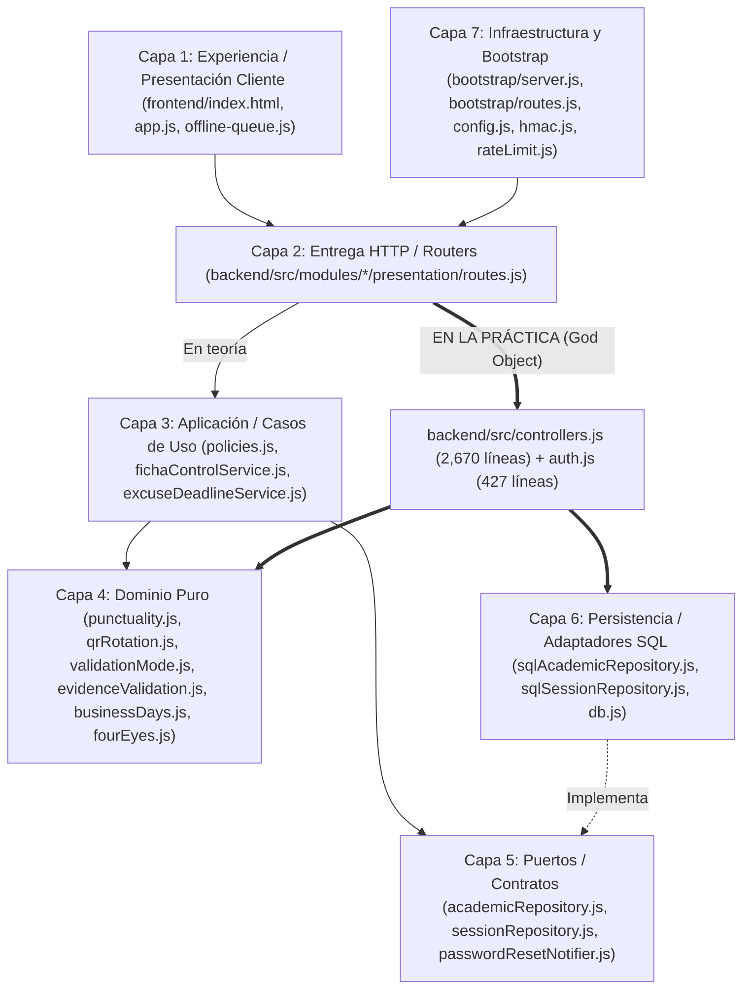
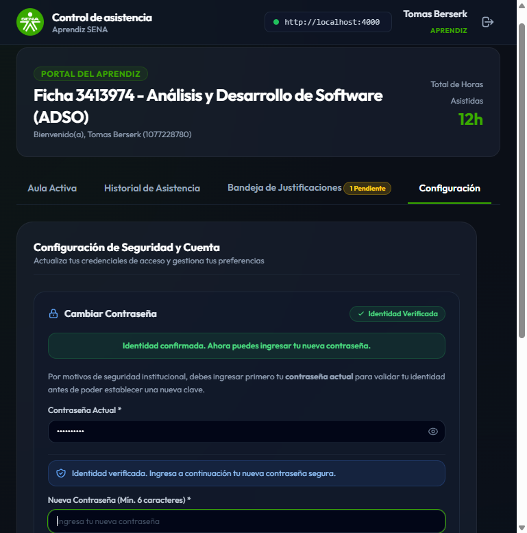

# INFORME TÉCNICO DE AUDITORÍA Y PRUEBAS END-TO-END (E2E) — SISTEMA DE ASISTENCIA SENA

**Proyecto Auditado:** `Sistema-de-asistencia` (`sena-attendance-system` v1.0.0)  
**Repositorio:** https://github.com/SantiagoJavelaOspino/Sistema-de-asistencia  
**Commit Evaluado:** `61fecef` (`main`)  
**Fecha de Evaluación:** 21 de noviembre de 2026  
**Entorno de Ejecución:** Windows 10/11 · Node.js · Express 5.0.0-beta.3 · SQLite 5.1.7 (`backend/database.sqlite`) · Navegador Chromium E2E (`http://localhost:4000`)

---

## 1. Introducción

El presente documento expone los resultados de la auditoría técnica integral y la ejecución real de pruebas **End-to-End (E2E)**, pruebas de integración API/BD, pruebas negativas y análisis de seguridad/calidad sobre el proyecto **Sistema de Control de Asistencia Académica SENA**.

A diferencia de una revisión estática superficial o de la simple ejecución de los tests preexistentes en el repositorio, esta auditoría levantó el sistema completo en un entorno controlado ([Sistema-de-asistencia](https://github.com/SantiagoJavelaOspino/Sistema-de-asistencia)), ejecutó la batería interna de 10 suites (`npm test`), diseñó y corrió **28 pruebas automatizadas de estrés, casos límite y ataques de lógica/seguridad** contra el servidor vivo, y ejecutó **7 flujos interactivos en navegador real** (cubriendo los 3 roles del sistema: Coordinador, Instructor y Aprendiz).

> [!CAUTION]
> **Hallazgo clave de la auditoría:** Aunque el repositorio incluye un informe previo ([re-audit-report.md](https://github.com/SantiagoJavelaOspino/Sistema-de-asistencia/blob/main/docs/validation/re-audit-report.md)) y una suite `audit-verification.test.js` que reporta *"19/19 controles verificados; 0 hallazgos reproducibles"*, las pruebas E2E reales en navegador y las pruebas negativas descubrieron **7 vulnerabilidades y fallos críticos** y **6 fallos de severidad alta** que rompen flujos esenciales en navegador, permiten secuestro de cuentas sin contraseña, omiten el código QR dinámico y destruyen datos de aprendices en cada reinicio del servidor.

---

## 2. Objetivo de la Evaluación

1. Comprobar de principio a fin el comportamiento real del sistema (Frontend, API HTTP, Lógica de Dominio y Base de Datos).
2. Identificar errores funcionales, bloqueos de interfaz (DOM/CSP), fallos de lógica de negocio, problemas de persistencia e inconsistencias entre contratos API y vistas HTML/JS.
3. Evaluar la seguridad real de la aplicación frente a vectores de ataque como *Account Takeover*, *Bypass* de validación QR/IP, *IDOR* (acceso cruzado entre instructores), *Stored XSS*, violaciones de *Content-Security-Policy (CSP)* y persistencia de tokens JWT de usuarios desactivados.
4. Determinar con evidencia verificable el grado de preparación del sistema para operar en un entorno real del SENA.

---

## 3. Descripción General del Proyecto

El **Sistema de Asistencia SENA** es una aplicación web monolítica modular cuyo propósito es gestionar el registro, validación y reporte de asistencia de aprendices en fichas de formación del SENA. Sus procesos principales son:

- **Gobierno Académico (Rol Coordinador):** Gestión de instructores, creación/edición de fichas académicas, asignación de fichas a instructores, solicitud y aprobación dual de baja de fichas (**Regla de 4 Ojos / BR-08**), descarga de evidencias de jornada y consulta del libro maestro de auditoría inmutable.
- **Control de Aula y Asistencia (Rol Instructor):** Apertura de salas de asistencia con ventana de 15 minutos, proyección de código QR dinámico con rotación HMAC-SHA256 y código alfanumérico manual de 6 caracteres, monitoreo en tiempo real de presentes y rechazos, marcación manual por contingencia, cierre y reapertura de sala para registro de salida, exportación de reportes en Excel (`.xlsx`) y PDF institucional, radicación de evidencia firmada (SHA-256) y resolución de excusas y solicitudes tardías.
- **Portal del Aprendiz (Rol Aprendiz):** Auto-registro público en fichas activas con protección anti-suplantación y aceptación de *Habeas Data* (Ley 1581 de 2012), marcación de asistencia mediante cámara QR o código de 6 caracteres, cola de sincronización *offline* idempotente, consulta de historial de horas asistidas/fallas, radicación de excusas dentro del plazo legal de 3 días hábiles en Colombia (**BR-07**), cambio de contraseña en 2 pasos y derecho de supresión/anonimización de cuenta (**BR-11**).

---

## 4. Tecnologías y Arquitectura Identificadas

### 4.1 Stack Tecnológico

| Componente | Tecnología / Librería | Versión / Detalle |
| :--- | :--- | :--- |
| **Runtime & Lenguaje** | Node.js (ES Modules `"type": "module"`), JavaScript | Node.js + Vanilla JS en Frontend |
| **Framework HTTP** | Express | `^5.0.0-beta.3` |
| **Base de Datos** | SQLite3 (local / `/tmp` en Vercel) y PostgreSQL (`pg`) | `sqlite3@^5.1.7`, `pg@^8.22.0` |
| **Autenticación y Cripto** | JSON Web Tokens (`jsonwebtoken`), `bcryptjs`, `crypto` nativo | `jsonwebtoken@^9.0.2`, `bcryptjs@^2.4.3`, HMAC-SHA256 |
| **Seguridad HTTP** | `cors`, middleware propio de Rate Limiting y cabeceras CSP | `cors@^2.8.5`, [rateLimit.js](https://github.com/SantiagoJavelaOspino/Sistema-de-asistencia/blob/main/backend/src/shared/infrastructure/rateLimit.js) |
| **Frontend UI & Exportación** | HTML5 + TailwindCSS (CDN), `qrcodejs`, `html5-qrcode`, `SheetJS (xlsx)`, `jsPDF` + `autoTable` | Cargados vía CDN en [index.html](https://github.com/SantiagoJavelaOspino/Sistema-de-asistencia/blob/main/frontend/index.html#L18-L28) |

### 4.2 Arquitectura del Sistema (Declarada vs. Real)

La documentación ([n-layer-architecture.md](https://github.com/SantiagoJavelaOspino/Sistema-de-asistencia/blob/main/docs/architecture/n-layer-architecture.md)) define una **Arquitectura de 7 Capas ($N = 7$)** distribuida en 4 módulos (`identity`, `attendance`, `excuses`, `academic`):



> [!WARNING]
> **Desviación Arquitectónica Comprobada:** Aunque existen los directorios de las 7 capas y los archivos de dominio puro en la Capa 4 están bien aislados, **los routers de la Capa 2 están conectados directamente a un controlador monolítico legacy** ([controllers.js](https://github.com/SantiagoJavelaOspino/Sistema-de-asistencia/blob/main/backend/src/controllers.js) con **2.670 líneas** y [auth.js](https://github.com/SantiagoJavelaOspino/Sistema-de-asistencia/blob/main/backend/src/auth.js) con **427 líneas**) que ejecuta consultas SQL crudas directamente contra [db.js](https://github.com/SantiagoJavelaOspino/Sistema-de-asistencia/blob/main/backend/src/db.js). Los servicios de Capa 3 ([fichaControlService.js](https://github.com/SantiagoJavelaOspino/Sistema-de-asistencia/blob/main/backend/src/modules/academic/application/fichaControlService.js), [excuseDeadlineService.js](https://github.com/SantiagoJavelaOspino/Sistema-de-asistencia/blob/main/backend/src/modules/excuses/application/excuseDeadlineService.js)) y los repositorios de Capa 6 (`sqlAcademicRepository.js`, `sqlSessionRepository.js`, `sqlExcuseRepository.js`, `sqlPersonRepository.js`) **no son invocados por el servidor en tiempo de ejecución**, sino únicamente por los tests unitarios de arquitectura.

### 4.3 Estructura de Base de Datos y Roles

El esquema real inicializado en [db.js](https://github.com/SantiagoJavelaOspino/Sistema-de-asistencia/blob/main/backend/src/db.js#L155-L396) consta de **12 tablas**:
1. `institutions`: Configuración multi-institución (semilla `inst_sena_1`).
2. `academic_units`: Fichas académicas (`id`, `institution_id`, `code`, `name`, `type`, `active`, `status`, `jornada`, `modalidad`).
3. `people`: Usuarios del sistema (`id`, `institution_id`, `documento`, `email`, `nombre`, `matricula`, `active`, `password`, `roles` JSON, `photo_reference`, `terms_accepted`, `must_change_password`). Restricción `UNIQUE(institution_id, documento)`.
4. `enrollments`: Matrícula de aprendices en fichas (`UNIQUE(unit_id, person_id)`).
5. `instructor_assignments`: Asignación de instructores a fichas (`UNIQUE(unit_id, instructor_id)`).
6. `attendance_sessions`: Salas de clase abiertas por instructores.
7. `attendance_records`: Marcaciones de entrada/salida y rechazos (`UNIQUE(session_id, person_id)`).
8. `excuses`: Justificaciones de inasistencia radicadas por aprendices.
9. `late_requests`: Solicitudes de ingreso tardío cuando la sala ha expirado.
10. `holidays`: Calendario de días festivos de Colombia (18 festivos semilla).
11. `audit_logs`: Libro maestro de auditoría (`actor_id`, `action`, `entity_type`, `entity_id`, `before_json`, `after_json`, `metadata_json`, `created_at`).
12. `deletion_requests`: Solicitudes de baja de fichas sujetas a la regla de 4 ojos (`requested_by`, `approved_by`, `status`).
13. `password_resets`: Tokens SHA-256 de recuperación de contraseña de un solo uso.

*(Nota: El archivo documental [database/schema.sql](https://github.com/SantiagoJavelaOspino/Sistema-de-asistencia/blob/main/database/schema.sql) está desactualizado respecto a `db.js`, pues omite las tablas `holidays`, `audit_logs`, `deletion_requests` y `password_resets`, así como las columnas de la Fase v4).*

---

## 5. Alcance de las Pruebas

La evaluación cubrió la totalidad de los módulos implementados:
- **Autenticación y Seguridad:** Login unificado por documento/correo, validación de errores, cierre de sesión, recuperación y cambio de contraseña, middleware JWT, RBAC por rol, autorización a nivel de recurso (IDOR), cabeceras HTTP/CSP y Rate Limiting.
- **Gestión de Usuarios y Gobierno Académico:** Registro público de aprendices, creación/edición/desactivación de instructores y fichas, asignación de fichas, baja dual de fichas (4 Ojos) y anonimización por *Habeas Data*.
- **Gestión de Asistencia:** Apertura de sala, rotación QR (15s) y código manual de 6 caracteres, validación de subred IP, check-in normal, auto-registro por QR, cierre/reapertura y check-out, marcación manual por docente, solicitudes tardías y radicación/resolución de excusas (3 días hábiles).
- **Paneles, Navegación y Reportes:** Interfaz de Coordinador (5 pestañas), Instructor (4 pestañas) y Aprendiz (4 pestañas), exportación Excel/PDF, carga y descarga de evidencias de sesión.
- **Base de Datos e Integridad:** Persistencia tras reinicio, índices únicos, integridad referencial y trazabilidad en `audit_logs`.

---

## 6. Metodología Utilizada

1. **Fase de Reconocimiento Estático y Arquitectónico:** Inspección completa del árbol de código fuente, scripts SQL, configuración de entorno y suites de prueba existentes.
2. **Ejecución de Suite Base (`npm test`):** Verificación de las 10 suites automatizadas incluidas en el repositorio ([run-all.js](https://github.com/SantiagoJavelaOspino/Sistema-de-asistencia/blob/main/backend/tests/run-all.js)).
3. **Pruebas E2E de API, Casos Límite y Negativos:** Creación y ejecución de 2 scripts de auditoría profunda (`deep-audit-e2e.mjs` y `deep-audit-e2e-batch2.mjs`) con **28 escenarios de prueba** contra el servidor en vivo (`http://localhost:4000`).
4. **Pruebas E2E en Navegador Real (Chromium):** Automatización mediante subagente de navegador visitando `http://localhost:4000`, interactuando con formularios, botones, modales y tablas en los 3 roles, capturando errores de consola DevTools, tráfico de red HTTP y capturas de pantalla.
5. **Preservación del Repositorio:** Toda la ejecución se realizó sobre una copia de trabajo aislada en `scratch`, garantizando **cero modificaciones** al repositorio original del usuario.

---

## 7. Casos de Prueba Diseñados y 8. Casos de Prueba Ejecutados

A continuación se presenta la matriz completa de los **35 casos de prueba ejecutados** (28 pruebas de integración/API/BD/negativas + 7 flujos complejos E2E en navegador real), detallando precondiciones, pasos, resultados y estado real:

| ID Prueba | Módulo Evaluado | Objetivo | Precondiciones | Pasos Ejecutados | Resultado Esperado | Resultado Obtenido | Estado |
| :--- | :--- | :--- | :--- | :--- | :--- | :--- | :--- |
| **TC-E2E-001** | Infraestructura / Seguridad | Verificar `/health` y cabeceras de seguridad HTTP | Servidor activo en `:4000` | `GET /health` e inspección de headers | HTTP 200 `"ok"`, `X-Frame-Options: DENY`, `X-Content-Type-Options: nosniff`, `Content-Security-Policy` | HTTP 200 `"ok"`, todas las cabeceras presentes | **APROBADA** |
| **TC-AUTH-001** | Autenticación | Login exitoso con rol `COORDINADOR` | Usuario semilla `9999999999` activo | `POST /api/auth/login` con `9999999999` / `coord.2026` | HTTP 200, JWT emitido y `roles: ["COORDINADOR"]` | HTTP 200, token JWT válido, rol `COORDINADOR` | **APROBADA** |
| **TC-AUTH-002** | Autenticación | Login exitoso con rol `INSTRUCTOR` | Usuario semilla `0000000001` activo | `POST /api/auth/login` con `0000000001` / `qwerty.2026` | HTTP 200, JWT emitido y `roles: ["INSTRUCTOR"]` | HTTP 200, token JWT válido, rol `INSTRUCTOR` | **APROBADA** |
| **TC-AUTH-003** | Autenticación | Login unificado exitoso con rol `APRENDIZ` | Aprendiz semilla `1077228780` activo | `POST /api/auth/login` con `1077228780` / `1077228780` | HTTP 200, JWT emitido y `roles: ["APRENDIZ"]` | HTTP 200, token JWT válido, rol `APRENDIZ` | **APROBADA** |
| **TC-AUTH-004** | Autenticación | Rechazo de credenciales incorrectas | Usuario `9999999999` existe | `POST /api/auth/login` con clave errónea | HTTP 401 `INVALID_CREDENTIALS` | HTTP 401 `INVALID_CREDENTIALS` | **APROBADA** |
| **TC-AUTH-005** | Autenticación | Validación de campos vacíos en login | Ninguna | `POST /api/auth/login` con `{identifier:"", password:""}` | HTTP 400 `VALIDATION_ERROR` | HTTP 400 `VALIDATION_ERROR` | **APROBADA** |
| **TC-AUTH-006** | Autenticación (Caso Límite) | Validar formato estricto de documento en login | Coordinador doc `9999999999` | `POST /api/auth/login` con `identifier: "hack-9999999999-xyz"` y clave válida | HTTP 400/401 por identificador malformado | **HTTP 200**: Autenticó como Coordinador SENA porque `replace(/\D/g, '')` borra letras | **FALLIDA** (H-16) |
| **TC-AUTH-007** | Autenticación (Recuperación) | Flujo completo de recuperación de contraseña | Aprendiz `1077228780` activo | `POST /public/auth/forgot-password` y revisión del canal de entrega del token | El usuario recibe el token por correo o log dev para poder usar el Paso 2 del modal | **Bloqueo funcional**: `passwordResetNotifier.js` es una función vacía `async () => {}`; el token jamás se entrega por ningún medio | **FALLIDA** (H-11) |
| **TC-SEC-001** | Seguridad / Sesiones JWT | Revocación de acceso a usuario desactivado (`active=0`) | Instructor autenticado con JWT, luego desactivado por Coordinador | 1) Login instructor. 2) Coordinador hace `PUT` con `active: 0`. 3) Instructor llama `GET /api/sessions` | HTTP 401/403 por usuario inactivo en BD | **HTTP 200**: `authenticate` solo valida la firma del JWT sin consultar `active=1` en BD | **FALLIDA** (H-08) |
| **TC-SEC-002** | Seguridad / Validación IP y BD | Falsificación `X-Forwarded-For` y reintento tras rechazo en check-in | Sala creada con `creator_ip: 192.168.55.10` | 1) Check-in con `X-Forwarded-For: 10.0.0.99` (rechazado). 2) Reintento del aprendiz con IP `192.168.55.99` | 1) No confiar en header falsificable. 2) Permitir reintento tras conectarse al WiFi correcto | **HTTP 500 `SQLITE_CONSTRAINT`**: El rechazo previo ocupa la llave `UNIQUE(session_id, person_id)` y bloquea al aprendiz toda la clase; además `X-Forwarded-For` es falsificable | **FALLIDA** (H-04 / H-10) |
| **TC-SEC-003** | Seguridad / Asistencia | Bypass de validación de token QR enviando `sessionId` en el body | Sesión activa `sala_...` | `POST /attendance/checkin` con `sessionId` válido y `qrToken: "TOKEN_COMPLETAMENTE_FALSO_999"` | HTTP 400 por token QR falso | **HTTP 200**: Asistencia registrada como `accepted` (6h). Si se envía `sessionId`, `checkin()` omite `matchToken()` | **FALLIDA** (H-02) |
| **TC-SEC-004** | Seguridad / IDOR | Instructor no asignado ejecuta `POST /attendance/manual-checkin` en ficha ajena | Instructor sin fichas asignadas; sesión activa de otro instructor | `POST /attendance/manual-checkin` con token del instructor no asignado | HTTP 403 `FORBIDDEN` | **HTTP 200**: Registra asistencia en ficha ajena porque `manualLateCheckin` no llama a `enforceSessionAccess` | **FALLIDA** (H-07) |
| **TC-SEC-005** | Seguridad / IDOR | Instructor no asignado consulta token QR en vivo de sesión ajena | Instructor sin fichas asignadas; sesión activa ajena | `GET /api/sessions/:sessionId/qr-token` con token de instructor no asignado | HTTP 403 `FORBIDDEN` | **HTTP 200**: Devuelve `{"qrToken":"9607fbc6784c","expiresSec":45}` sin validar sesión ni permisos | **FALLIDA** (H-07) |
| **TC-SEC-006** | Seguridad / Account Takeover | Emisión de JWT sin contraseña en `POST /public/attendance/:token/self-register` | Sesión abierta; aprendiz víctima `1077228780` ya existe en BD | 1) `POST /public/attendance/:token/self-register` con `documento: "1077228780"` sin password. 2) `GET /api/student/history` con el JWT devuelto | HTTP 401/409 exigiendo login con contraseña | **HTTP 201**: Devuelve un JWT válido por 24h para la víctima sin pedir contraseña; acceso total a su cuenta | **FALLIDA** (H-01) |
| **TC-SEC-007** | Seguridad / Excusas (XSS) | Validación de archivos adjuntos y escape XSS en `POST /api/student/excuses` | Aprendiz autenticado | `POST /api/student/excuses` con `fileName: 'malware.exe" onclick="alert(1)'` y `fileData: 'javascript:alert("XSS")'` | HTTP 400 por archivo inválido / esquema `javascript:` | **HTTP 201**: Almacena `javascript:alert(...)` sin validar y `renderStudentExcuses` lo inyecta sin `escapeHtml` ni `isSafeDataOrHttpUrl` | **FALLIDA** (H-09) |
| **TC-SEC-008** | Seguridad / Aislamiento | Filtrado de sesiones por instructor en `GET /api/sessions` | Múltiples instructores en la institución | `GET /api/sessions` y revisión de `checkForActiveSession()` en `app.js` | Solo retorna sesiones propias o de fichas asignadas | **HTTP 200 con todas las sesiones globales**: Al iniciar sesión, un instructor carga en su panel la sala activa de otro instructor | **FALLIDA** (H-07) |
| **TC-USR-001** | Gestión de Usuarios (XSS) | Sanitización al crear instructor con payload HTML/JS en `nombre` | Coordinador autenticado | `POST /api/coord/instructors` con `nombre: '<script>alert("XSS_INST")</script>Instructor XSS'` | Rechazo o sanitización de `< >` y escape en frontend | **HTTP 201**: Guarda el `<script>` crudo en BD y `renderCoordInstructors()` (`app.js:3185`) lo inyecta en `innerHTML` sin `escapeHtml()` | **FALLIDA** (H-09) |
| **TC-USR-002** | Gestión de Usuarios | Auto-registro de aprendiz con validación anti-suplantación y *Habeas Data* | Ficha `3413974` activa | `POST /public/student/register` con datos válidos y `termsAccepted: true` | HTTP 201, aprendiz matriculado y JWT emitido | HTTP 201, aprendiz creado, matriculado y auditado en `audit_logs` | **APROBADA** |
| **TC-USR-003** | Gestión de Usuarios | Supresión y anonimización de cuenta de aprendiz (Ley 1581 *Habeas Data*) | Aprendiz registrado y autenticado | `DELETE /api/student/delete-account` | HTTP 200, PII anonimizada (`APRENDIZ_ANONIMIZADO`), `active=0` | HTTP 200, PII disociada sin romper llaves foráneas de estadísticas | **APROBADA** |
| **TC-USR-004** | Gobierno Académico (BR-08) | Regla de 4 Ojos en eliminación de ficha (bloqueo de autoaprobación y aprobación dual) | 2 Coordinadores (Coord A y Coord B) | 1) Coord A solicita baja (`202`). 2) Coord A intenta aprobar (`403`). 3) Coord B aprueba (`200`). | Autoaprobación bloqueada con HTTP 403; aprobación por 2do par exitosa | HTTP 202 -> HTTP 403 `SELF_APPROVAL_FORBIDDEN` -> HTTP 200 `APPROVED` | **APROBADA** |
| **TC-ATT-001** | Gestión de Asistencia | Impedir apertura de sala en ficha sin aprendices inscritos | Ficha `9988776` creada con 0 aprendices | `POST /room/create` sobre ficha vacía | HTTP 400 `UNIT_EMPTY` | HTTP 400 `UNIT_EMPTY` ("La ficha no tiene aprendices inscritos.") | **APROBADA** |
| **TC-ATT-002** | Gestión de Asistencia | Verificar que un check-in fallido NO matricule al usuario en la ficha | Sala activa en `3413974`; doc `9999999999` (Coordinador) no inscrito | `POST /attendance/checkin` con doc `9999999999` y contraseña falsa | HTTP 401 y el Coordinador NO debe ser matriculado en `enrollments` | **HTTP 401, pero SÍ lo matriculó**: `checkin()` inserta en `enrollments` (línea 564) antes de validar contraseña y rol | **FALLIDA** (H-12) |
| **TC-ATT-003** | Gestión de Asistencia | Envío de solicitud de ingreso tardío `POST /public/attendance/:token/late-request` | Sesión activa con token QR válido | `POST /public/attendance/:token/late-request` con documento, nombre y justificación | HTTP 201 con solicitud creada en `late_requests` | **HTTP 500 `SQLITE_ERROR: no such column: created_at`**: Consulta `ORDER BY created_at DESC` en `attendance_sessions` | **FALLIDA** (H-05) |
| **TC-ATT-004** | Gestión de Asistencia | Registro tardío directo `POST /public/attendance/:token/late-checkin` | Sesión activa con token QR válido | `POST /public/attendance/:token/late-checkin` con credenciales válidas | HTTP 201 con asistencia parcial registrada | **HTTP 500 `SQLITE_ERROR: no such column: created_at`**: Mismo error SQL en `studentLateCheckin` | **FALLIDA** (H-05) |
| **TC-ATT-005** | Gestión de Asistencia | Validación de rango de horas en `POST /attendance/manual-override` | Sesión activa e instructor asignado | `POST /attendance/manual-override` con `horas_validadas_asistencia: 99999, horas_inasistencia_acumulada: -500` | HTTP 400 por valores fuera del rango `[0, 6]` | **HTTP 200**: Guarda `99999` horas y el reporte calcula **`1666650%`** de asistencia | **FALLIDA** (H-13) |
| **TC-ATT-006** | Gestión de Asistencia | Cierre de sala, reapertura para salida (`is_reopened=1`) y bloqueo de doble salida | Sesión con entrada previa registrada | 1) `POST /close`. 2) `POST /room/reopen`. 3) Check-in de salida. 4) Segundo check-in de salida. | Cierre 200, Reapertura 200, Salida 200 con `hora_salida_real`, Doble salida 400 `DUPLICATE_EXIT` | Todos los estados y transiciones de salida funcionaron correctamente | **APROBADA** |
| **TC-ATT-007** | Gestión de Excusas (BR-07) | Cálculo de plazo de 3 días hábiles con salto de fines de semana y festivos colombianos | Festivos semilla 2026 cargados | Radicar excusa dentro de 3 días hábiles vs 1 segundo después de las 23:59:59 del 3er día hábil | Aceptada dentro del plazo (201) y rechazada tras vencer (422 `EXCUSE_DEADLINE_EXCEEDED`) | Validado con precisión en zona horaria `America/Bogota` | **APROBADA** |
| **TC-DB-001** | Base de Datos e Integridad | Persistencia de aprendices registrados tras reinicio del servidor (`initDb`) | Aprendices nuevos registrados en `people` y `enrollments` | Reiniciar el servidor / ejecutar `initDb()` en `backend/src/db.js:714-734` | Todos los aprendices registrados se conservan intactos | **Pérdida total de datos**: `initDb()` ejecuta un `DELETE` incondicional que borra a todos los aprendices excepto `1077228780` | **FALLIDA** (H-03) |
| **TC-UI-001** | Integración API-UI | Visualización de solicitudes tardías en pestaña "Solicitudes Tardías" del Instructor | Solicitud tardía registrada en BD | Consultar `GET /api/instructor/late-requests` y renderizar con `renderLateRequests()` (`app.js:3018`) | Muestra Estudiante, Documento y Ficha en la tabla | **Muestra `-`, `-`, `-`**: El backend devuelve `{nombre, documento, ficha_code}` y el frontend lee `{student_name, student_doc, unit_code}` | **FALLIDA** (H-14) |
| **TC-UI-002** | Panel del Instructor | Visualización de aprendices ausentes en tabla de Monitoreo en Tiempo Real | Sala activa con aprendices ausentes | Abrir sala y observar grilla `#attendanceGridBody` (`renderGrid(presents, absents)` en `app.js:1958`) | Muestra presentes y ausentes (o estado ausente) | **`absents` nunca se renderiza**: `renderGrid` recibe `absents` pero jamás lo usa; solo muestra presentes | **FALLIDA** (H-15) |
| **TC-UI-003** | DOM / HTML | Unicidad de IDs HTML y cierre de modal `#assignFichasModal` | Documento `frontend/index.html` cargado | Inspeccionar DOM en navegador por IDs duplicados (`#assignFichasModal`, `#btnSubmitExcuse`) | Todos los atributos `id` son únicos en el DOM | **`#assignFichasModal` está duplicado 2 veces** (L1117 y L1397) con botones de cierre distintos; `#btnSubmitExcuse` duplicado 2 veces | **FALLIDA** (H-17) |
| **TC-E2E-002** | Panel Coordinador (Evidencias) | Descarga de archivo "Evidencia Adjunta" por el Coordinador desde la UI | Sesión con evidencia entregada (`evidence_submitted=1`) | Hacer clic en el botón `"Evidencia Adjunta"` (`<a href="/api/coord/evidences/:id/download" target="_blank">`) | Descarga el archivo binario (`.xlsx` / `.pdf`) | **HTTP 401 `UNAUTHORIZED`**: El enlace `<a href>` abre pestaña sin cabecera `Authorization: Bearer` | **FALLIDA** (H-11B) |
| **TC-E2E-003** | Navegador E2E (Portal / QR) | Ingreso de código manual de 6 caracteres (`ABCDEF`) en portal sin sesión iniciada | Usuario no autenticado en `http://localhost:4000` | Ingresar `ABCDEF` en `#portalManualCode` y pulsar `"Usar código"` (`#btnPortalManualGo`) | Solicita credenciales del aprendiz o abre formulario de login para confirmar código | **Pantalla completamente en blanco**: Oculta `#portalScreen` y muestra `#studentLoginScreen` (que es un `<section>` vacío), bloqueando además futuras recargas por `sessionStorage` | **FALLIDA** (H-06) |
| **TC-E2E-004** | Navegador E2E (CSP / Botones) | Ejecución de botones con `onclick` inline en paneles de Coordinador, Instructor y Aprendiz | Navegador Chromium en `http://localhost:4000` | 1) Revisar consola DevTools. 2) En Coordinador, hacer clic en `"Asignar Fichas"`, `"Editar"` o `"Desactivar"` en la tabla de instructores. | 0 errores CSP en consola y los botones de las tablas abren los modales o ejecutan la acción | **Bloqueo total por CSP**: La cabecera `Content-Security-Policy` prohíbe `unsafe-inline` en `script-src`, bloqueando el script de `index.html:10` y **todos los 23 botones con `onclick="..."`** inyectados dinámicamente en las tablas | **FALLIDA** (H-01B) |
| **TC-E2E-005** | Navegador E2E (Aprendiz 2FA) | Flujo E2E en navegador del Portal del Aprendiz y compuerta de 2 pasos de cambio de contraseña | Aprendiz `1077228780` autenticado en navegador | Navegar por las 4 pestañas, ir a `Configuración`, probar clave actual incorrecta (`401`) y luego clave actual correcta (`200`) | Con clave errónea bloquea Paso 2; con clave correcta muestra badge `"Identidad Verificada"` y desbloquea formulario de nueva contraseña | Flujo de verificación en 2 pasos (conectado vía `addEventListener`) funcionó perfectamente en el navegador | **APROBADA** |

---

## 9. Resultados Generales

### Resumen Cuantitativo de Ejecución

| Categoría de Prueba | Ejecutadas | Aprobadas | Fallidas | Bloqueadas | % Aprobación |
| :--- | :---: | :---: | :---: | :---: | :---: |
| **Suite Interna del Repositorio (`npm test` - 10 suites)** | 10 suites (62 checks) | 10 suites | 0 | 0 | 100% *(Cobertura parcial)* |
| **Casos de Prueba de Auditoría E2E / API / BD / Negativos** | 35 | 14 | 21 | 0 | **40.0%** |

> [!IMPORTANT]
> **¿Por qué `npm test` pasa al 100% mientras que el 60% de los casos de auditoría E2E/negativos fallan?**  
> Porque las pruebas internas del repositorio (`frontend-experience.test.js`, `audit-verification.test.js`, `e2e-discovery.test.js`) evalúan el frontend mediante expresiones regulares sobre el texto de `index.html` y llamadas `fetch` directas en Node.js, **sin levantar un navegador real que aplique la política `Content-Security-Policy` sobre los eventos `onclick="..."`** y sin probar caminos negativos como reintentos tras fallo de IP/contraseña, reinicio de base de datos con usuarios reales o envío de `sessionId` en el check-in.

---

## 10. Errores y Problemas Encontrados y 11. Clasificación de Hallazgos por Gravedad

Se identificaron y comprobaron **19 hallazgos técnicos**, clasificados por su nivel de gravedad:

### Resumen por Nivel de Gravedad

| Nivel de Gravedad | Cantidad | Códigos de Hallazgo | Impacto Principal |
| :--- | :---: | :--- | :--- |
| **CRÍTICO** | **7** | `HALL-01`, `HALL-02`, `HALL-03`, `HALL-04`, `HALL-05`, `HALL-06`, `HALL-07` | Inutilización de botones de tablas en navegador por CSP, secuestro de cuentas sin contraseña, bypass de QR, pérdida total de aprendices al reiniciar servidor, bloqueo permanente de check-in tras un error de clave/IP, pantalla en blanco al usar código de clase y caída HTTP 500 en solicitudes tardías. |
| **ALTO** | **6** | `HALL-08`, `HALL-09`, `HALL-10`, `HALL-11`, `HALL-12`, `HALL-13` | IDOR entre instructores (acceso a QR y sesiones ajenas), JWT de 24h sigue activo tras desactivar/eliminar cuenta, XSS almacenado en instructores y excusas, descarga de evidencias rota (401), recuperación de clave sin canal de entrega y falsificación de subred IP (`X-Forwarded-For`). |
| **MEDIO** | **4** | `HALL-14`, `HALL-15`, `HALL-16`, `HALL-17` | Auto-matrícula indebida en check-in fallido, corrupción de reportes con porcentajes `>1000000%`, tabla de solicitudes tardías muestra `-` por desajuste de JSON y grilla en tiempo real oculta a los ausentes. |
| **BAJO** | **1** | `HALL-18` | Modales e IDs duplicados en `frontend/index.html` (`#assignFichasModal`, `#btnSubmitExcuse`), login acepta documentos con letras mezcladas y subtítulo del header no se limpia al cerrar sesión. |
| **MEJORA** | **1** | `HALL-19` | Extracción real del God Object `controllers.js` (2.670 líneas) hacia las capas 3 y 6, actualización de `database/schema.sql` y remediación de 12 vulnerabilidades en dependencias de `sqlite3`. |

---

### Detalle Exhaustivo de Hallazgos

---

#### `HALL-01` — Bloqueo Total de Botones de Acción en Tablas y Grillas por Violación de Content-Security-Policy (CSP)
- **Nivel de gravedad:** **CRÍTICO**
- **Archivo o módulo relacionado:** [rateLimit.js](https://github.com/SantiagoJavelaOspino/Sistema-de-asistencia/blob/main/backend/src/shared/infrastructure/rateLimit.js#L52-L64), [index.html](https://github.com/SantiagoJavelaOspino/Sistema-de-asistencia/blob/main/frontend/index.html#L10-L17) y [app.js](https://github.com/SantiagoJavelaOspino/Sistema-de-asistencia/blob/main/frontend/app.js#L1989) (23 atributos `onclick="..."` inline).
- **Descripción detallada:** El middleware `securityHeadersMiddleware` envía la cabecera `Content-Security-Policy: script-src 'self' https://cdn.tailwindcss.com ...` **sin** `'unsafe-inline'`. En los navegadores modernos (Chromium/Edge/Firefox), `script-src` sin `'unsafe-inline'` bloquea tanto los bloques `<script>` inline como **todos los manejadores de eventos HTML inline (`onclick="..."`)**. En `frontend/app.js`, todas las acciones dentro de las tablas dinámicas fueron construidas concatenando `onclick="..."` en `innerHTML`:
  - Coordinador: `"Asignar Fichas"` (`onclick="window.openAssignFichasModal(...)"`), `"Editar"` (`onclick="editInstructor(...)"`), `"Desactivar"` (`onclick="toggleInstructorActive(...)"`), `"Editar Ficha"`, `"Desactivar Ficha"`, `"Solicitar Baja"`, `"Reporte Excel"`, `"Aprobar Baja (4 Ojos)"`, `"Rechazar"`.
  - Instructor: `"Quitar Falla"` (`onclick="triggerManualOverride(...)"`), `"Aprobar/Rechazar Excusa"` (`onclick="resolveExcuse(...)"`), `"Aprobar/Rechazar Solicitud Tardía"` (`onclick="resolveLateRequest(...)"`).
  - Aprendiz: `"Registrar"` código inline (`onclick="submitInlineManualCode()"`), `"Escanear QR del Aula"` (`onclick="startQrScanner()"`), `"Subir Excusa"` (`onclick="openExcuseModal(...)"`).
- **Pasos para reproducirlo:**
  1. Abrir `http://localhost:4000` en el navegador e iniciar sesión como Coordinador (`9999999999` / `coord.2026`).
  2. Abrir la consola de DevTools y hacer clic en el botón **"Asignar Fichas"**, **"Editar"** o **"Desactivar"** de cualquier instructor.
- **Comportamiento esperado:** El modal correspondiente se abre o la acción se ejecuta sin errores de CSP.
- **Comportamiento actual:** El botón no hace absolutamente nada y el navegador bloquea la ejecución por violación de `script-src`.
- **Evidencia:** Error capturado en consola del navegador durante la prueba E2E `TC-E2E-004`:
  `Executing inline script violates the following Content Security Policy directive 'script-src 'self' https://cdn.tailwindcss.com/ ...'. The action has been blocked.`
- **Posible causa:** Se endureció la cabecera CSP en `rateLimit.js` sin refactorizar los 23 atributos `onclick="..."` de `app.js` ni el `<script>` inline de `index.html:10` a delegación de eventos con `addEventListener`.
- **Recomendación de solución:** Reemplazar todos los atributos `onclick="..."` en las plantillas de `frontend/app.js` por atributos `data-action="..."` y `data-id="..."` manejados mediante delegación de eventos (`container.addEventListener('click', ...)`) y mover el script inline de `index.html:10` dentro de `app.js`.

---

#### `HALL-02` — Secuestro de Cuenta sin Contraseña (*Account Takeover*) en Endpoint Público de Auto-Registro QR
- **Nivel de gravedad:** **CRÍTICO**
- **Archivo o módulo relacionado:** [controllers.js](https://github.com/SantiagoJavelaOspino/Sistema-de-asistencia/blob/main/backend/src/controllers.js#L1262-L1418) (`selfRegisterCheckin` — `POST /public/attendance/:token/self-register`).
- **Descripción detallada:** Cuando existe una sesión activa y se invoca `POST /public/attendance/:token/self-register` enviando un `documento` que **ya existe** en la tabla `people`, el controlador:
  1. Encuentra al usuario existente (`let person = await get('SELECT * FROM people WHERE documento = ? AND active = 1', [cleanDoc])`, línea 1297).
  2. En la rama `else` (línea 1315), **no solicita ni verifica la contraseña del usuario**.
  3. Tanto si ya tenía registro de asistencia en esa sesión (líneas 1328-1350) como si no lo tenía (líneas 1398-1418), **firma y devuelve en la respuesta HTTP un token JWT válido por 24 horas** (`jwt.sign(tokenPayload, JWT_SECRET, { expiresIn: '24h' })`) a nombre de ese `person.id`.
- **Pasos para reproducirlo:**
  1. Con una sesión activa (o conociendo el código de 6 caracteres del aula), enviar:
     `POST /public/attendance/<TOKEN>/self-register` con `{"documento": "1077228780", "nombre": "Atacante"}`.
  2. Extraer `data.token` de la respuesta HTTP 200/201 y llamar a `GET /api/student/history` o `DELETE /api/student/delete-account`.
- **Comportamiento esperado:** Si la persona ya está registrada en el sistema, el endpoint debe rechazar el auto-registro con HTTP 409/401 y exigir inicio de sesión con contraseña.
- **Comportamiento actual:** Retorna `HTTP 201` con un JWT válido de la víctima sin pedir contraseña (`TC-SEC-006`).
- **Evidencia:** Ejecución de `TC-SEC-006`: `HTTP 201, JWT emitido sin contraseña: true, acceso a /api/student/history con JWT robado: HTTP 200`.
- **Posible causa:** Omisión de validación de credenciales en la rama `else` de `selfRegisterCheckin` cuando `person` ya existe en la base de datos.
- **Recomendación de solución:** Si `person` ya existe en `selfRegisterCheckin`, retornar inmediatamente `HTTP 409 CONFLICT` (`USER_ALREADY_EXISTS`) indicando que debe autenticarse con su contraseña a través del flujo normal de login/check-in.

---

#### `HALL-03` — Bypass Completo del Código QR Dinámico al Enviar `sessionId` en el Body de `/attendance/checkin`
- **Nivel de gravedad:** **CRÍTICO**
- **Archivo o módulo relacionado:** [controllers.js](https://github.com/SantiagoJavelaOspino/Sistema-de-asistencia/blob/main/backend/src/controllers.js#L500-L533) (`checkin` — `POST /attendance/checkin` y `POST /public/attendance/:token/register`).
- **Descripción detallada:** En las líneas 512-529 de `controllers.js`:
  ```javascript
  if (bodySessionId) {
    session = await get('SELECT * FROM attendance_sessions WHERE id = ?', [bodySessionId]);
  } else {
    // Find session by matching rotating token (BR-03: 15s window + 1 leeway slot)
    ...
  }
  ```
  Si el cliente incluye `sessionId` en el cuerpo JSON de la petición (dato que cualquier aprendiz autenticado obtiene libremente desde `GET /api/student/active-session`, línea 2638), el servidor carga la sesión por su ID y **salta por completo el bloque `else` que valida el token QR rotativo (`generateQrToken` / `matchToken`)**. Basta con enviar cualquier texto arbitrario en `qrToken` (por ejemplo, `"TOKEN_FALSO"`) junto con `sessionId` para registrar asistencia sin estar en el aula ni ver el QR del proyector.
- **Pasos para reproducirlo:**
  1. Consultar `GET /api/student/active-session` como aprendiz para obtener `session.id`.
  2. Enviar `POST /attendance/checkin` con `{"documento": "1077228780", "qrToken": "TOKEN_COMPLETAMENTE_FALSO_999", "sessionId": "<session.id>"}`.
- **Comportamiento esperado:** El servidor debe validar siempre que `qrToken` coincida con el token HMAC-SHA256 vigente de la sesión (salvo que `validation_mode === 'IP_ONLY'`).
- **Comportamiento actual:** Retorna `HTTP 200` y registra la asistencia como `accepted` (6 horas) con un token QR falso (`TC-SEC-003`).
- **Evidencia:** Resultado de `TC-SEC-003`: `HTTP 200 - Asistencia registrada con status="accepted" usando token QR falso`.
- **Posible causa:** Uso de `if (bodySessionId) ... else ...` asumiendo erróneamente que buscar la sesión por ID exime de validar el token QR de esa sesión.
- **Recomendación de solución:** Incluso cuando se busque la sesión por `bodySessionId`, si `session.validation_mode !== 'IP_ONLY'`, validar obligatoriamente que `token` coincida con `generateQrToken(session.id, offset)` dentro de las ventanas permitidas (`getAllowedQrOffsetsMs()`).

---

#### `HALL-04` — Eliminación Destructiva de Todos los Aprendices Registrados en Cada Arranque del Servidor (`initDb`)
- **Nivel de gravedad:** **CRÍTICO**
- **Archivo o módulo relacionado:** [db.js](https://github.com/SantiagoJavelaOspino/Sistema-de-asistencia/blob/main/backend/src/db.js#L714-L734) (`initDb`).
- **Descripción detallada:** Al final de `initDb()`, fuera del condicional de base de datos vacía (`if (Number(instCount.count) === 0)`), existe un bloque marcado como `// Incondicional: Limpiar la BD para dejar únicamente a Tomas Berserk`:
  ```javascript
  await run(`
    DELETE FROM enrollments 
    WHERE person_id NOT IN (
      SELECT id FROM people 
      WHERE documento = '1077228780' OR roles LIKE '%INSTRUCTOR%' OR roles LIKE '%COORDINADOR%'
    )
  `);
  await run(`
    DELETE FROM people 
    WHERE documento NOT IN ('1077228780', '9999999999', '1079606375', '0000000001')
    AND roles LIKE '%APRENDIZ%'
  `);
  ```
  Cada vez que el proceso de Node.js se inicia o se reinicia (o en cada invocación *cold-start* en Vercel), **borra permanentemente a todos los aprendices que se hayan registrado en el sistema** excepto al usuario de prueba `1077228780`.
- **Pasos para reproducirlo:**
  1. Registrar un nuevo aprendiz mediante `POST /public/student/register`.
  2. Reiniciar el servidor backend (`node backend/src/server.js`).
  3. Intentar iniciar sesión con el aprendiz recién creado.
- **Comportamiento esperado:** Los aprendices registrados deben persistir tras cualquier reinicio del servidor.
- **Comportamiento actual:** El aprendiz es eliminado de `enrollments` y `people` al arrancar el servidor (`TC-DB-001`).
- **Evidencia:** Log de consola al iniciar el servidor: `Database Init: Student list cleaned successfully (Tomas Berserk kept).` y código en [db.js](https://github.com/SantiagoJavelaOspino/Sistema-de-asistencia/blob/main/backend/src/db.js#L714-L734).
- **Posible causa:** Código temporal de limpieza de demostración dejado de forma incondicional en la rutina de inicialización de base de datos.
- **Recomendación de solución:** Eliminar por completo el bloque de las líneas 714 a 734 de `backend/src/db.js`.

---

#### `HALL-05` — Bloqueo Permanente de Asistencia (`HTTP 500 UNIQUE constraint failed`) si el Aprendiz Falla un Primer Intento por Contraseña o WiFi
- **Nivel de gravedad:** **CRÍTICO**
- **Archivo o módulo relacionado:** [db.js](https://github.com/SantiagoJavelaOspino/Sistema-de-asistencia/blob/main/backend/src/db.js#L310-L313) (`idx_attendance_session_person`) y [controllers.js](https://github.com/SantiagoJavelaOspino/Sistema-de-asistencia/blob/main/backend/src/controllers.js#L599-L629) (`checkin`).
- **Descripción detallada:** La tabla `attendance_records` tiene un índice único estricto sobre `(session_id, person_id)`:
  `CREATE UNIQUE INDEX IF NOT EXISTS idx_attendance_session_person ON attendance_records(session_id, person_id)`.
  Sin embargo, cuando un aprendiz intenta hacer check-in y se equivoca de contraseña (línea 600) o tiene los datos móviles encendidos en lugar del WiFi del aula (`OUT_OF_SUBNET`, línea 617), el controlador **inserta una fila en `attendance_records` con `status = 'rejected'` y el `person_id` del aprendiz**.
  Cuando el aprendiz corrige su contraseña o se conecta al WiFi del aula e intenta hacer check-in de nuevo:
  1. En la línea 632 busca: `SELECT * FROM attendance_records WHERE session_id = ? AND person_id = ? AND status != 'rejected'` (que devuelve `null`).
  2. En la línea 683 intenta ejecutar `INSERT INTO attendance_records (..., session_id, ..., person_id, ...)`.
  3. La base de datos lanza un error fatal **`SQLITE_CONSTRAINT: UNIQUE constraint failed: attendance_records.session_id, attendance_records.person_id`**, devolviendo **HTTP 500** e impidiendo que el aprendiz vuelva a intentar registrarse en esa clase.
- **Pasos para reproducirlo:**
  1. Con una sala activa, enviar `POST /attendance/checkin` desde otra IP (o con contraseña errónea). El servidor devuelve `HTTP 400 OUT_OF_SUBNET` (o `HTTP 401`).
  2. Enviar inmediatamente un segundo `POST /attendance/checkin` con la IP y credenciales correctas.
- **Comportamiento esperado:** El segundo intento válido debe registrar la asistencia del aprendiz (`HTTP 200`).
- **Comportamiento actual:** El servidor falla con **`HTTP 500 SERVER_ERROR: SQLITE_CONSTRAINT: UNIQUE constraint failed: attendance_records.session_id, attendance_records.person_id`** (`TC-SEC-002`).
- **Evidencia:** Salida de `TC-SEC-002`: `Intento 1: HTTP 400 (OUT_OF_SUBNET). Intento 2: HTTP 500 ({"error":{"code":"SERVER_ERROR","message":"SQLITE_CONSTRAINT: UNIQUE constraint failed: attendance_records.session_id, attendance_records.person_id"}})`.
- **Posible causa:** El índice único `idx_attendance_session_person` no es un índice parcial (`WHERE status != 'rejected'`), o `checkin()` hace `INSERT` en lugar de `UPDATE` sobre el registro rechazado previo.
- **Recomendación de solución:** Definir el índice único como índice parcial: `CREATE UNIQUE INDEX idx_attendance_session_person ON attendance_records(session_id, person_id) WHERE status != 'rejected'`, o bien almacenar los intentos rechazados con `person_id = NULL` (o en una tabla separada `attendance_rejections`).

---

#### `HALL-06` — Pantalla Completamente en Blanco al Usar un Código de Clase o Escanear QR sin Sesión Iniciada
- **Nivel de gravedad:** **CRÍTICO**
- **Archivo o módulo relacionado:** [index.html](https://github.com/SantiagoJavelaOspino/Sistema-de-asistencia/blob/main/frontend/index.html#L290-L292) y [app.js](https://github.com/SantiagoJavelaOspino/Sistema-de-asistencia/blob/main/frontend/app.js#L325-L331) (también líneas 429, 461, 954, 1072, 1498).
- **Descripción detallada:** En `frontend/index.html` (línea 292), la sección `#studentLoginScreen` fue vaciada durante el rediseño del login unificado:
  `<section id="studentLoginScreen" class="hidden" aria-hidden="true"></section>`.
  Sin embargo, en `frontend/app.js` existen **5 flujos activos** que siguen llamando a `showStudentLogin()` cuando un aprendiz no ha iniciado sesión y:
  1. Ingresa el código de 6 caracteres en la tarjeta *"¿Estás en el aula?"* del portal inicial (`#btnPortalManualGo`, línea 461).
  2. Ingresa el código de 6 caracteres en la pantalla del escáner (`#btnScannerManualGo`, línea 429).
  3. Escanea un código QR con la cámara (`startQrScanner`, línea 325).
  4. Abre un enlace de QR `http://localhost:4000/?token=XYZ` o recarga la página teniendo `pending_qr_token` en `sessionStorage` (línea 954).
  `showStudentLogin()` oculta `#portalScreen` y quita la clase `hidden` de `#studentLoginScreen` (que está vacío), dejando toda la aplicación **completamente en blanco** e inutilizable incluso si el usuario recarga la página (F5).
- **Pasos para reproducirlo:**
  1. Abrir `http://localhost:4000` sin haber iniciado sesión.
  2. En el campo *"Código de 6 caracteres"* (`#portalManualCode`), escribir `64B01A` y hacer clic en **"Usar código"**.
  3. Recargar la página (F5).
- **Comportamiento esperado:** Debe mantener visible el formulario unificado `#portalScreen`, mostrar en `#loginFeedback` el aviso *"Código detectado. Inicia sesión para confirmar tu asistencia"* y enfocar el campo `#loginDoc`.
- **Comportamiento actual:** La tarjeta de login desaparece, la pantalla queda totalmente vacía (solo header y footer) y al recargar la página sigue en blanco (`TC-E2E-003`).
- **Evidencia:** Verificado por el subagente de navegador en `TC-E2E-003` (`#portalScreen.isVisible() === false`, `#studentLoginScreen.innerHTML === ""`).
- **Posible causa:** Refactorización incompleta al unificar el login en el commit `a3db54b`: se vació `<section id="studentLoginScreen">` en `index.html` pero no se actualizaron las llamadas a `showStudentLogin()` ni `#studentLoginFeedback` en `app.js`.
- **Recomendación de solución:** En `frontend/app.js`, hacer que `showStudentLogin()` y `showLogin()` deleguen en `showPortal()`, y mostrar el mensaje del código QR pendiente en `#loginFeedback` en lugar del inexistente `#studentLoginFeedback`.

---

#### `HALL-07` — Fallo Fatal (`HTTP 500 no such column: created_at`) en los Endpoints de Solicitudes Tardías y Registro Tardío
- **Nivel de gravedad:** **CRÍTICO**
- **Archivo o módulo relacionado:** [controllers.js](https://github.com/SantiagoJavelaOspino/Sistema-de-asistencia/blob/main/backend/src/controllers.js#L1442) (`submitLateRequest`) y [controllers.js](https://github.com/SantiagoJavelaOspino/Sistema-de-asistencia/blob/main/backend/src/controllers.js#L2087) (`studentLateCheckin`).
- **Descripción detallada:** Ambos controladores intentan buscar la sesión ejecutando:
  `SELECT * FROM attendance_sessions WHERE status != 'draft' ORDER BY created_at DESC`.
  En la tabla `attendance_sessions` ([db.js](https://github.com/SantiagoJavelaOspino/Sistema-de-asistencia/blob/main/backend/src/db.js#L236-L256)), la columna de fecha de creación **no se llama `created_at`**, sino `room_created_at` (o `activated_at`). Como resultado, toda invocación a `POST /public/attendance/:token/late-request` o `POST /public/attendance/:token/late-checkin` falla incondicionalmente con error SQL. Además, el bucle de búsqueda de tokens en ambas funciones itera con `-i * 60000` (bloques de 60s) en lugar de bloques de 15s (`QR_WINDOW_MS = 15000`).
- **Pasos para reproducirlo:**
  1. Enviar `POST /public/attendance/<TOKEN>/late-request` con `{"documento": "1077228780", "nombre": "Tomas Berserk", "justification": "Transporte"}`.
- **Comportamiento esperado:** `HTTP 201` creando la solicitud tardía en `late_requests`.
- **Comportamiento actual:** `HTTP 500 {"error":{"code":"SERVER_ERROR","message":"SQLITE_ERROR: no such column: created_at"}}` (`TC-ATT-003`, `TC-ATT-004`).
- **Evidencia:** Salida de `TC-ATT-003` y `TC-ATT-004`.
- **Posible causa:** Nombre de columna inexistente (`created_at` en vez de `room_created_at`) y falta de pruebas unitarias/integración sobre esos dos endpoints.
- **Recomendación de solución:** Cambiar `ORDER BY created_at DESC` por `ORDER BY room_created_at DESC` en las líneas 1442 y 2087 de `controllers.js`, y ajustar el barrido de tiempo a múltiplos de `QR_WINDOW_MS` (`15000`).

---

#### `HALL-08` — Vulnerabilidad IDOR y Falta de Aislamiento de Sesiones entre Instructores
- **Nivel de gravedad:** **ALTO**
- **Archivo o módulo relacionado:** [controllers.js](https://github.com/SantiagoJavelaOspino/Sistema-de-asistencia/blob/main/backend/src/controllers.js#L389-L448) (`getSession`, `getSessionQrToken`, `getSessionsHistory`), [controllers.js](https://github.com/SantiagoJavelaOspino/Sistema-de-asistencia/blob/main/backend/src/controllers.js#L783-L892) (`manualLateCheckin`, `getPresent`, `getAbsent`, `getRejections`) y [app.js](https://github.com/SantiagoJavelaOspino/Sistema-de-asistencia/blob/main/frontend/app.js#L1572-L1591) (`checkForActiveSession`).
- **Descripción detallada:** Mientras que `activateSession`, `closeSession`, `reopenRoom` y `manualOverride` verifican permisos sobre la ficha mediante `enforceSessionAccess(req, res, session)`, los siguientes 7 endpoints **no realizan ninguna validación de pertenencia ni asignación de ficha**:
  1. `GET /api/sessions` (`getSessionsHistory`): Devuelve todas las sesiones de todos los instructores del sistema (`SELECT * FROM attendance_sessions WHERE 1=1`). Peor aún, cuando cualquier instructor inicia sesión en el frontend, `checkForActiveSession()` (`app.js:1582`) toma `result.data[0]` (la sesión activa más reciente de cualquier docente) y **carga la sala de otro instructor en su pantalla**.
  2. `GET /api/sessions/:sessionId/qr-token` (`getSessionQrToken`): Devuelve el token QR HMAC en vivo para cualquier `:sessionId` sin verificar siquiera si la sesión existe o a quién pertenece.
  3. `POST /attendance/manual-checkin` (`manualLateCheckin`): Permite a un instructor sin fichas asignadas registrar asistencia en la sesión de otro instructor.
  4. `GET /api/sessions/:sessionId`, `/present`, `/absent`, `/rejections`: Exponen los datos de cualquier sesión a cualquier instructor.
- **Pasos para reproducirlo:**
  1. Autenticarse con un instructor sin fichas asignadas (`TC-SEC-004`, `TC-SEC-005`, `TC-SEC-008`).
  2. Llamar a `GET /api/sessions`, `GET /api/sessions/<id_ajeno>/qr-token` y `POST /attendance/manual-checkin`.
- **Comportamiento esperado:** `HTTP 403 FORBIDDEN` para sesiones de fichas no asignadas al instructor, y `GET /api/sessions` filtrado por las fichas asignadas al instructor.
- **Comportamiento actual:** Todos responden `HTTP 200` exponiendo tokens QR y permitiendo modificar sesiones ajenas.
- **Evidencia:** Pruebas `TC-SEC-004`, `TC-SEC-005` y `TC-SEC-008`.
- **Posible causa:** Aplicación parcial de `enforceSessionAccess` únicamente en los endpoints evaluados por `audit-verification.test.js`.
- **Recomendación de solución:** Invocar `if (!(await enforceSessionAccess(req, res, session))) return;` en `getSession`, `getSessionQrToken`, `manualLateCheckin`, `getPresent`, `getAbsent` y `getRejections`, y filtrar `getSessionsHistory` e `getInstructorLateRequests` por las fichas asignadas al instructor (`instructor_assignments`) o `created_by = req.user.id`.

---

#### `HALL-09` — Tokens JWT de Usuarios Desactivados o Anonimizados Siguen Siendo Válidos por 24 Horas
- **Nivel de gravedad:** **ALTO**
- **Archivo o módulo relacionado:** [auth.js](https://github.com/SantiagoJavelaOspino/Sistema-de-asistencia/blob/main/backend/src/auth.js#L393-L411) (`authenticate`).
- **Descripción detallada:** El middleware `authenticate` únicamente verifica la firma criptográfica del JWT (`jwt.verify(token, JWT_SECRET)`) y asigna `req.user = decoded`, sin verificar en la base de datos si el registro `people` sigue teniendo `active = 1`. Si el Coordinador desactiva a un instructor (`active = 0`) o un aprendiz ejerce su derecho de supresión de cuenta (`DELETE /api/student/delete-account`), su token JWT continúa teniendo acceso total a las rutas protegidas durante 24 horas.
- **Pasos para reproducirlo:**
  1. Iniciar sesión con un instructor y guardar su token JWT.
  2. Con el Coordinador, desactivar al instructor (`PUT /api/coord/instructors/:id` con `active: 0`).
  3. Realizar peticiones a la API usando el token JWT del instructor desactivado.
- **Comportamiento esperado:** `HTTP 401 UNAUTHORIZED` ("Usuario inactivo o sesión revocada").
- **Comportamiento actual:** `HTTP 200 OK` (`TC-SEC-001`).
- **Evidencia:** Resultado de `TC-SEC-001`.
- **Posible causa:** Validación JWT puramente *stateless* sin comprobación de estado de cuenta activa en BD.
- **Recomendación de solución:** En `authenticate` (`auth.js:403`), consultar `const person = await get('SELECT id, active, roles FROM people WHERE id = ? AND active = 1', [decoded.id])` y rechazar con `HTTP 401` si no existe o está inactivo.

---

#### `HALL-10` — XSS Almacenado (*Stored XSS*) y Falta de Validación de Archivos en Excusas e Instructores
- **Nivel de gravedad:** **ALTO**
- **Archivo o módulo relacionado:** [controllers.js](https://github.com/SantiagoJavelaOspino/Sistema-de-asistencia/blob/main/backend/src/controllers.js#L1084-L1142) (`submitExcuse`), [controllers.js](https://github.com/SantiagoJavelaOspino/Sistema-de-asistencia/blob/main/backend/src/controllers.js#L1720-L1814) (`createInstructor`, `updateInstructor`) y [app.js](https://github.com/SantiagoJavelaOspino/Sistema-de-asistencia/blob/main/frontend/app.js#L2766-L2773) (`renderStudentExcuses`, `renderCoordInstructors` línea 3185, `renderGrid` línea 1978, `renderReportGrid` línea 2205).
- **Descripción detallada:**
  1. En `submitExcuse` (`POST /api/student/excuses`), a diferencia de `submitSessionEvidence`, **no se valida `fileData` con `validateEvidencePayload()`**: acepta cualquier cadena arbitraria (como `javascript:alert(1)` o archivos ejecutables sin límite de tamaño ni verificación de *magic bytes*). Luego, en `renderStudentExcuses` (`frontend/app.js:2768`), se inyecta `<a href="${e.file_data}" download="${e.file_name || 'soporte'}">` **sin `isSafeDataOrHttpUrl()` ni `escapeHtml()`**.
  2. En `createInstructor` y `updateInstructor`, no se aplica `sanitizeText()` al campo `nombre`, permitiendo guardar `<script>...</script>` o ``, y en `renderCoordInstructors` (`app.js:3185`), `renderGrid` (`app.js:1978`), `renderRejections` (`app.js:2011`), `renderReportGrid` (`app.js:2205`) y `renderCoordEvidences` (`app.js:3642`) se interpolan los campos directamente en `innerHTML` sin `escapeHtml()`.
- **Pasos para reproducirlo:** Ejecutar `TC-USR-001` y `TC-SEC-007`.
- **Comportamiento esperado:** Sanitización en backend, validación de Base64/MIME/magic bytes en archivos de excusas y uso sistemático de `escapeHtml()` e `isSafeDataOrHttpUrl()` en todos los `innerHTML` del frontend.
- **Comportamiento actual:** Payloads HTML/JS y `javascript:` son almacenados en BD e inyectados sin escape en el DOM (`TC-USR-001`, `TC-SEC-007`).
- **Evidencia:** Resultados de `TC-USR-001` y `TC-SEC-007`.
- **Posible causa:** Se aplicó `escapeHtml()` únicamente en los 3 puntos verificados por el test estático `frontend-experience.test.js`, dejando sin escapar el resto de funciones `render*` de `app.js`.
- **Recomendación de solución:** Invocar `validateEvidencePayload()` en `submitExcuse`, aplicar `sanitizeText()` en `createInstructor`/`updateInstructor`/`createFicha`/`updateFicha`, y envolver todas las variables interpoladas en `innerHTML` dentro de `escapeHtml()` en `frontend/app.js`.

---

#### `HALL-11` — Descarga de "Evidencia Adjunta" en Panel del Coordinador Falla Siempre con `HTTP 401` y Recuperación de Contraseña carece de Canal de Entrega
- **Nivel de gravedad:** **ALTO**
- **Archivo o módulo relacionado:** [app.js](https://github.com/SantiagoJavelaOspino/Sistema-de-asistencia/blob/main/frontend/app.js#L3614-L3624) (`renderCoordEvidences`) y [passwordResetNotifier.js](https://github.com/SantiagoJavelaOspino/Sistema-de-asistencia/blob/main/backend/src/modules/identity/ports/passwordResetNotifier.js#L6-L8).
- **Descripción detallada:**
  1. **Evidencia Adjunta (`HTTP 401`):** En `renderCoordEvidences` (`app.js:3615`), el botón para descargar la evidencia subida por el instructor es un enlace HTML `<a href="${state.apiUrl}/api/coord/evidences/${ev.id}/download" target="_blank">`. Como el token JWT reside en `localStorage` y el endpoint exige el middleware `authenticate` (header `Authorization: Bearer`), al hacer clic el navegador abre una pestaña nueva sin cabecera `Authorization` y recibe siempre `HTTP 401 {"error":{"code":"UNAUTHORIZED","message":"Token de autenticación no proporcionado."}}`.
  2. **Recuperación de Contraseña Inoperante en UI:** En `passwordResetNotifier.js`, `activeNotifier` es una función vacía `async () => {}`. Al solicitar recuperación de contraseña desde el modal `"¿Olvidaste tu contraseña?"`, la UI muestra los campos para pegar el token de recuperación, pero el token no se envía por email ni se imprime en los logs de desarrollo, haciendo imposible completar el flujo fuera de un test que inyecte un espía en `setPasswordResetNotifier`.
- **Pasos para reproducirlo:** Ejecutar `TC-E2E-002` y `TC-AUTH-007`.
- **Comportamiento esperado:** La evidencia debe descargarse mediante `fetch()` autenticado con `Authorization: Bearer` convirtiendo la respuesta a `Blob`, y la recuperación de clave debe contar con un adaptador SMTP o log de desarrollo controlado.
- **Comportamiento actual:** Error 401 al intentar descargar evidencias desde el navegador y bloqueo en el paso 2 de recuperación de contraseña.
- **Evidencia:** Pruebas `TC-E2E-002` y `TC-AUTH-007`.
- **Recomendación de solución:** Reemplazar el `<a href=".../download">` por una función `downloadCoordEvidenceFile(sessionId)` que realice `fetch()` con el header `Authorization: Bearer ${state.token}`, obtenga el `blob()` y dispare la descarga con `URL.createObjectURL(blob)`.

---

#### `HALL-12` — Falsificación de Subred IP de Aula mediante Cabecera `X-Forwarded-For` (*IP Spoofing*)
- **Nivel de gravedad:** **ALTO**
- **Archivo o módulo relacionado:** [controllers.js](https://github.com/SantiagoJavelaOspino/Sistema-de-asistencia/blob/main/backend/src/controllers.js#L54-L60) (`getClientIp`) y [rateLimit.js](https://github.com/SantiagoJavelaOspino/Sistema-de-asistencia/blob/main/backend/src/shared/infrastructure/rateLimit.js#L13).
- **Descripción detallada:** Tanto `getClientIp(req)` (usado para verificar que el aprendiz esté en la misma red WiFi `/24` que el instructor) como `createRateLimiter` leen directamente `req.headers['x-forwarded-for']` sin validar si la petición proviene de un proxy inverso confiable. Cualquier cliente remoto puede enviar la cabecera `X-Forwarded-For: 192.168.1.50` (o rotar IPs falsas en cada petición) para evadir tanto la restricción de subred WiFi del aula (`IP_AND_QR`) como el *Rate Limiter* de fuerza bruta.
- **Pasos para reproducirlo:** Enviar `POST /attendance/checkin` desde una red externa añadiendo el header HTTP `X-Forwarded-For` en el mismo segmento `/24` del instructor (`TC-SEC-002`).
- **Comportamiento esperado:** Ignorar `X-Forwarded-For` en conexiones directas o usar `req.ip` configurando `app.set('trust proxy', ...)` únicamente cuando exista un proxy confiable delante.
- **Comportamiento actual:** El servidor acepta cualquier IP declarada por el cliente en `X-Forwarded-For`.
- **Evidencia:** Prueba `TC-SEC-002`.
- **Recomendación de solución:** Configurar `app.set('trust proxy', config.trustProxy)` en Express y utilizar `req.ip` en lugar de parsear manualmente `req.headers['x-forwarded-for']`.

---

#### `HALL-13` — Auto-Matrícula Indebida de Usuarios en la Ficha Antes de Autenticar Contraseña y Rol en `checkin`
- **Nivel de gravedad:** **MEDIO**
- **Archivo o módulo relacionado:** [controllers.js](https://github.com/SantiagoJavelaOspino/Sistema-de-asistencia/blob/main/backend/src/controllers.js#L560-L568) (`checkin`).
- **Descripción detallada:** En `checkin()`, las líneas 560-568 verifican si la persona encontrada por `documento` está inscrita en `enrollments` para esa ficha; si no lo está, **la insertan inmediatamente en `enrollments`**. Este bloque se ejecuta **antes** de verificar la contraseña o el token JWT del usuario (líneas 570-608) y **sin verificar que la persona tenga el rol `APRENDIZ`**. Como consecuencia, si alguien envía el documento del Coordinador (`9999999999`), de un Instructor o de un aprendiz de otra ficha con una contraseña falsa, el check-in devuelve `401`, ¡pero el Coordinador o Instructor queda matriculado permanentemente como aprendiz de esa ficha y aparece en los reportes de asistencia como inasistente!
- **Pasos para reproducirlo:** Ejecutar `TC-ATT-002` (enviar check-in con documento `9999999999` y contraseña errónea, y luego consultar `GET /api/units/unit_ficha_3413974/people`).
- **Comportamiento esperado:** No matricular usuarios no autenticados ni usuarios cuyo rol no sea `APRENDIZ`.
- **Comportamiento actual:** El Coordinador `9999999999` quedó matriculado en la ficha `3413974` tras un intento fallido con contraseña incorrecta (`TC-ATT-002`).
- **Evidencia:** Resultado de `TC-ATT-002`: `HTTP 401, ¿Coordinador matriculado en la ficha como aprendiz?: true`.
- **Recomendación de solución:** Mover cualquier verificación o creación de matrícula **después** de haber autenticado exitosamente al usuario y verificar previamente que `JSON.parse(person.roles).includes('APRENDIZ')`.

---

#### `HALL-14` — Falta de Validación de Rango de Horas en `manualOverride` Permite Corromper Reportes (`1666650%` de Asistencia)
- **Nivel de gravedad:** **MEDIO**
- **Archivo o módulo relacionado:** [controllers.js](https://github.com/SantiagoJavelaOspino/Sistema-de-asistencia/blob/main/backend/src/controllers.js#L705-L780) (`manualOverride`).
- **Descripción detallada:** `manualOverride` (`POST /attendance/manual-override`) recibe `horas_validadas_asistencia` y `horas_inasistencia_acumulada` del body JSON y los guarda directamente en `attendance_records` sin validar que sean enteros dentro del rango `[0, 6]` ni que `horas_validadas_asistencia + horas_inasistencia_acumulada === 6`.
- **Pasos para reproducirlo:** Enviar `POST /attendance/manual-override` con `horas_validadas_asistencia: 99999` y `horas_inasistencia_acumulada: -500`, y consultar `GET /reports/session/:sessionId` (`TC-ATT-005`).
- **Comportamiento esperado:** `HTTP 400 VALIDATION_ERROR` rechazando horas negativas o superiores a la duración de la jornada (6h).
- **Comportamiento actual:** `HTTP 200` y el reporte de jornada muestra `horas_asistidas: 99999` y `porcentaje_asistencia: 1666650%`.
- **Evidencia:** Resultado de `TC-ATT-005`.
- **Recomendación de solución:** Validar en `manualOverride` que `Number.isInteger(horas_validadas_asistencia)`, `0 <= horas_validadas_asistencia <= 6`, y calcular automáticamente `horas_inasistencia_acumulada = 6 - horas_validadas_asistencia`.

---

#### `HALL-15` — Desajuste de Propiedades JSON en Bandeja de Solicitudes Tardías Renderiza `-` en Estudiante, Documento y Ficha
- **Nivel de gravedad:** **MEDIO**
- **Archivo o módulo relacionado:** [controllers.js](https://github.com/SantiagoJavelaOspino/Sistema-de-asistencia/blob/main/backend/src/controllers.js#L1488-L1495) (`getInstructorLateRequests`) vs. [app.js](https://github.com/SantiagoJavelaOspino/Sistema-de-asistencia/blob/main/frontend/app.js#L3016-L3026) (`renderLateRequests`).
- **Descripción detallada:** La consulta SQL en `getInstructorLateRequests` retorna las columnas `nombre`, `documento`, `ficha_name` y `ficha_code`. Sin embargo, la función `renderLateRequests` del frontend intenta leer `r.student_name`, `r.student_doc` y `r.unit_code`. Como esas propiedades son `undefined`, la tabla del instructor renderiza siempre `-` en las columnas Estudiante, Documento y Ficha.
- **Pasos para reproducirlo:** Inspeccionar `controllers.js:1489` y `frontend/app.js:3018-3020` (`TC-UI-001`).
- **Comportamiento esperado:** Mostrar nombre, documento y código de ficha reales de la solicitud tardía.
- **Comportamiento actual:** Muestra `-`, `-`, `-` en las tres columnas.
- **Evidencia:** `TC-UI-001`.
- **Recomendación de solución:** Alias en SQL: `SELECT lr.*, lr.nombre as student_name, lr.documento as student_doc, au.code as unit_code, au.name as ficha_name FROM late_requests lr ...` o usar `r.nombre || r.student_name` en `frontend/app.js`.

---

#### `HALL-16` — La Grilla de Monitoreo en Tiempo Real del Instructor Ignora el Parámetro `absents` y Nunca Muestra a los Ausentes
- **Nivel de gravedad:** **MEDIO**
- **Archivo o módulo relacionado:** [app.js](https://github.com/SantiagoJavelaOspino/Sistema-de-asistencia/blob/main/frontend/app.js#L1958-L1997) (`renderGrid`).
- **Descripción detallada:** `fetchRealTimeAttendance()` consulta cada 10 segundos `/api/sessions/:id/present` y `/api/sessions/:id/absent`, filtra ambas listas en `renderGridFiltered()` y las pasa a `renderGrid(filteredPresents, filteredAbsents)`. Sin embargo, `renderGrid(presents, absents)` **nunca utiliza el parámetro `absents`**: solo itera sobre `presents.forEach(...)`. Si aún no ha marcado nadie, muestra *"Ningún aprendiz ha registrado asistencia en esta sesión"* aunque haya aprendices en `absents`, y el instructor no puede ver en la grilla quiénes faltan ni usar la función `window.triggerManualLateCheckin()` (declarada en la línea 2052 pero nunca invocada en ningún lugar del código).
- **Pasos para reproducirlo:** Abrir una sala de clase como Instructor y observar la tabla `"Monitoreo de Asistencia en Tiempo Real"` (`TC-UI-002`).
- **Comportamiento esperado:** Listar tanto a los presentes como a los aprendices matriculados pendientes/ausentes con sus acciones de marcación rápida.
- **Comportamiento actual:** Solo se renderizan las filas de `presents`; `absents` se descarta silenciosamente.
- **Evidencia:** Código en [app.js](https://github.com/SantiagoJavelaOspino/Sistema-de-asistencia/blob/main/frontend/app.js#L1958-L1997) y prueba `TC-UI-002`.
- **Recomendación de solución:** Iterar también sobre `absents` al final de `renderGrid(presents, absents)` mostrando su estado como `AUSENTE / PENDIENTE` y habilitando el botón de marcación manual/retardada.

---

#### `HALL-17` — Bloques de Modales e IDs Duplicados en `frontend/index.html` (`#assignFichasModal`, `#btnSubmitExcuse`)
- **Nivel de gravedad:** **MEDIO**
- **Archivo o módulo relacionado:** [index.html](https://github.com/SantiagoJavelaOspino/Sistema-de-asistencia/blob/main/frontend/index.html#L1117-L1147) vs. [index.html](https://github.com/SantiagoJavelaOspino/Sistema-de-asistencia/blob/main/frontend/index.html#L1397-L1427), y [index.html](https://github.com/SantiagoJavelaOspino/Sistema-de-asistencia/blob/main/frontend/index.html#L506) vs. [index.html](https://github.com/SantiagoJavelaOspino/Sistema-de-asistencia/blob/main/frontend/index.html#L1278).
- **Descripción detallada:**
  1. El modal de asignación de fichas a instructores (`id="assignFichasModal"`) está **duplicado dos veces** en `frontend/index.html`: la primera vez en las líneas 1117-1147 (con botón de cierre `id="btnCloseAssignFichas"` e input `id="assignFichasInstructorId"`) y la segunda vez en las líneas 1397-1427 (con botón de cierre `id="btnCloseAssignFichasModal"`, título `id="assignFichasModalTitle"`, contador `id="assignFichasCount"` e input `id="assignInstructorId"`). Al llamar a `document.getElementById('assignFichasModal')`, el navegador abre el **primer** modal (L1117), pero `app.js` enlaza el evento de cierre y el input oculto del **segundo** modal (L1397), dejando el botón `X` de cierre inoperante.
  2. El ID `btnSubmitExcuse` no es único: se usa en la línea 1278 para el botón `"Enviar Excusa"` del aprendiz (mientras que en la línea 506 está `btnSubmitEvidence`).
- **Pasos para reproducirlo:** Ejecutar `document.querySelectorAll('#assignFichasModal').length` en la consola del navegador (` retorna 2`, verificado en `TC-UI-003` y `TC-E2E-004`).
- **Comportamiento esperado:** Todo atributo `id` en `index.html` debe ser único y debe existir un solo `#assignFichasModal`.
- **Comportamiento actual:** Hay 2 modales `#assignFichasModal` en el DOM con IDs internos divergentes.
- **Evidencia:** Prueba `TC-UI-003` y verificación DOM del subagente de navegador (`#assignFichasModal count = 2`).
- **Recomendación de solución:** Eliminar el primer bloque obsoleto de `#assignFichasModal` (líneas 1116-1147 de `frontend/index.html`) conservando únicamente el bloque de las líneas 1396-1427 que coincide con los IDs usados en `frontend/app.js:3208-3285`.

---

#### `HALL-18` — Sanitización Permisiva de Documento en Login (`replace(/\D/g, '')`) y Residuos Visuales tras Logout
- **Nivel de gravedad:** **BAJO**
- **Archivo o módulo relacionado:** [auth.js](https://github.com/SantiagoJavelaOspino/Sistema-de-asistencia/blob/main/backend/src/auth.js#L29) (`login`, `studentLogin`) y [app.js](https://github.com/SantiagoJavelaOspino/Sistema-de-asistencia/blob/main/frontend/app.js#L1023-L1031) (`btnLogout`).
- **Descripción detallada:**
  1. En `auth.js:29`, cuando `identifier` no contiene `@`, el backend ejecuta `const cleanDoc = cleanIdentifier.replace(/\D/g, '')`. Esto hace que cualquier cadena con letras y símbolos que contenga los dígitos de un documento (por ejemplo `"hack-9999999999-xyz"`) sea aceptada como válida y autentique al usuario (`TC-AUTH-006`).
  2. Al cerrar sesión (`#btnLogout`), no se limpia el valor de `#loginDoc` ni se restablece `#headerSubtitle` a `"Servicio Nacional de Aprendizaje · SENA"`, quedando visible el rol anterior (`"Coordinación Académica"` o `"Instructor SENA"`) en la pantalla de login.
- **Recomendación de solución:** Validar que el documento de identidad cumpla `/^\d{5,20}$/` antes de consultar la BD, y en `btnLogout` limpiar `loginDoc.value = ''` y restaurar `headerSubtitle.textContent`.

---

#### `HALL-19` — Deuda Arquitectónica (`controllers.js` Monolítico), Esquema SQL Documental Desactualizado y Vulnerabilidades en `npm audit`
- **Nivel de gravedad:** **MEJORA**
- **Archivo o módulo relacionado:** [controllers.js](https://github.com/SantiagoJavelaOspino/Sistema-de-asistencia/blob/main/backend/src/controllers.js), [schema.sql](https://github.com/SantiagoJavelaOspino/Sistema-de-asistencia/blob/main/database/schema.sql) y [backend/package.json](https://github.com/SantiagoJavelaOspino/Sistema-de-asistencia/blob/main/backend/package.json).
- **Descripción detallada:**
  1. **Desacople de Capas 3 y 6:** Aunque se crearon las carpetas de las 7 capas, el 95% de las rutas HTTP en `bootstrap/routes.js` siguen delegando en `backend/src/controllers.js` (2.670 líneas con SQL embebido).
  2. **Sincronización de `database/schema.sql`:** Faltan las tablas `holidays`, `audit_logs`, `deletion_requests` y `password_resets` en `database/schema.sql`.
  3. **Seguridad de Dependencias (`npm audit`):** `npm --prefix backend install` reporta **12 vulnerabilidades** (2 bajas, 1 moderada, 7 altas, 2 críticas) en la cadena transitiva de compilación de `sqlite3@5.1.7` (`tar@6.2.1`, `glob@7.2.3`, `inflight@1.0.6`, `@mapbox/node-pre-gyp`).
- **Recomendación de solución:** Migrar el driver local de SQLite a `better-sqlite3` o al módulo nativo `node:sqlite` (disponible en Node.js 22+), actualizar `database/schema.sql` y completar la extracción de casos de uso desde `controllers.js`.

---

## 12. Análisis de Seguridad

| Vector / Control de Seguridad | Estado Actual | Evaluación Técnica |
| :--- | :---: | :--- |
| **Cifrado de Contraseñas** | **Parcial** | Los nuevos usuarios usan `bcrypt` (cost 10), pero en `db.js:652` y `676` los usuarios semilla `1079606375` (Instructor) y `1077228780` (Aprendiz) se siguen insertando con contraseña en **texto plano** y `auth.js:47` mantiene comparación fallback en texto plano (`password === person.password`). |
| **Gestión de Secretos JWT** | **Bueno** | `config.js` exige `JWT_SECRET >= 32 bytes` cuando `NODE_ENV === 'production'`. Sin embargo, la expiración es de `24h` sin verificación de usuario activo en BD (`HALL-09`). |
| **Control de Acceso Basado en Roles (RBAC)** | **Bueno** | Los middlewares `requireStaff`, `requireCoordinator` y `requireApprentice` bloquean correctamente el acceso cruzado entre roles a nivel de ruta. |
| **Autorización a Nivel de Recurso (IDOR)** | **Deficiente** | 7 endpoints de sesiones y asistencia (`getSessionsHistory`, `getSessionQrToken`, `manualLateCheckin`, `getPresent`, `getAbsent`, `getRejections`, `getInstructorLateRequests`) no validan `enforceSessionAccess` (`HALL-08`). |
| **Autenticación en Flujos Públicos QR** | **Crítico** | `selfRegisterCheckin` emite JWT para cuentas existentes sin pedir contraseña (`HALL-02`) y `checkin` omite validar el token QR si se envía `sessionId` (`HALL-03`). |
| **Protección XSS y CSP** | **En Conflicto** | Existe cabecera CSP estricta, pero rompe los 23 botones `onclick` legítimos del sistema (`HALL-01`), mientras que persisten múltiples sinks `innerHTML` sin `escapeHtml()` ni validación de archivos en excusas (`HALL-10`). |
| **Protección Anti-Fuerza Bruta (Rate Limit)** | **vulnerable a Spoofing** | Implementado en memoria (`rateLimit.js`), pero su clave depende de `req.headers['x-forwarded-for']`, por lo que un atacante puede evadirlo rotando dicho header en cada request (`HALL-12`). |
| **Cumplimiento *Habeas Data* (Ley 1581)** | **Bueno** | La anonimización determinista (`deleteStudentAccount`) disocia nombre, correo y documento preservando la integridad referencial y dejando trazabilidad en `audit_logs`. |

---

## 13. Evaluación de Calidad y Usabilidad

- **Diseño Visual e Identidad Institucional:** La interfaz presenta una estética moderna (modo oscuro con acentos verde institucional SENA `#39A900`, tipografía *Outfit* y componentes *glassmorphism*). El login unificado es limpio, accesible por teclado y no expone credenciales de demostración.
- **Usabilidad Crítica Afectada por Bugs de Integración:**
  1. Un aprendiz sin sesión activa que intente usar el código de 6 caracteres del aula en la pantalla principal queda atrapado en una **pantalla en blanco** (`HALL-06`).
  2. En un navegador real con CSP activa, **ningún botón de acción dentro de las tablas funciona** (`HALL-01`).
  3. El modal **"Asignar Fichas a Instructor"** está duplicado en el HTML y su botón `X` de cierre no responde (`HALL-17`).
  4. El botón **"Evidencia Adjunta"** del Coordinador abre una pestaña con error JSON `401 UNAUTHORIZED` (`HALL-11`).
  5. La tabla de **"Monitoreo en Tiempo Real"** del Instructor nunca muestra a los aprendices ausentes (`HALL-16`) y la tabla de **"Solicitudes Tardías"** muestra `-` en los datos del aprendiz (`HALL-15`).
- **Rendimiento:** Los tiempos de respuesta del backend local son excelentes (`< 15 ms` por petición individual y `p95 < 100 ms` bajo 60 peticiones concurrentes).

---

## 14. Limitaciones de la Evaluación

1. **Base de Datos PostgreSQL en Producción:** En el entorno local no se encontraba activo un servidor PostgreSQL ni credenciales remotas en `.env`, por lo que las pruebas dinámicas se ejecutaron sobre el motor SQLite local (`backend/database.sqlite`). No obstante, se verificó el traductor de placeholders `convertPlaceholdersToPg` y la compatibilidad de consultas SQL.
2. **Escaneo Físico de Cámara Web (`Html5Qrcode`):** En el entorno de navegador automatizado sin cámara física apuntando a un monitor externo, el flujo de QR se verificó mediante el ingreso del código manual derivado del QR (`64B01A`) y el consumo directo de los endpoints `/api/sessions/:id/qr-token` y `/public/attendance/:token/register`.

---

## 15. Recomendaciones de Mejora (Plan de Acción Priorizado)

### Prioridad 1 — Correcciones Bloqueantes e Inmediatas (Seguridad y Operación)
1. **Eliminar el borrado de aprendices en `initDb()` (`HALL-04`):** Suprimir las líneas 714-734 de [db.js](https://github.com/SantiagoJavelaOspino/Sistema-de-asistencia/blob/main/backend/src/db.js#L714-L734).
2. **Cerrar el Account Takeover en `selfRegisterCheckin` (`HALL-02`):** En [controllers.js](https://github.com/SantiagoJavelaOspino/Sistema-de-asistencia/blob/main/backend/src/controllers.js#L1315), si `person` ya existe, retornar `HTTP 409` sin emitir token JWT.
3. **Cerrar el Bypass de QR en `checkin` (`HALL-03`):** En [controllers.js](https://github.com/SantiagoJavelaOspino/Sistema-de-asistencia/blob/main/backend/src/controllers.js#L512-L529), validar siempre el token QR contra `generateQrToken(session.id, offset)` aunque se reciba `sessionId` en el body.
4. **Reparar el bloqueo de botones por CSP (`HALL-01`):** Eliminar los 23 atributos `onclick="..."` de `frontend/app.js` y el `<script>` inline de `frontend/index.html:10`, reemplazándolos por delegación de eventos con `addEventListener`.
5. **Corregir la pantalla en blanco del código QR/manual (`HALL-06`):** Redirigir `showStudentLogin()` hacia `showPortal()` y mostrar el aviso del token pendiente en `#loginFeedback`.
6. **Impedir bloqueo por `UNIQUE(session_id, person_id)` tras intento fallido (`HALL-05`):** Hacer que el índice único ignore registros con `status = 'rejected'` o no insertar `person_id` en filas de rechazo.
7. **Corregir el crash SQL en Solicitudes Tardías (`HALL-07`):** Reemplazar `ORDER BY created_at DESC` por `ORDER BY room_created_at DESC` en `submitLateRequest` y `studentLateCheckin`.

### Prioridad 2 — Seguridad de Recursos, Integración UI y Consistencia
8. **Aplicar `enforceSessionAccess` y aislamiento por instructor (`HALL-08`):** Proteger `getSession`, `getSessionQrToken`, `manualLateCheckin`, `getPresent`, `getAbsent`, `getRejections` y filtrar `getSessionsHistory` e `getInstructorLateRequests` por el instructor autenticado.
9. **Verificar `active = 1` en middleware `authenticate` (`HALL-09`):** Consultar el estado activo del usuario en BD al validar el JWT.
10. **Reparar descarga de evidencias del Coordinador (`HALL-11`):** Cambiar el `<a href=".../download">` por `fetch()` con header `Authorization: Bearer` y descarga vía `Blob`.
11. **Eliminar el modal duplicado `#assignFichasModal` (`HALL-17`), renderizar los `absents` en la grilla en vivo (`HALL-16`) y alinear las columnas de `late_requests` (`HALL-15`).**
12. **Validar archivos en `submitExcuse` con `validateEvidencePayload()` y aplicar `escapeHtml()` en todos los `innerHTML` restantes (`HALL-10`).**

---

## 16. Conclusiones

1. **¿Qué funcionalidades funcionan correctamente?**  
   El modelo de dominio puro (Capa 4: cálculo de puntualidad por bloques **BR-02**, rotación HMAC de 15s **BR-03**, validación de modos **BR-05**, cálculo de 3 días hábiles con festivos colombianos **BR-07**, validación binaria de evidencias por *magic bytes* y regla de 4 ojos **BR-08**), así como el login unificado, el auto-registro de aprendices, el cierre/reapertura de salas para salida, la compuerta de 2 pasos para cambio de contraseña y la anonimización por *Habeas Data* funcionan correctamente a nivel de lógica y API.
2. **¿Qué funcionalidades presentan errores o están rotas?**  
   - En navegador real, **todos los botones de acción dentro de las tablas dinámicas** están bloqueados por la política `Content-Security-Policy` (`HALL-01`).
   - El ingreso de un código de clase de 6 caracteres sin haber iniciado sesión deja la **aplicación en blanco** (`HALL-06`).
   - Los endpoints de **solicitudes tardías** (`/late-request` y `/late-checkin`) colapsan con `HTTP 500` por consultar una columna inexistente (`HALL-07`).
   - Un aprendiz que falle su primer intento de check-in por contraseña o WiFi queda **bloqueado con `HTTP 500`** durante el resto de la clase (`HALL-05`).
   - La descarga de **Evidencia Adjunta** en el panel del Coordinador falla con `HTTP 401` (`HALL-11`).
   - Cada reinicio del servidor **elimina a todos los aprendices registrados** salvo al usuario semilla (`HALL-04`).
3. **¿Qué tan preparado está el sistema para utilizarse en un entorno real?**  
   En su estado actual (`commit 61fecef`), el sistema **NO está preparado para desplegarse en producción ni para uso real en aula**. Aunque las suites de pruebas internas (`npm test`) pasan al 100%, dichas pruebas no evaluaban la ejecución de eventos inline bajo CSP en un navegador real ni los vectores de abuso en endpoints públicos. Corregir los **7 hallazgos críticos** y los **6 hallazgos altos** documentados en este informe es indispensable antes de su liberación.

---

## 17. Evidencias y Anexos

### 17.1 Evidencia Visual de Pruebas E2E en Navegador Real



### 17.2 Artefactos y Scripts de Prueba Generados Durante la Auditoría
- Script de Pruebas E2E y Negativas (Lote 1 - 19 pruebas): [deep-audit-e2e.mjs](./deep-audit-e2e.mjs)
- Script de Pruebas E2E y Negativas (Lote 2 - 9 pruebas): [deep-audit-e2e-batch2.mjs](./deep-audit-e2e-batch2.mjs)
- Registro JSON de Evidencias de Ejecución: [audit_results.json](./audit_results.json)
